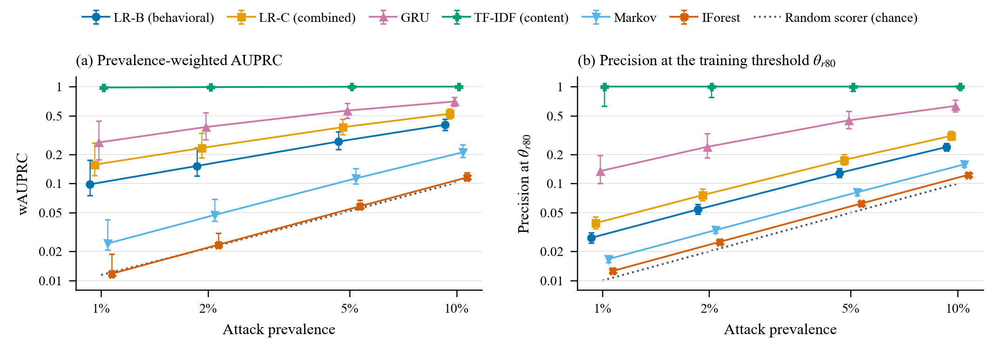
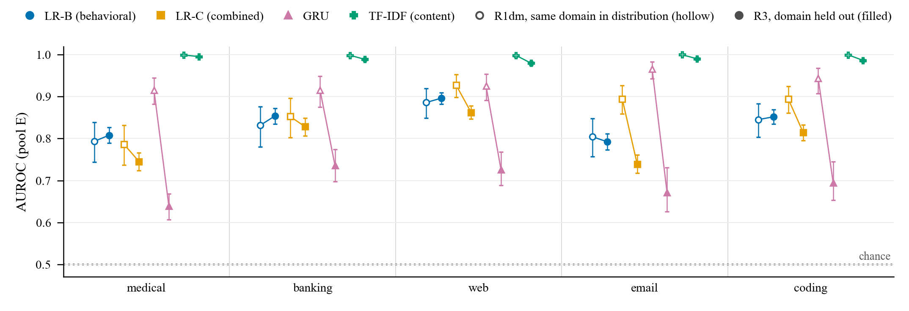
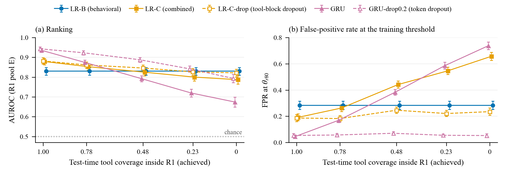
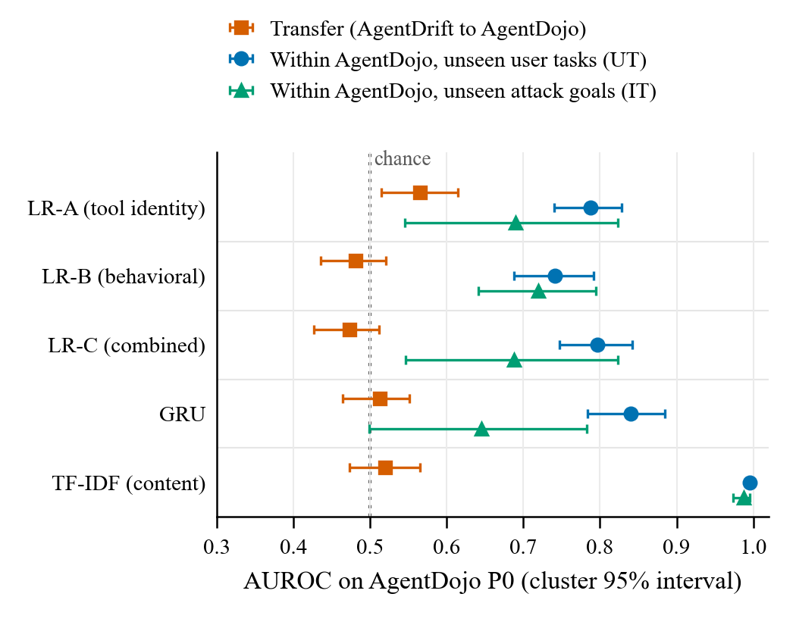

# Evaluating Baseline Detectors of Hijacked LLM Agents Under Rare Attacks and Distribution Shift

**Mahmoud Abbasi and Juan M. Núñez V.**

*M. Abbasi (corresponding author, e-mail: mahmoudabbasi@usal.es) and J. M. Núñez V. are with the BISITE Research Group, University of Salamanca, 37007 Salamanca, Spain.*

**Abstract**

Detectors can flag hijacked large language model (LLM) agents from their tool-call traces. In eleven audited detector evaluations, attacks make up 16% to 86% of the test samples, none varies attack prevalence, and training and test data mostly share a generator. We ask what such evaluations predict about deployment. On AgentDrift and AgentDojo we evaluate logistic regression on tool-identity, behavioral and combined features, a gated recurrent unit (GRU) sequence model, a content reference based on term frequency-inverse document frequency (TF-IDF) and a released LLM action monitor (AlignmentCheck) with two backbones, under a graded series of shifts with thresholds fixed on training data. Three results follow. At 2% prevalence the strongest in-distribution model reaches an area under the receiver operating characteristic curve (AUROC) of 0.879 but a precision of 0.076 at its training threshold, and that precision moves from 0.039 to 0.117 with the mix of negatives alone. As the share of test tools absent from training rises, detector rankings cross near half coverage and reverse below it, because unseen tools reach untrained inputs, and training-time dropout largely removes the reversal. Training thresholds also over-alert, but a reimplemented frozen-encoder detector does so without untrained inputs. No detector trained on one benchmark transfers to the other (AUROC 0.47 to 0.57), including the content reference, which reaches 0.996 within AgentDojo mostly by matching fixed attack strings, whereas the released monitor, trained on neither, reaches 0.930 with an open backbone and 0.934 with a commercial one. With the open backbone its native decision would still mostly raise false alerts at 2% prevalence (precision 0.096 on AgentDojo). We do not propose a detector. We report what these evaluation choices hide.

**Index Terms**

Anomaly detection, class imbalance, distribution shift, evaluation methodology, intrusion detection, large language model agents, precision-recall analysis, prompt injection.

## I. INTRODUCTION

Agents built on large language models (LLMs) carry out user tasks by calling tools such as mail clients, payment services, file systems and web browsers, and the output of each call returns to the model as context. Instructions planted in that output can redirect the agent toward an attacker's goal, a threat known as indirect prompt injection [@greshake2023]. Benchmarks such as InjecAgent [@zhan2024injecagent] and AgentDojo [@agentdojo] show that such injections still succeed against current models at rates that cannot be ignored. A hijacked agent has to act through its tools, so its sequence of tool calls is a natural place to look for evidence of compromise. Recent work proposes rule-based, automaton-based, graph, sequence and verifier detectors that score such traces [@traceaegis; @praetor; @agentsentry; @driftnet; @trajguard; @mcpshield; @skynet; @trajad; @sentinelagent; @llamafirewall].

How these detectors are evaluated matters as much as how they are built. In the eleven evaluations we audited (Section II), test sets contain 16% to 86% attacks, only four works report a threshold-free metric, none varies attack prevalence, and training and test data usually come from the same generator. In operation, successful hijacks may be a small and unknown share of the sessions that a security team audits, and the tools, tasks and domains an agent meets change over time and between organizations.

When attacks are rare, even a small false-positive rate yields alerts that are mostly false [@axelsson2000]. The receiver operating characteristic (ROC) does not depend on prevalence while precision does [@davis2006; @saito2015], although the choice between ROC and precision-recall summaries is itself debated [@mcdermott2024]. Learned security detectors also degrade under distribution shift and profit from biased splits [@sommer2010; @pendlebury2019; @arp2022]. Tool-call detectors face a further shift that is easy to measure, because one can count the share of test tool calls whose tool appeared in training.

MCPShield [@mcpshield] shows that random splits can inflate the area under the ROC curve (AUROC) by up to 25.8 points relative to task-disjoint splits and traces the gap to metadata features, a one-hot tool name with an argument hash and the response length, that learn task-specific tool signatures. Agent-Sentry [@agentsentry] transfers its pipeline to native AgentDojo and AgentDyn [@li2026agentdyn] traces and then fits and tests on those traces by grouped cross-validation, which amounts to a within-target control. TrajAD [@trajad] compares leave-one-domain-out training with a fully supervised upper bound, and Fomin [@fomin2026] makes the leave-one-dataset-out case for classifiers of malicious prompts. No audited evaluation measures detection at controlled attack prevalence or reports tool-vocabulary coverage for every split. None contains a domain shift in which no test tool occurs in training, or a transfer from a synthetic generator to recorded agent runs. Each of these elements has antecedents. Our contribution is to run them jointly on one set of detectors, with thresholds fixed on training data, so that the effect of each shift can be read against the others.

We evaluate logistic regression on tool identity (LR-A), on behavioral features (LR-B) and on both (LR-C), a gated recurrent unit (GRU) sequence model and a content reference based on term frequency-inverse document frequency (TF-IDF). As a released reference we add AlignmentCheck, the action monitor of LlamaFirewall [@llamafirewall], with an open and a commercial LLM backbone. Five research questions guide the study. RQ1 asks how the prevalence-weighted area under the precision-recall curve (AUPRC) and precision at a training-derived threshold compare with AUROC as attack prevalence falls from 10% to 1%, and how much they depend on the mix of negatives. RQ2 concerns whether reuse of generation worlds or tasks inflates the standard estimate. RQ3 examines how ranking and operating points change when a domain and all its tools are held out, and why. RQ4 tests whether a detector trained on one benchmark keeps its signal on another once a within-target control separates a failure to transfer from features that cannot detect the target attacks. RQ5 asks which of these conclusions hold for a detector that reads content.

The paper makes four contributions. First, it defines an evaluation protocol (Fig. 1). The protocol reports prevalence-weighted AUPRC, which is the calibrated average precision of Siblini et al. [@siblini2020], and treats the negative-class mix as a second mixing parameter. It also reports tool-vocabulary coverage for every setting, applies a graded series of world, task, domain and benchmark shifts, and adds a within-target control with checks on the composition of the target benchmark. Second, it follows detector behavior across the whole range of tool-vocabulary overlap rather than at full and zero coverage alone. The in-distribution ranking of our detectors holds while most test tools are known, becomes indistinguishable once about half of them are new and reverses below that, because unseen tools reach untrained inputs. Dropout during training largely removes the reversal. The training thresholds of the affected detectors degrade steadily over the same range, and a reimplemented frozen-encoder detector shows that this failure also arises without untrained inputs. Threshold failure turns out to be detector-specific, and the behavioral signal that survives zero coverage is mostly an observation-length cue written by the attacker. Third, it shows that both benchmarks are nearly separable by surface content, AgentDrift through its generator templates and AgentDojo through fixed attack strings. No trained detector transfers from AgentDrift to AgentDojo, not even a content detector that is near perfect in distribution, and the within-target control succeeds for some representations only. A released action monitor that is trained on neither benchmark does transfer. Fourth, it turns these findings into recommendations. We do not propose a detector. Our claims concern our own baselines, one content reference and one reimplementation, not the published detectors of Section II.

*Fig. 1. Detection setting and evaluation design. (a) The attacker controls the content of a tool observation, and the detector scores the recorded trace of each finished session against a threshold fixed on training data. (b) The five settings, from the standard split R1 to cross-benchmark transfer R4, with the tool-vocabulary coverage κ of each test set (bar, as in Table II) and the table or figure that reports it. Dashed boxes are the two controls, graded coverage inside R1 and the within-AgentDojo control. Thresholds are never re-tuned on test data.*

## II. RELATED WORK

### A. Detectors Over Agent Tool-Call Traces

We identified the audited works through targeted searches of arXiv and Google Scholar up to September 2026, looking for detectors of compromised LLM agents that operate on tool-call traces. A work was included when it proposed or evaluated a trajectory-level or step-level detector of compromised or anomalous agent behavior on agent traces. Eleven works met this criterion. The audit is not a systematic review, since we followed no registered search protocol, and relevant detectors may have been missed. We left out MELON [@zhu2025melon] because it re-executes the live agent rather than scoring recorded traces. TraceSafe [@chen2026tracesafe] and ATBench [@li2026atbench] were excluded as guardrail benchmarks, and AgentDoG [@liu2026agentdog] as a safety guard model evaluated on such benchmarks. StepGuard [@zheng2026stepguard], a step-level guard model posted inside our search window, was identified only during revision, so we discuss it but did not add it to the audit. TrajAD and Trajectory Guard [@trajguard] target procedural errors and plan anomalies rather than injections. Their protocols still bear directly on our questions, since TrajAD holds out a domain and Trajectory Guard uses external test sets without benign traces.

The audited detectors range from rule, automaton and LLM-overseer monitors, such as TraceAegis [@traceaegis], Praetor [@praetor], Agent-Sentry and SentinelAgent [@sentinelagent], to learned sequence, graph and verifier models, such as DriftNet [@driftnet], Trajectory Guard, Skynet [@skynet], MCPShield and TrajAD. LlamaFirewall [@llamafirewall] pairs the PromptGuard 2 input classifier with AlignmentCheck, a few-shot LLM auditor that reasons over the whole execution trace without fine-tuning. AgentDrift [@agentdrift] is a benchmark rather than a detector, and its surface-feature logistic regression only checks that the benchmark cannot be solved from surface cues.

Table S18 of the supplement records the protocol of each audited work, with every cell checked against the arXiv full text of the version named in its note. In the test sets that mix both classes, attacks or anomalies make up between 16.5% (Skynet on Agent-SafetyBench [@zhang2024agentsafetybench]) and 86.3% (MCPShield on RAS-Eval [@fu2025raseval]) of the samples, by our arithmetic from the reported class counts. Four works report a threshold-free measure. The others report metrics at one operating point or no quantitative metric, and none varies the class ratio. Eight works test drift in a limited form, such as a task-disjoint split, unseen anomaly types or a prompt-style shift, and three not at all. Only MCPShield reports repeated seeds, and Praetor reports Clopper-Pearson intervals for single runs.

### B. Agent-Security Benchmarks and Prompt-Injection Defenses

InjecAgent and AgentDojo measure how often injected tool outputs redirect an agent, and ASB [@zhang2025asb], AgentDyn and RAS-Eval extend the measurement to more scenarios and to dynamic or real tool execution. These benchmarks report attack success and utility for live agents. They do not provide labeled corpora for training trace detectors, which AgentDrift does. Agent-SafetyBench, ATBench and TraceSafe instead ask whether a judge recognizes unsafe behavior in a recorded trajectory. Many defenses, MELON among them, act on the live agent or its inputs. By contrast, the audited detectors and ours score recorded traces, which is closer to intrusion detection over logs. For prompt classifiers, Fomin finds that pooled cross-validation reports AUC 8.0 to 16.5 points higher than leave-one-dataset-out evaluation.

### C. In-Distribution Versus Out-of-Distribution Performance and Prior Shift

Out-of-distribution accuracy is often almost linearly correlated with in-distribution accuracy [@miller2021]. Teney et al. [@teney2023] show, however, that the correlation can be inverted on real-world data, so that selecting by in-distribution accuracy selects against robustness. Shortcut learning likewise yields decision rules that fail under harder test conditions [@geirhos2020]. Our configurations are fixed without hyperparameter search and our thresholds are set on training data, so no test-domain information enters model selection. We measure the size of each shift with a classifier two-sample test [@lopezpaz2017]. Because precision depends on the class prior, AUPRC values from test sets with different class ratios cannot be compared directly. Siblini et al. [@siblini2020] calibrate precision and average precision to a reference prior in closed form, and Boyd et al. [@boyd2013] compare estimators and confidence intervals for the area under the precision-recall curve. McDermott et al. question the general preference for AUPRC under imbalance, so we report AUROC next to it.

### D. Distribution Shift in Security Machine Learning

Sommer and Paxson [@sommer2010] place anomaly-based intrusion detection outside the closed-world assumption of most machine learning. Arp et al. [@arp2022] catalogue pitfalls such as sampling bias, spurious correlations and inappropriate baselines. TESSERACT [@pendlebury2019] shows how biased splits inflate results in malware classification, and conformal evaluation rejects decisions on drifting samples [@barbero2022]. These works treat drift mainly as a function of time. Tool-call detectors also face a shift that is easier to quantify, because tools absent from training can appear at test time, and the coverage κ of Section III-D records how often they do.

### E. Positioning of This Study

We neither propose a detector nor re-evaluate the audited detectors as released. DriftNet's code and weights have not been released, so we reimplemented its architecture from the paper as one further detector (Section VI-D). None of our numbers is DriftNet's own. Agent-Sentry's within-target control uses two benchmarks that share agents, tools and environments. TrajAD's held-out domain, on which F1 is 83.09% against 83.84% for the supervised upper bound, comes from the same generation pipeline as its training data. The task-disjoint splits of Agent-Sentry, DriftNet and MCPShield hold out tasks rather than tools. Our feature ablation extends MCPShield's finding on tool-name metadata, and its probe of the generating model, to a combined model for which no test tool was seen in training. Praetor remains the only audited work that evaluates adaptive attackers.

## III. BENCHMARKS AND PROBLEM FORMULATION

### A. AgentDrift

AgentDrift [@agentdrift] contains 12,536 synthetic trajectories from five domains (email, banking, web, coding and medical), generated according to its README and datasheet by Llama-3.3-70B-Instruct (quantized) at temperature 0.8 with prompts and scripts that are not released (Table I). It ships a stratified split with 8,775 training, 1,880 validation and 1,881 test trajectories and a task-disjoint split with 9,081 training and 1,722 test trajectories. Every trajectory carries a world record (user, e-mail address, company, contacts and date). The 10,656 training and test trajectories contain 1,133 worlds. Labeling each trajectory with its world's majority label is correct for 0.883 [0.860, 0.909] of them, against 0.558 for the majority class. The release documents several template regularities. By our count, an ext-audit.com address appears in 0.281 of the 7,036 poisoned observations, and 0.985 of hard negatives carry at least one of the three markers the README names. Banking has 256 full hijacks against 720 in each other domain, because the validator cut off its generation job. The banking fold therefore differs from the others in hijack mix (34.7% full hijacks against 58.5% to 60.6%) and prevalence (0.401 against 0.522), which confounds comparisons across folds that involve banking.

### B. AgentDojo

We use the recorded runs without defenses of `gpt-4o-2024-05-13`, `claude-3-5-sonnet-20241022`, `gemini-1.5-pro-002`, `gpt-4-turbo-2024-04-09` and `gemini-2.0-flash-001` from the AgentDojo repository [@agentdojo] over the workspace, travel, banking and Slack suites. A run without an attack is benign, and a run with an attack is compromised when the benchmark's security check reports that the attacker's goal was reached and unsuccessful otherwise. Runs with fewer than two tool calls are removed (Table I), and the removal is asymmetric across classes and models. It takes, for example, 77 of 132 `gemini-2.0-flash-001` benign runs. Because trace length alone separates compromised from benign traces with an AUROC of 0.675, the filter shapes the negatives. Population P0 has a native prevalence (the attack share of the unresampled pool) of 0.854, 117 user-task identifiers and 30 injection goals. Of its traces, 69.8% contain no tool seen in AgentDrift. The 4,987 retained unsuccessful attacks are scored separately. Three properties act as confounds. First, 65 benign traces ran an injection task as the user task, and removing them gives population C1. Second, `gpt-4o-2024-05-13` contributes 1,866 of the 2,294 compromised traces (81.3%). Third, 101 compromised traces, all from that model, come from denial-of-service (DoS) variants, which AgentDojo labels compromised exactly when the user task was not completed.

An earlier version of this study paired each tool call with its observation through the tool-call identifier. Gemini runs leave that identifier empty and some GPT runs reuse it, so affected steps received another step's observation. The earlier extractor also cut observations at 2,000 characters without saying so. The corrected extractor pairs calls and observations by position, checked by a unit test, and stores observations uncut. The fix changes 413 of the 2,686 P0 traces by observation content and 408 by per-step observation length. Section S2 and Table S1 give the changes by model, the extent of the cut, and the earlier and corrected values. Every AgentDojo number here comes from the corrected extraction.

**TABLE I**
**CHARACTERISTICS OF THE EVALUATED BENCHMARKS**

| Property | AgentDrift [@agentdrift] | AgentDojo [@agentdojo] (population P0) |
|---|---|---|
| Version and license | Release 1.0 (record schema 2.0), commit `014a514f`, CC BY 4.0 | Commit `089ed468`, MIT |
| Domains or suites | 5 (email, banking, web, coding, medical) | 4 (workspace, travel, banking, Slack) |
| Distinct tools | 103, disjoint across domains | 67, of which 7 occur in AgentDrift (κ = 0.075) |
| Negative class | 4,000 benign and 1,500 hard negatives, plus 1,500 failed attacks used as training negatives and scored separately at test | 392 benign |
| Positive class | 5,536 attacked (3,136 full, 1,500 partial, 900 delayed hijacks) | 2,294 compromised (security check succeeded), 101 of them DoS |
| Excluded runs | None | Runs with fewer than two tool calls (236 benign, 70 compromised and 2,260 unsuccessful-attack runs) |
| Trajectory length (tool calls) | 3 to 11 (mean 5.67) | 2 to 29 (mean 5.24) |

### C. Threat and Deployment Model

We consider an indirect injector who controls the content of tool outputs that the agent reads, has no access to the agent's model or to the detector, and does not adapt to the detector. The goal is to make the agent act on the attacker's behalf, for example by sending data or money, or, in the DoS variants, to stop it from completing its task. The defender scores the recorded trace of each finished session once, and an alert sends the session to an analyst. Our setting is therefore a post hoc audit. Recall counts hijacked sessions identified afterwards rather than prevented actions, and alerts are counted per 1,000 audited sessions. The prevalence grid of 1% to 10% (Section IV-B) stands for the share of audited sessions that contain a successful hijack, and its lower end is set by our pool sizes.

The content-blind detectors read at most tool names, argument counts and observation lengths. The content reference also reads argument values and observation text, including the injected text. The attacker directly writes the maximum and mean observation length (Section V-A), since the injected observation is one of the observations. The other behavioral features depend on the actions the hijack induces, which the attacker influences through the injected goal but does not set. Argument counts and tool identities are limited by the tools available to the agent.

### D. Trace-Level Detection Task

A trajectory is a sequence of tool-call steps

$$\tau = (s_1,\ldots,s_m), \qquad s_t = (a_t, u_t, o_t), \tag{1}$$

where $a_t$ is the tool name, $u_t$ the arguments and $o_t$ the observation returned by the tool. The label $y(\tau)\in\{0,1\}$ is 1 for an attacked AgentDrift trajectory or a compromised AgentDojo trace. A detector assigns each trajectory of the form (1) a score $f(\tau)\in\mathbb{R}$ and flags it when the score reaches a threshold $\theta$,

$$\hat{y}_\theta(\tau) = \mathbf{1}\left[f(\tau)\ge\theta\right]. \tag{2}$$

In training, the failed attacks and hard negatives of AgentDrift count as negatives. For AgentDrift, evaluation uses pool E, which holds benign, hard-negative and attacked test trajectories, and failed attacks are scored separately. For AgentDojo it uses P0. Every AUROC and AUPRC in the paper refers to these pools unless another population is named. With $\mathcal{V}$ the tool vocabulary of the benign training trajectories, the tool-vocabulary coverage of a test set $\mathcal{D}$ is the share of its tool calls whose tool appears in $\mathcal{V}$,

$$\kappa(\mathcal{D};\mathcal{V}) = \frac{\sum_{\tau\in\mathcal{D}}\sum_{t=1}^{m(\tau)}\mathbf{1}\left[a_t\in\mathcal{V}\right]}{\sum_{\tau\in\mathcal{D}}m(\tau)}. \tag{3}$$

### E. Distribution-Shift Settings

Table II defines the settings and gives κ from (3), and Fig. 1(b) shows how they relate. R1 is the standard stratified split. R1-wd re-splits the pooled training and test trajectories over five split seeds so that no world is shared. R2 is the task-disjoint split, and R3 holds out one domain, which forces $\kappa=0$. R4 trains on AgentDrift and tests on AgentDojo, changing the ecosystem, the trace generator, attack construction and label semantics at once. The within-AgentDojo control trains and tests on P0 by five-fold cross-validation, repeated with fold-assignment seeds 0 to 4. Folds are grouped by suite and user task (UT) or, for compromised traces, by suite and injection goal (IT). UT-F adds the unsuccessful attacks as training negatives. P0F adds them to P0 as evaluation negatives, and AgentDojo leave-one-suite-out (LOSO) is a recorded-trace analogue of R3. Consecutive settings differ in more than one factor, so we compare them descriptively.

**TABLE II**
**EVALUATION SETTINGS WITH TOOL-VOCABULARY COVERAGE AND MEASURED SHIFT**

| Setting | Training data | Test pool ($n_-/n_+$) | Tool coverage κ | Shift statistic (C2ST AUROC) | Shift introduced |
|---|---|---|---|---|---|
| R1 | Stratified training split (8,775) | Stratified test split, 825/831 | 1.000 | 0.501 [0.485, 0.515] | None (reference) |
| R1-wd | Pooled corpus with no shared world, split seeds 0 to 4 (8,711 to 8,764) | 786 to 811 / 863 to 924 | 1.000 | 0.553 to 0.564 | World identity |
| R2 | Task-disjoint training split (9,081) | 35 unseen tasks, 729/775 | 1.000 | 0.551 [0.537, 0.565] | Task |
| R3 | Four domains (8,446, or 8,840 with banking held out) | Held-out domain, 935/1,020 (banking 935/626) | 0.000 | 0.622 (email) to 0.866 (web) | Domain and all its tools |
| R4 | All pooled AgentDrift (10,656) | AgentDojo P0, 392/2,294 (P0F adds 4,987 negatives) | 0.075 | 0.992 [0.991, 0.993] | Benchmark, ecosystem, generator, labels |
| Within, UT | Four fifths of P0, 5 repetitions | Held-out folds of P0 | 0.976 | 0.721 (0.616 to 0.844) | Unseen user tasks |
| Within, IT | As UT, grouped by injection goal | Held-out folds of P0 | 0.980 | 0.722 (0.631 to 0.799) | Unseen attack goals |
| Within, UT-F | As UT, unsuccessful attacks as training negatives | Held-out folds of P0 | 0.976 | 0.681 (0.589 to 0.785) | Training population |
| LOSO | Three suites of P0 (1,677 to 2,401) | Held-out suite, 56 to 128 / 182 to 904 | 0.000 (banking, Slack), 0.084 (travel), 0.362 (workspace) | 0.887 to 0.971 | Suite and most of its tools |

*The shift statistic is the cross-validated AUROC of a logistic regression on representation B that separates training from test rows (0.5 means indistinguishable). It ignores the tool-vocabulary shift. Ranges are over seeds, folds or suites, and within-AgentDojo rows give the mean and range over 25 cross-validation pairs. Table S2 gives every value.*

## IV. EVALUATION FRAMEWORK

### A. Pre-Specified Analysis Plans and What Was Known

All analyses follow four pre-specified internal analysis plans, none of them externally registered, and Table S3 records what was known when each plan was written and every deviation from it. File modification times date each plan but cannot show that it was not edited later, and only part of each plan was prospective. The R4 plan was last written after the transfer and within-AgentDojo results were known, so its one-sided near-chance clause (Section IV-F) is post hoc. The ablation plan was prospective only for LR-A and for the R1 and R3 results of LR-B, and the GRU plan preceded every GRU result but followed all linear results. A revision plan was written after an independent pre-submission review had reported exploratory versions of most analyses, so the revision analyses are confirmatory re-runs of analyses whose approximate outcome was known, not prospective tests. The released monitor of Section V-F is the exception. Its plan was registered by hash before any monitor call, and its outcomes were prospective.

### B. Controlled Prevalence and Prevalence-Weighted AUPRC

Prevalence shift leaves the class-conditional score distributions unchanged, so precision at prevalence $\pi$ follows from the true- and false-positive rates at a threshold,

$$\mathrm{Prec}(\theta;\pi) = \frac{\pi\,\mathrm{TPR}(\theta)}{\pi\,\mathrm{TPR}(\theta) + (1-\pi)\,\mathrm{FPR}(\theta)}. \tag{4}$$

Our primary AUPRC estimand is the prevalence-weighted average precision over the thresholds $\theta_k$ of the full test pool,

$$\mathrm{wAUPRC}@\pi = \sum_k \big(\mathrm{TPR}(\theta_k) - \mathrm{TPR}(\theta_{k-1})\big)\,\mathrm{Prec}(\theta_k;\pi). \tag{5}$$

It equals average precision with each positive weighted by $\pi/(1-\pi)\cdot n_-/n_+$, where $n_-$ and $n_+$ are the numbers of negatives and positives. It is also the calibrated average precision of Siblini et al. [@siblini2020]. We report $\pi$ of 1%, 2%, 5% and 10%. Because (5) uses every positive at every prevalence, its intervals come from a bootstrap of the full pool. An earlier version of this study drew only as many positives per replicate as the target prevalence allows (8 to 92 in R1). That estimator targets the expected average precision of so small a test set and is biased upward at low prevalence, so we keep it only to show how variable a small test set is.

### C. Threshold Selection

Operating points apply thresholds fixed without test data through (2). The main one,

$$\theta_{r80} = Q_{0.20}\big(\{f(\tau) \mid \tau\in\mathcal{D}_{\mathrm{train}},\ y(\tau)=1\}\big), \tag{6}$$

is the 20th percentile of in-sample training-positive scores, so it flags 80% of training positives. For the GRU we also report $\theta_{\mathrm{val}80}$, the same quantile on validation positives, and for every detector $\theta=0.5$. In the within-AgentDojo cross-validation, thresholds are recomputed on each training fold.

### D. Uncertainty, Clustering and Multiplicity

Intervals are 95% percentile intervals from 2,000 bootstrap replicates of the final test predictions [@efron1993bootstrap], stratified by class for AgentDrift trajectories. Following the cluster bootstrap [@field2007bootstrap], AgentDojo intervals resample the 117 suite and user-task clusters (attack-goal clusters for the positives in IT), and R2 intervals resample its 35 test tasks. Where a detector has several fits, such as cross-validation repetitions or GRU training seeds, each replicate draws one fit. The GRU interval therefore describes a randomly drawn single-seed deployment, while its point estimate is the mean over seeds. No interval includes the variability of retraining on new data. Paired differences resample the same rows for both detectors, and differences between settings use independent bootstraps.

We call a difference distinguishable from zero when its 95% interval excludes zero, and an AUROC distinguishable from chance when its interval excludes 0.5. We also apply the Holm correction [@holm1979] within pre-defined families. These are the five R3 folds, the comparisons at one prevalence, and the representations of one R4 configuration. A result whose decision depends on the resampling unit, on the correction or on Monte Carlo error is called borderline. Each table draws its numbers from one analysis run, so intervals for the same quantity can differ in the third decimal between tables.

### E. Domain-Matched Comparator, Threshold Failure and Reversal

An R3 AUROC ranks trajectories within one domain, whereas the pooled R1 AUROC also ranks across domains. We therefore compare each R3 fold with R1dm, which is the R1 model scored on the R1 test pool restricted to the held-out domain. Threshold failure is a change in recall or FPR at $\theta_{r80}$ of (6), relative to R1dm, that is distinguishable from zero. A reversal in a fold has two requirements after Holm correction within the five folds. One detector must hold an in-distribution advantage over another that is distinguishable from zero in R1dm, and the R3 paired difference must be distinguishable from zero with the opposite sign. AUROC is the primary metric and wAUPRC@10% the secondary one.

### F. Cross-Benchmark Decision Rule

The plan for R4 calls within-AgentDojo detection reasonable when AUROC is at least 0.80 with a lower 95% bound of at least 0.70, and wAUPRC@10% is at least 0.30 with a lower bound above 0.10. Transfer is near chance when its AUROC interval includes 0.5 or its AUROC is below 0.60. The second clause is one-sided and post hoc (Section IV-A), and under it an interval lying entirely below 0.5 also counts as near chance. We rename the plan's three cases to avoid a clash with representations A, B and C. Transfer failure (Case A) requires reasonable within-AgentDojo detection under UT on P0 and C1, near-chance transfer and a within-minus-transfer difference distinguishable from zero. Weak representation (Case B) applies when within detection under UT is not reasonable for P0 or C1 and transfer is also poor, and population-dependent (Case C) when within detection is reasonable only in the controlled populations. Mixed or other outcomes are reported as observed, including UT reasonable but IT not reasonable. We apply the rule literally, per representation, over the P0, C1, model-balanced and within-model populations. The operational target is compromise, and treating every injection attempt as positive is only an exploratory target.

## V. DETECTORS AND REPRESENTATIONS

### A. Representations

Representation A counts how often each tool of $\mathcal{V}$ is called, so a trajectory with $\kappa=0$ maps to the zero vector. Representation B has ten features that do not name tools. They are the trajectory length $m$, the number of distinct tools, tool diversity (distinct tools divided by $m$), the number of immediate repeats, the count and fraction of calls whose tool name contains one of fourteen write-like keywords (such as send, delete, transfer or share), the maximum and mean number of arguments per call, and the maximum and mean observation length in characters. One non-blind annotator marked which AgentDrift tools change state. Against that annotation the keyword flag has a precision of 0.957 and a recall of 0.440, and annotation-based features change LR-B's AUROC by at most 0.024 (Table S4). Representation C concatenates A and B.

### B. Logistic Regression and Unsupervised References

Logistic regression on representations A, B and C gives LR-A, LR-B and LR-C. It uses L2 regularization with inverse strength 1, the lbfgs solver, class weights inversely proportional to class frequency and features standardized with training statistics. Two unsupervised references are fitted on benign training trajectories. The first is a first-order Markov model of tool transitions with add-0.5 smoothing, which scores the mean negative log-probability of transitions and is constant when every tool is unseen. The second is an Isolation Forest [@liu2008iforest] with 200 trees on representation C.

### C. Content-Aware Reference

The TF-IDF detector is a class-weighted logistic regression on TF-IDF features [@salton1988tfidf] of the concatenated text of every step, which includes the tool name, argument keys and values and the observation text. It uses lowercase word unigrams and bigrams with a minimum document frequency of 2, at most 50,000 features and sublinear term frequency. Sensitivity variants remove all digits, mask the strings of the trajectory's world record, or keep only the words of tool names.

### D. Ablation and Dropout Variants

LR-B-noobs and LR-C-noobs drop the two observation-length features. They were chosen after exploratory results were known and are post hoc. LR-B-minus drops the two keyword features. LR-C-drop is trained on the training set together with a copy whose tool block is zeroed, which is equivalent to dropping the tool block with probability 0.5.

### E. GRU Sequence Detector

The GRU [@cho2014gru] is a learned analogue of LR-C with more capacity, used as a robustness check. Each tool call becomes a token (0 for padding, 1 for the unknown token `<UNK>` and one index per tool of the benign training trajectories). Tokens are embedded in 32 dimensions and passed to a one-layer GRU with 64 hidden units. Its final hidden state is concatenated with the ten standardized behavioral features and fed to a linear output layer, giving about 22k parameters. Sequences keep at most their last 16 calls. Training minimizes class-weighted binary cross-entropy with Adam [@kingma2015adam] (learning rate $10^{-3}$, coupled weight decay $10^{-4}$), with batch size 64, gradient clipping at norm 1.0 and at most 30 epochs. Early stopping uses the AUPRC of a stratified 10% validation hold-out (patience 5). We use training seeds 0, 1 and 2 and no pretrained language model. In AgentDrift `<UNK>` never occurs in training, so its embedding receives no gradient from the loss and stays an untrained random vector. Within AgentDojo it occurs in up to 334 steps of 327 compromised training traces per fold. Removing those traces changes the within-AgentDojo AUROC by less than 0.01. GRU-drop0.2, with the pre-specified $p=0.2$, and GRU-drop0.1 replace each training token by `<UNK>` independently with probability $p$.

### F. Released Action Monitor

AlignmentCheck is the action monitor of LlamaFirewall [@llamafirewall]. It shows an LLM the user's request and the agent's actions so far and asks whether the latest action pursues a goal that the user did not set. We use its released prompt and output schema verbatim and scan each step against the trace before it, as the released scanner does, so a trace of $m$ steps costs $m$ calls. Each step is rendered as the released demonstration renders an action, with the tool name, the arguments and an empty thought. No tool observation is shown, so the monitor never reads the injected text. The AgentDojo user request is taken from the recorded run files. An output that cannot be parsed takes the released default, which flags the step, and the native decision flags a trace when any step is flagged.

We run the prompt with two backbones. MON-L is Llama 3.3 70B Instruct [@llama3] in a 4-bit quantization [@gptq], served with vLLM [@vllm] at temperature 0 with output constrained to the schema. Its graded step score is the probability of `true` at the conclusion token, and its trace score is the maximum over steps. MON-A is Claude Sonnet 5.5 (`claude-sonnet-5-5`), queried through a batch interface at its lowest thinking setting and with default sampling, because the interface rejects a temperature for this model. Its coarse trace score is the number of flagged steps. The monitor is not trained, so a setting changes only its test rows and the training positives from which $\theta_{r80}$ is read, and the within-minus-transfer contrast of Section IV-F does not apply to it. MON-L runs in every setting, MON-A on the R1 test set and on all AgentDojo traces. Two sensitivity arms of MON-L add the agent's own text as the thought (MON-L-th) or replace masked tool names by `unknown_tool` (MON-L-mask). None of this is LlamaFirewall as deployed. There is no PromptGuard layer, the scan runs after the fact instead of blocking actions, and neither backbone is Meta's default. AgentDrift was generated by a Llama 3.3 70B model, so MON-L may be familiar with its traces, and the AgentDojo results carry the claims. The plan was registered by hash before any monitor call, and Section S14 lists its five hashed amendments, each made before any monitor result was analysed.

## VI. EXPERIMENTAL RESULTS

### A. Attack Prevalence and the Negative Mix (RQ1)

Detection quality that looks good by AUROC degrades quickly as attacks become rarer (Table III and Fig. 2). LR-C has an AUROC of 0.879, yet at 2% prevalence its wAUPRC is 0.232 and its precision at $\theta_{r80}$ is 0.076, with 12.2 false alerts for every true one. The GRU ranks better but reaches a wAUPRC of only 0.382 at 2%, and its test recall at $\theta_{r80}$ falls short of the 0.80 target. At $\theta_{\mathrm{val}80}$ its recall is 0.775 [0.745, 0.804] at a precision of 0.179 [0.147, 0.225] (Table S5). At a fixed test recall of 0.8, its FPR is 0.082 against 0.210 for LR-C, although this comparison is descriptive because it uses test labels.

Using all positives settles comparisons that subsampling left open. The subsampled LR-C value at 2% is 0.259 [0.105, 0.466], an interval 2.46 times wider than the weighted one. After Holm correction within each prevalence, 3, 5, 5 and 5 of five paired comparisons are distinguishable from zero at 1%, 2%, 5% and 10%, against 1, 1, 4 and 5 with subsampling. LR-C exceeds the Markov model at every prevalence (+0.132 [+0.093, +0.235] at 1%). Two comparisons at 2% are borderline. These are LR-C − LR-B (+0.081 [+0.003, +0.168], Holm p = 0.044, not distinguishable under world-cluster resampling) and GRU − LR-C (+0.150 [+0.023, +0.296], Holm p = 0.040), and neither is distinguishable at 1%.

The negative mix matters as much as prevalence (Table S6). At $\theta_{r80}$, LR-C flags 0.118 of benign trajectories, 0.387 of hard negatives and 0.218 of failed attacks. Its precision at 2% is therefore 0.117 [0.097, 0.145] against benign negatives only, 0.076 with the pool-E mix of 27% hard negatives, and 0.039 [0.034, 0.047] against hard negatives only. LR-A, LR-B, LR-C, the Markov model and the GRU all flag hard negatives more often than benign trajectories. LR-C recalls 0.830 of full, 0.727 of partial and 0.642 of delayed hijacks. Its AUROC advantage over LR-B is distinguishable on full hijacks (+0.092 [+0.075, +0.109]) but not on partial or delayed ones.

**TABLE III**
**DETECTION QUALITY IN R1 AT CONTROLLED ATTACK PREVALENCE, WITH PREVALENCE-WEIGHTED AUPRC AND PRECISION AT THE TRAINING THRESHOLD $\theta_{r80}$**

<!-- BEGIN v04_prevalence -->
| Detector | AUROC | wAUPRC 1% | wAUPRC 2% | wAUPRC 5% | wAUPRC 10% | Precision at θr80, 2% | Precision at θr80, 10% | Recall at θr80 | FPR at θr80 | Alerts per 1,000 at 2% |
| --- | --- | --- | --- | --- | --- | --- | --- | --- | --- | --- |
| LR-A (tool identity) | 0.777 [0.755, 0.799] | 0.089 [0.069, 0.164] | 0.140 [0.112, 0.214] | 0.255 [0.213, 0.327] | 0.382 [0.334, 0.445] | 0.043 [0.040, 0.048] | 0.198 [0.183, 0.216] | 0.744 | 0.335 | 343 |
| LR-B (behavioral) | 0.830 [0.810, 0.849] | 0.098 [0.076, 0.175] | 0.152 [0.119, 0.231] | 0.271 [0.224, 0.340] | 0.403 [0.354, 0.462] | 0.054 [0.048, 0.061] | 0.238 [0.217, 0.260] | 0.795 | 0.284 | 294 |
| LR-C (combined) | 0.879 [0.862, 0.895] | 0.156 [0.121, 0.261] | 0.232 [0.183, 0.330] | 0.380 [0.321, 0.462] | 0.523 [0.466, 0.590] | 0.076 [0.067, 0.088] | 0.309 [0.281, 0.344] | 0.771 | 0.192 | 203 |
| GRU | 0.936 [0.922, 0.947] | 0.265 [0.177, 0.442] | 0.382 [0.282, 0.537] | 0.564 [0.470, 0.671] | 0.699 [0.628, 0.770] | 0.238 [0.184, 0.328] | 0.629 [0.551, 0.727] | 0.682 | 0.045 | 58 |
| TF-IDF (content) | 0.999 [0.999, 1.000] | 0.975 [0.960, 0.991] | 0.984 [0.973, 0.994] | 0.992 [0.986, 0.997] | 0.996 [0.992, 0.998] | 1.000 (≥ 0.771) | 1.000 (≥ 0.948) | 0.763 | 0.000 (CP upper 0.004) | 15 |
| Markov | 0.724 [0.700, 0.748] | 0.024 [0.021, 0.042] | 0.047 [0.041, 0.069] | 0.113 [0.099, 0.144] | 0.210 [0.187, 0.250] | 0.033 [0.031, 0.036] | 0.157 [0.147, 0.169] | 0.810 | 0.482 | 489 |
| IForest | 0.588 [0.560, 0.615] | 0.012 [0.011, 0.019] | 0.023 [0.022, 0.031] | 0.058 [0.054, 0.067] | 0.115 [0.107, 0.129] | 0.025 [0.024, 0.027] | 0.123 [0.116, 0.130] | 0.785 | 0.623 | 626 |
| Random scorer | 0.500 | 0.011 [0.009, 0.016] | 0.022 [0.019, 0.027] | 0.052 [0.047, 0.059] | 0.102 [0.093, 0.114] | 0.020 | 0.100 | n/a | n/a | n/a |
<!-- END v04_prevalence -->
*Pool E of R1 has 831 attacked and 825 negative trajectories (600 benign and 225 hard negatives). Precision and alerts per 1,000 trajectories follow (4) from recall and FPR at $\theta_{r80}$ under the pool-E negative mix. Table S6 gives their intervals by negative class. TF-IDF flags no pool-E negative, so its FPR is the exact 95% upper bound and its precision the lower bound implied by it. The random-scorer row gives the mean and the 2.5th to 97.5th percentiles over 2,000 random scorers. The monitor rows are the AlignmentCheck prompt with the Llama 3.3 70B (MON-L) and Claude Sonnet 5.5 (MON-A) backbones (Section V-F), at $\theta_{r80}$ and at the released native decision, on the same bootstrap replicates. ‡ MON-A ranks traces by the number of flagged steps, so its AUROC and wAUPRC are coarse.*

*Fig. 2. Detection quality in R1 as attack prevalence falls. (a) Prevalence-weighted AUPRC. (b) Precision at the training threshold $\theta_{r80}$, with the bar of TF-IDF extending to its implied lower bound. Both axes are logarithmic, bars are 95% bootstrap intervals, and the dotted line is chance (the random-scorer mean in (a) and the prevalence in (b)).*

Below the floor set by our pool size, (4) gives LR-C a precision at $\theta_{r80}$ of 0.0040 at 0.1% prevalence and 0.00040 at 0.01%. A threshold that flags at most 1% of training negatives catches 0.276 [0.244, 0.307] of R1 attacks at a test FPR of 0.017, whereas the GRU and TF-IDF exceed that budget on test data (FPR 0.070 and 0.033).

### B. World and Task Reuse (RQ2)

R1 reuses generation worlds. For 99.3% of its test trajectories the world also occurs in training, and the training-world attack rate predicts the test label with an AUROC of 0.963. Nested, regularized probes, however, do not identify worlds beyond what the domain gives (representation A 0.096 against a domain-only floor of 0.097, Table S7). The world-disjoint control shows little inflation (Table S8). Over five split seeds, no decrease in pool-E AUROC is distinguishable from zero in any of 25 detector and seed pairs, and LR-A gains in every seed (+0.039 to +0.045). LR-B is lower than in R1 in all five seeds (−0.027 to −0.008). Its largest loss is distinguishable only when the resampling accounts for trajectories shared between the test sets, and not after Holm correction over seeds, so we treat it as borderline. The split also raises the email share of pool E from 0.208 to between 0.553 and 0.621.

**TABLE IV**
**AUROC UNDER DOMAIN SHIFT (R3) AGAINST THE DOMAIN-MATCHED R1 VALUE (R1dm), WITH PAIRED DIFFERENCES AND THE PRE-SPECIFIED REVERSAL RULE**

<!-- BEGIN v04_r3 -->
| Held-out domain | LR-B (behavioral) R1dm | LR-B (behavioral) R3 | LR-C (combined) R1dm | LR-C (combined) R3 | GRU R1dm | GRU R3 | TF-IDF (content) R3 | LR-C − LR-B, R1dm | LR-C − LR-B, R3 | GRU − LR-C, R1dm | GRU − LR-C, R3 |
| --- | --- | --- | --- | --- | --- | --- | --- | --- | --- | --- | --- |
| R1 pooled | 0.830 |  | 0.879 |  | 0.936 |  | 0.999 | +0.049* [+0.034, +0.064] |  | +0.057* [+0.042, +0.072] |  |
| medical | 0.793 | 0.808 | 0.786 | 0.745 | 0.916 | 0.639↓ | 0.996 | −0.007 [−0.035, +0.023] | −0.063* [−0.074, −0.053] | +0.130* [+0.089, +0.173] | −0.107*† [−0.130, −0.087] |
| banking | 0.832 | 0.854 | 0.853 | 0.828 | 0.915 | 0.736↓ | 0.989 | +0.021 [−0.014, +0.053] | −0.026* [−0.038, −0.014] | +0.063* [+0.017, +0.111] | −0.092*† [−0.133, −0.061] |
| web | 0.886 | 0.896 | 0.927 | 0.862↓ | 0.925 | 0.726↓ | 0.980 | +0.041* [+0.014, +0.069] | −0.034*† [−0.046, −0.023] | −0.002 [−0.030, +0.023] | −0.137* [−0.168, −0.100] |
| email | 0.804 | 0.792 | 0.894 | 0.739↓ | 0.966 | 0.671↓ | 0.990 | +0.090* [+0.046, +0.136] | −0.053*† [−0.063, −0.043] | +0.071* [+0.042, +0.103] | −0.069*† [−0.106, −0.009] |
| coding | 0.845 | 0.852 | 0.894 | 0.814↓ | 0.944 | 0.695↓ | 0.987 | +0.049* [+0.019, +0.081] | −0.038*† [−0.048, −0.026] | +0.049* [+0.009, +0.086] | −0.119*† [−0.155, −0.078] |
<!-- END v04_r3 -->
*R1dm is the R1 model scored on the R1 test pool of the held-out domain (111 to 180 positives, 165 negatives), and R3 is the model trained without that domain (626 to 1,020 positives, 935 negatives). Single AUROCs are points, with intervals in Fig. 3. \* marks a difference distinguishable from zero after Holm correction over five domains, ↓ an R3 decrease against R1dm distinguishable after Holm correction, and † a reversal by the rule of Section IV-E. The R1dm and R3 pools share 345 trajectories per domain (276 in banking), so the independent intervals of R3 − R1dm are conservative. Comparisons across folds that involve banking are confounded by its hijack mix (Section III-A).*

*Fig. 3. AUROC of LR-B, LR-C, the GRU and TF-IDF on each held-out domain. Hollow markers give the R1 model on the same domain (R1dm) and filled markers the model trained without it (R3). Bars are 95% intervals, and the dotted line is chance.*

On unseen tasks with known tools, no change is distinguishable in either direction. With task-cluster resampling, R2 − R1 AUROC is +0.023 [−0.005, +0.049] for LR-C and −0.020 [−0.054, +0.008] for the GRU, and LR-C's wAUPRC@10% gain of +0.092 [+0.002, +0.174] is borderline. Unlike MCPShield's tool-name metadata, which falls from 0.898 to 0.640 under task-disjoint splits, LR-A scores 0.788 in R2 against 0.777 in R1. The reason is that all tasks of an AgentDrift domain share one tool set, so a task-disjoint split keeps full coverage and cannot remove task-specific tool signatures. R2 also reuses worlds as often as R1, and its 35 test tasks give wide intervals.

### C. Domain Shift, Ranking and Thresholds (RQ3)

Holding out a domain lowers the AUROC of LR-C and the GRU but leaves LR-B unchanged (Table IV and Fig. 3). Against its own domain's R1 score, the AUROC decrease of LR-C is distinguishable after Holm correction in web, email and coding (−0.065 to −0.155) but not in medical or banking. The pooled comparator would have pointed to medical, banking, email and coding instead and would have suggested that web keeps its AUROC, which it does not. On wAUPRC@10% the decrease is distinguishable in all five folds. LR-B changes in no fold, whereas the GRU falls in every fold.

The in-distribution orderings do not survive. After Holm correction, LR-C ranks below LR-B in all five held-out domains, and the GRU ranks below LR-C in all five for each of its training seeds. In R1dm, the in-distribution advantage of LR-C over LR-B is distinguishable only in web, email and coding, and that of the GRU over LR-C in every domain except web. The rule of Section IV-E therefore finds a C-versus-B reversal in three domains and a GRU-versus-C reversal in four. The GRU plan did not anticipate the GRU reversal, so we treat it as exploratory. World-cluster resampling gives the same folds, and a joint bootstrap over trajectories shared by the R1dm and R3 pools changes no decision. Standardizing the hijack-pattern composition lowers banking's R3 AUROC by 0.037 to 0.051, moves no other fold by more than 0.008 and leaves LR-C below LR-B in every fold. The shift statistic does not track these losses, since email has the smallest behavioral shift in Table II but the largest LR-C loss.

**TABLE V**
**OUT-OF-VOCABULARY MECHANISM AND DROPOUT REMEDIES, WITH TOOL-PATHWAY OFFSETS, DROPOUT AUROC AND PAIRED DIFFERENCES IN R1 AND EACH R3 FOLD**

<!-- BEGIN v04_oov -->
| Setting | LR-C offset w_A^T c | LR-C-drop offset | GRU tool-pathway offset | GRU-drop0.2 tool-pathway offset | LR-C-drop AUROC | LR-C-drop − LR-B | LR-C-drop − LR-C | GRU-drop0.2 AUROC | GRU-drop0.2 − LR-C | GRU-drop0.2 − GRU |
| --- | --- | --- | --- | --- | --- | --- | --- | --- | --- | --- |
| R1 | n/a | n/a | +0.476 | +0.243 | 0.882 | +0.051* [+0.036, +0.067] | +0.003* [+0.001, +0.005] | 0.943 | +0.064* [+0.050, +0.079] | +0.007 [−0.002, +0.016] |
| R3 medical | +1.794 | −0.057 | +5.862 | +2.420 | 0.797 | −0.011* [−0.013, −0.009] | +0.051* [+0.042, +0.061] | 0.747 | +0.001 [−0.017, +0.019] | +0.108* [+0.081, +0.139] |
| R3 banking | +1.899 | −0.057 | +5.679 | +2.260 | 0.853 | −0.001 [−0.003, +0.001] | +0.025* [+0.015, +0.035] | 0.848 | +0.019* [+0.004, +0.033] | +0.112* [+0.076, +0.147] |
| R3 web | +1.702 | −0.033 | +7.376 | +2.280 | 0.894 | −0.002*† [−0.004, −0.001] | +0.032* [+0.022, +0.043] | 0.870 | +0.008 [−0.010, +0.021] | +0.144* [+0.102, +0.181] |
| R3 email | +1.790 | −0.021 | +6.826 | +1.774 | 0.777 | −0.015*† [−0.017, −0.013] | +0.038* [+0.029, +0.047] | 0.766 | +0.026 [−0.007, +0.055] | +0.095* [+0.020, +0.150] |
| R3 coding | +1.653 | −0.032 | +6.872 | +2.159 | 0.847 | −0.005*† [−0.007, −0.003] | +0.033* [+0.022, +0.042] | 0.811 | −0.003 [−0.036, +0.019] | +0.116* [+0.054, +0.163] |
<!-- END v04_oov -->
*The GRU offset is the mean tool-pathway contribution on held-out negatives minus that on training negatives, averaged over ten seeds for the GRU and three seeds for GRU-drop0.2. The contrast GRU-drop0.2 − GRU pairs seeds 0 to 2. AUROC values and offsets are points. \* marks a paired difference distinguishable from zero after Holm correction over five folds (without correction in the R1 row, which gives the in-distribution cost of each remedy), and † a reversal by the rule of Section IV-E that persists after the remedy.*

*Fig. 4. Removing tool identity at test time inside R1. (a) AUROC and (b) FPR at $\theta_{r80}$ against the achieved tool coverage. Dashed lines with hollow markers are the dropout variants, and bars are 95% intervals conditional on the drawn masks and seeds.*

Thresholds fail in a detector-specific way (Table S9 and Fig. S1). LR-C over-alerts in every fold. Its FPR at $\theta_{r80}$ rises from between 0.121 and 0.321 in R1dm to between 0.503 and 0.722 in R3, and its recall from between 0.613 and 0.906 to between 0.828 and 0.990. At $\theta=0.5$ its R3 FPR is 0.538 to 0.733. LR-A, the Isolation Forest, GRU-drop0.2 and TF-IDF under-alert in every fold. The scores of LR-A and the Markov model are constant at $\kappa=0$ (AUROC exactly 0.500), and every trajectory exceeds the Markov threshold. The GRU with pooled seeds over-alerts in three folds after Holm correction and in four before it, with an R3 FPR of 0.438 to 0.764 against at most 0.071 in R1dm. Each seed's own threshold fails in every fold, and the seeds disagree (banking recall 0.903, 0.006 and 0.957). LR-B's threshold carries over in four of five domains. It fails only in medical, where recall falls from 0.694 to 0.560 (change −0.135 [−0.208, −0.059]), and its FPR rise in email is not distinguishable from zero (+0.061 [−0.018, +0.138]).

A threshold set on 200 unlabeled held-out trajectories to reproduce the R1 alert rate partly restores LR-C's operating point (Table S10). Under the pre-specified reading, which uses a sample at native prevalence, its fold-mean FPR falls to 0.217 to 0.312 with recall of 0.609 to 0.770. A post hoc reading with traffic at 2% prevalence gives an FPR of 0.179 to 0.221. The remedy fails for the GRU, whose recall under the post hoc reading collapses to 0.123 to 0.273.

### D. Mechanism of the Domain-Shift Failures (RQ3)

Three measurements bear on these results (Table V), and a fourth, with a detector that has no untrained input, tests how far they reach. The first is a pair of offsets. At $\kappa=0$ the tool block of LR-C is an all-zero raw vector, which the training scaler maps to a constant $c$. Writing the logit as $g(\tau)=w_A^\top z_A(\tau)+w_B^\top z_B(\tau)+b$ with standardized blocks $z_A$ and $z_B$, every held-out trajectory receives

$$g(\tau) = w_B^\top z_B(\tau) + \big(w_A^\top c + b\big). \tag{7}$$

The offset $w_A^\top c$ in (7) is +1.653 to +1.899 logits, a tool contribution that only 10.7% to 15.0% of training trajectories reach. Because it is constant within a fold, it cannot change the ranking. It does, however, push every held-out trajectory toward the attack side, so LR-C's recall and FPR rise together. The GRU shows the same effect more strongly. Adam's coupled weight decay alone shrinks the norm of its untrained `<UNK>` embedding from 5.250 to 6.477 at initialization to 0.095 to 2.332, well below the median trained tool-embedding norms of 4.146 to 4.824. Through the tool pathway, held-out negatives then receive a mean logit 6.523 higher than training negatives (positive in 49 of 50 fold and seed cells), against 0.476 in R1. Dropout trains the missing inputs and shrinks both offsets. These are measurements of one component of each logit. They show that the untrained inputs add an offset in these two detectors. They do not show that an offset of this size needs an untrained input. The fourth measurement shows that it does not.

The second measurement removes tool identity at test time inside R1, with no change of domain, and follows both orderings across the range of coverage rather than at its two ends (Fig. 4 and Table S11). Masking a random share of the 103 training tool names gives achieved coverages of 1.000, 0.775, 0.483, 0.225 and 0.000. LR-C falls from 0.879 through 0.853 and 0.825 to 0.787 [0.765, 0.808], and its FPR at $\theta_{r80}$ rises from 0.192 through 0.263 and 0.442 to 0.657, a change of +0.466 [+0.433, +0.497]. The GRU falls further, from 0.936 to 0.674, and its FPR rises from 0.045 to 0.737. LR-B holds at 0.830 throughout, since no tool feature enters it. Both reversals are therefore graded rather than a cliff at zero. LR-C − LR-B is +0.049 [+0.034, +0.064] at full coverage, −0.005 [−0.016, +0.006] at 0.483 and −0.043 [−0.055, −0.031] at zero, and GRU − LR-C follows the same path from +0.057 [+0.043, +0.071] to −0.113 [−0.129, −0.096]. For both pairs the crossing lies between coverages of 0.775 and 0.483, so a deployment in which about half the tools are new is already enough to remove the in-distribution advantage, well before the disjoint-vocabulary case of R3. The cross-benchmark setting of Section VI-E sits near the lower end of this range at $\kappa = 0.075$. Dropout keeps FPR nearly flat but does not remove the ranking loss.

**TABLE VI**
**CROSS-BENCHMARK TRANSFER TO AGENTDOJO ON THE CORRECTED EXTRACTION, WITHIN-AGENTDOJO CONTROLS AND THE PRE-SPECIFIED OUTCOME PER REPRESENTATION**

<!-- BEGIN v04_r4 -->
| Detector | Transfer AUROC (P0) | Within-AgentDojo AUROC (UT) | Within (UT) − transfer, paired | Within-AgentDojo AUROC (IT) | Transfer AUROC, unsuccessful attacks also negatives (P0F) | Within (UT) wAUPRC at 10% | Pre-specified outcome (Sec. IV-F) |
| --- | --- | --- | --- | --- | --- | --- | --- |
| LR-A (tool identity) | 0.566 [0.515, 0.615] | 0.788 [0.740, 0.828] | +0.223* [+0.159, +0.285] | 0.690 [0.545, 0.823] | 0.585 [0.536, 0.635] | 0.303 [0.228, 0.488] | Mixed (weak representation and population-dependent, reasonable on C1 only) |
| LR-B (behavioral) | 0.482 [0.436, 0.521] | 0.741 [0.688, 0.792] | +0.263* [+0.198, +0.323] | 0.719 [0.642, 0.794] | 0.626 [0.575, 0.669] | 0.228 [0.183, 0.314] | Weak representation (no population reaches the bar) |
| LR-C (combined) | 0.473 [0.427, 0.512] | 0.797 [0.747, 0.842] | +0.327* [+0.268, +0.382] | 0.688 [0.547, 0.823] | 0.626 [0.574, 0.670] | 0.298 [0.228, 0.453] | Mixed (weak representation and population-dependent, reasonable on C1 only) |
| GRU | 0.513 [0.464, 0.551] | 0.840 [0.784, 0.884] | +0.329* [+0.264, +0.388] | 0.645 [0.499, 0.783] | 0.645 [0.593, 0.689] | 0.411 [0.317, 0.607] | Transfer failure under UT, but within not reasonable under IT |
| TF-IDF (content) | 0.520 [0.473, 0.565] | 0.996 [0.992, 0.999] | +0.477* [+0.430, +0.523] | 0.987 [0.974, 0.996] | 0.626 [0.578, 0.666] | 0.980 [0.959, 0.996] | Transfer failure under UT, also reasonable under IT |
| SE (reimplementation) | 0.481 [0.399, 0.560] | 0.956 [0.916, 0.984] | +0.478* [+0.389, +0.563] | not run | 0.572 [0.490, 0.657] | 0.727 [0.501, 0.934] | Transfer failure under UT, IT not run |
<!-- END v04_r4 -->
*Transfer models are trained on AgentDrift, and within models by cross-validation grouped by user task (UT) or attack goal (IT). Intervals resample suite and user-task clusters (attack-goal clusters for IT), and the paired gap uses the same clusters for both scores and is centered on the bootstrap mean. \* marks a gap distinguishable from zero after Holm correction over the six representations. The outcome applies the rule of Section IV-F over the P0, C1, model-balanced and within-model populations. SE is our reimplementation of the DriftNet architecture. Its within-AgentDojo scores average ten repetitions, against five for the other rows, and it was not fitted under IT. The monitor rows are untrained, so the within-AgentDojo columns do not apply to them, and their outcome is that of Section VI-G.*

*Fig. 5. AUROC on AgentDojo P0 for transfer from AgentDrift and for the within-AgentDojo controls on unseen user tasks (UT) and unseen attack goals (IT). Bars are 95% cluster-bootstrap intervals, and the dotted line is chance.*

The third measurement shows that dropout during training largely removes the R3 reversals at no in-distribution cost. GRU-drop0.2 meets the reversal rule against LR-C in no fold and lies above LR-C in banking. At $p=0.1$ the reversal survives in medical only. LR-C-drop − LR-B still meets the rule in web, email and coding, but the two scores are almost rank-identical (Spearman correlation of at least 0.997), so we read it as a near tie. Dropout changes the direction of threshold failure rather than removing it, since GRU-drop0.2 under-alerts. GRU − LR-C stays below zero in every fold, whether the interval is the mixture interval of Section IV-D, a two-level bootstrap over seeds and trajectories or a seed-averaged interval. In email, however, the per-seed differences range from −0.096 to −0.025 (Table S12, which also gives the earlier version's post hoc linear head on B trained with the GRU procedure).

The fourth measurement repeats the ladder with a detector that has no untrained input. SE is our reimplementation of the DriftNet architecture [@driftnet], whose code and weights have not been released, so none of its numbers is DriftNet's own. It embeds each step with a frozen sentence encoder and passes the sequence to a small transformer trained on AgentDrift (Table S19). A held-out tool name is then an ordinary point in a space the encoder already covers. The analysis plan was fixed before any embedding or fit existed. It predicted no reversal and a small offset. The first prediction held and the second did not. On the full detection logit, held-out negatives sit 5.161, 5.795 and 7.420 logits above training negatives in medical, coding and web, averaged over ten seeds. In banking and email the offset is 0.524 and 0.692, close to SE's in-distribution value of 0.643. The large offsets match the GRU's tool-pathway offsets of 5.679 to 7.376 in Table V. The full-logit estimator differs from the one in Table V. Applied post hoc to the GRU, it gives 5.6 to 7.4 in every fold and 0.661 in R1, within 0.51 of the GRU's tool-pathway values, so the two detectors sit on one scale. The training thresholds fail with the offsets. At $\theta_{r80}$ SE's FPR rises from 0.001 in R1 to 0.046, 0.049 and 0.106 in medical, coding and web, while in banking and email recall falls to 0.345 and 0.620. The ranking behaves as the first three measurements predict. SE stays above LR-B in every fold and meets the reversal rule in none. The margin is distinguishable from zero after Holm correction in four folds, but not in web (+0.008 [−0.056, +0.043]). Masking tool names inside R1 barely moves SE, from 0.998 at full coverage to 0.994 at zero, where LR-C and the GRU lose 0.092 and 0.262. That sweep is a weak shift for SE, though. Masking moves the R1 test steps to a mean cosine distance of 0.126 from their nearest training step, against 0.26 to 0.41 in R3. SE also loses 0.040 to 0.093 AUROC from domain-matched R1 to R3, a loss comparable to LR-C's. Our reading is narrow. Untrained inputs fit the ranking reversals and the graded loss with coverage, and SE agrees with that account without proving it, because SE differs from LR-C in more than its inputs. They are one source of the threshold offsets. A domain shift in a trained input space produces offsets of the same size, so recalibration on target data is needed whatever the representation. The plan's bar for a small offset was +0.5, which lies below SE's own R1 value. The decision therefore rests on the three large folds, not on banking and email.

What remains of the behavioral signal at zero coverage is largely an observation-length cue (Table S13). The mean observation length carries the largest standardized weight in LR-B (−1.861 [−1.965, −1.770]) and in LR-C's behavioral block. On its own it ranks attacked trajectories below benign ones in every AgentDrift population. Even benign-labeled steps of attacked trajectories are short (median 59 characters, and 73 in hard negatives, against 98 in benign trajectories), which points to the generator. Without the two observation features, LR-B loses 0.112 to 0.221 AUROC in every R3 fold, while the two features alone come within 0.053 of full LR-B. LR-C-noobs still ranks below LR-B-noobs in all five folds on wAUPRC@10% and in four on AUROC. The attacker writes this cue. Appending characters to the injected observation of each attacked R1 trajectory lowers LR-C's recall at $\theta_{r80}$ from 0.771 to 0.634 with 100 characters and to 0.033 with 1,200, and the GRU's from 0.682 to 0.000. SE reads the observation through its embedding rather than as a length, and the same padding lowers its recall from 0.796 to 0.531 and its AUROC from 0.998 to 0.883 (Table S19). We tested only the effect on scores, not whether padded injections would still succeed. Within AgentDojo the cue points the other way (mean observation AUROC 0.558), and padding slightly raises LR-C's recall.

On recorded traces the C-versus-B reversal does not replicate consistently (Table S14). In AgentDojo LOSO no suite meets the reversal rule, because the in-distribution C − B advantage is not distinguishable from zero in any suite (pooled +0.056 [−0.003, +0.111]). In the two zero-coverage suites the held-out sign differs (banking −0.059 [−0.172, +0.034], Slack +0.044 [+0.016, +0.076]). Rule 4 of the ablation plan asks whether the combined model degrades more than the behavioral one from R1 to R4. It is met (+0.057 [+0.042, +0.073]), but this is a weak test because both transfer near chance.

### E. Cross-Benchmark Transfer (RQ4)

No detector trained on AgentDrift transfers to AgentDojo (Table VI and Fig. 5). On P0 the transfer intervals of LR-B, LR-C and the GRU include 0.5, and LR-A (0.5655) counts as near chance only through the post hoc one-sided clause. Transfer wAUPRC@10% lies near the chance mean of 0.103 for the first three and slightly above it for LR-A (0.138 [0.121, 0.178]). At its training threshold, transferred LR-C flags 0.224 of benign and 0.225 of compromised traces. Composition does not explain the failure (Table S15). With positives reweighted to the benign model mix at native counts, transfer moves by at most a few hundredths (LR-C 0.486 [0.435, 0.530]). LR-A − LR-C stays distinguishable from zero (+0.094 [+0.020, +0.168] on P0), although LR-A's balanced transfer is only 0.555. LR-C transfers at 0.476 on the important_instructions template, the only one run for every model, and at 0.309 to 0.666 across the 15 templates of `gpt-4o-2024-05-13`. Without the observation features, transfer rises to 0.630 for LR-B-noobs and 0.657 for LR-C-noobs. This is consistent with a reversed and out-of-range cue (54.1% of P0 traces have a longer maximum observation than any AgentDrift trace), but these variants are post hoc. SE, our reimplementation of the DriftNet architecture, also fails to transfer (0.481 [0.399, 0.560]) while reaching 0.956 [0.916, 0.984] within AgentDojo, and zeroing its four world features changes neither number detectably (Table S19).

The within-target control succeeds for some representations only. Under UT the within-minus-transfer gap is distinguishable after Holm correction for every representation, but among the content-blind detectors only the GRU clears the reasonable bar on P0. Under IT these detectors reach 0.645 to 0.719, and the gap remains distinguishable only for LR-B, with LR-C borderline (+0.220 [+0.038, +0.394], Holm p = 0.051). The last column of Table VI gives the outcomes. LR-A and LR-C are mixed because the conditions for weak representation and for population-dependent both hold. LR-C misses the P0 bar by 0.003 AUROC and 0.002 wAUPRC@10% (0.797 and 0.2985, shown as 0.298). It meets the bar on C1 (0.832) and reaches the 0.80 point criterion without the 101 DoS positives (0.813 [0.763, 0.859]), so its outcome is borderline. Behavioral detectors rarely catch the DoS positives (within-UT LR-C recall of 0.176 against 0.745 on the others), and removing them leaves transfer unchanged.

The population matters in a second way. With the unsuccessful attacks as additional evaluation negatives (P0F), transfer rises to 0.626 for LR-C and 0.645 for the GRU and is no longer near chance, because the AgentDrift-trained models score unsuccessful attacks below benign runs. SE rises less, to 0.572 [0.490, 0.657], an interval that still includes 0.5. Trained within AgentDojo with unsuccessful attacks as negatives (UT-F), LR-C reaches 0.819 and the GRU 0.869 on P0F. This does not count as transfer failure in the rule's sense, because transfer is no longer near chance. With every injection attempt as positive, an exploratory target, the content-blind representations score only 0.584 to 0.613 within AgentDojo. The LR-C transfer interval widens from [0.441, 0.508] under trajectory resampling to [0.329, 0.599] with attack-goal clusters (Table S16). A regularized probe does not identify the generating model from B or C (B 0.488 [0.402, 0.578]). The stronger signal reported in the earlier version came from the extraction error.

Among the outcomes of the GRU plan, Outcome 1 (strong R1 performance, a decrease in at least three R3 folds and near-chance transfer on P0 and under model balancing) is indeterminate at the boundary. Its balanced interval is [0.501, 0.569] under the pre-specified stratified bootstrap and [0.487, 0.575] under the cluster bootstrap. Outcome 2 (a substantial improvement under shift) is not met, and Outcome 3 (near-chance transfer with strong R1 performance) is met. Outcome 4 (large seed variance) is triggered on the operating point, but under criteria defined after the fact (R3 banking FPR of 0.619, 0.000 and 0.694 across seeds).

### F. Content-Aware Reference (RQ5)

The TF-IDF reference changes several conclusions (Table S17). In distribution it is near perfect (R1 AUROC 0.999, no false positive at $\theta_{r80}$) and exceeds LR-C in all seven in-distribution settings, including the five world-disjoint seeds. Under R3 its AUROC stays between 0.980 and 0.996, above LR-C in every fold after Holm correction, with no reversal and no rise in FPR. The difficulty at low prevalence, the FPR explosion and the ranking reversal therefore belong to the content-blind detectors rather than to the benchmark. Threshold non-transfer holds for content too, in the recall direction (R3 recall 0.272 to 0.696 against 0.685 to 0.817 in R1dm). TF-IDF recalls 0.733 to 0.988 of full hijacks but only 0.038 to 0.345 of partial and 0.006 to 0.225 of delayed ones. The words of tool names alone score 0.520 to 0.663 in R3, below LR-B in every fold.

AgentDrift is nearly separable by surface content, because every trajectory category carries its own generator template. The token "2026", which has the strongest negative weight, occurs in 0.742 of benign and 0.848 of failed-attack training trajectories against none of the hard negatives and 0.046 of attacked ones. The hard-negative and failed-attack templates are just as specific. Yet none of the ten single-token rules selected on training data exceeds a test AUROC of 0.780. Masking world strings, anonymizing names or removing digits changes the R1 AUROC by at most 0.001, so the separation is spread over many template tokens.

Content does not rescue transfer. TF-IDF transfers with an AUROC of 0.520 [0.471, 0.564] and flags no trace at its training threshold. Its advantage over LR-C there (+0.047 [−0.002, +0.096], p = 0.057 under cluster resampling) is borderline. Within AgentDojo it is again near perfect, reaching 0.987 even on unseen attack goals and 0.989 to 0.998 in LOSO. It largely detects the presence of an injection, however. Five fixed attack strings occur in 0.996 of compromised and 0.947 of unsuccessful-attack traces and in no benign trace, and used as a fixed rule they give an AUROC of 0.998. With unsuccessful attacks as training negatives TF-IDF falls to 0.941 [0.911, 0.966], although it still ranks compromised traces above unsuccessful attacks (AUROC 0.808).

### G. A Released Action Monitor (RQ1 and RQ4)

A released monitor that is trained on neither benchmark does transfer. On P0 MON-L reaches an AUROC of 0.930 [0.909, 0.951], and 0.940 [0.928, 0.952] with positives reweighted to the benign model mix, and it exceeds every AgentDrift-trained detector on the same rows (differences +0.410 [+0.359, +0.468] to +0.457 [+0.410, +0.509]). The failure of Section VI-E is therefore a property of detectors trained on one benchmark, not of the task. On the AgentDrift R1 test set, which is new to the prompt, it reaches 0.856 [0.838, 0.874], against 0.879 for LR-C trained on that benchmark (difference −0.023 [−0.043, −0.002]). Under the held-out domains of R3 it reaches 0.829 to 0.925 and ranks above LR-C and the GRU in every fold, although below TF-IDF, so an untrained monitor is also spared the domain-shift failures of Section VI-C. Meta evaluated the prompt on AgentDojo, so the AgentDojo result may be optimistic for the prompt (Section VIII).

Its native decision is not usable at low prevalence (RQ1). It flags 0.900 of compromised and 0.173 of benign P0 traces and 0.847 and 0.221 of the corresponding R1 test traces, so its implied precision at 2% prevalence is 0.096 [0.071, 0.141] on P0 and 0.073 [0.065, 0.082] on R1, below 0.5 in both. The released decision rule, like a training threshold, would mostly raise false alerts at a 2% attack rate.

The released decision keeps a similar FPR on the two benchmarks (R1 negatives minus P0 benign traces +0.047 [−0.029, +0.117]), but a threshold read from training data does not port, even for an untrained detector. On P0 the threshold read from AgentDojo training folds instead of AgentDrift training positives changes recall by −0.075 [−0.103, −0.049] and FPR by −0.064 [−0.105, −0.033], so the threshold claim of Section VI-C extends to a detector without untrained inputs.

Judging actions does separate attempted from successful hijacks better than reading content. MON-L flags 0.212 [0.145, 0.287] of the 4,987 unsuccessful attacks, against 0.308 [0.238, 0.375] for TF-IDF trained within AgentDojo, a difference of −0.096 [−0.186, −0.006], an interval that only just excludes zero. MON-A flags 0.063 [0.047, 0.083] of them (difference −0.245 [−0.316, −0.176]). Relative to its recall on P0 the monitor flags unsuccessful attacks at a ratio of 0.235, against 0.395 for TF-IDF. This comparison was added after registration because the registered comparator, TF-IDF at its transfer threshold, flags no AgentDojo trace.

The commercial backbone changes one reading. MON-A reaches an AUROC of 0.934 [0.915, 0.952] on P0 and 0.817 [0.796, 0.837] on R1 from its coarse step count. Its native decision flags 0.883 of compromised and 0.038 of benign P0 traces, so its implied precision at 2% is 0.320 [0.203, 0.591] on P0, an interval that reaches above 0.5, but it flags 0.313 of R1 negatives and reaches only 0.054 [0.049, 0.060] there. The pre-specified reading that the native decision is unusable at 2% therefore holds for MON-L only, and whether it is usable depends on the backbone and the benchmark. MON-A's 174 refusals on P0 take the default flag, and excluding them lowers its P0 FPR to 0.028. The two backbones agree on trace flags with Cohen's κ of 0.69. MON-L remains the reference because it is reproducible. The advantage of MON-L over MON-A on R1 minus that on P0 is +0.043 [+0.019, +0.067], which suggests that familiarity with its own generator helps MON-L on AgentDrift, although the backbones also differ in capability.

Masking every tool name in R1 moves the AUROC of MON-L by −0.091 [−0.109, −0.074], more than 0.05, so the monitor relies on what tool names mean, although with every name masked it still reaches 0.765 [0.743, 0.788]. Adding the agent's own text as the thought gives 0.944 [0.924, 0.961] on P0, and every MON-L call returned a valid output. Table S20 and Table S21 give every setting and arm.

## VII. DISCUSSION

### A. Summary of Principal Findings

This study asked how evaluation choices change the picture of tool-call detectors for hijacked LLM agents. On attack prevalence (RQ1), a high AUROC did not imply a usable operating point once attacks were rare, and precision depended as much on the mix of negatives as on prevalence. Reuse of generation worlds or tasks (RQ2) inflated the standard estimate very little. Under a domain shift with no shared tools (RQ3), the in-distribution ranking of the content-blind detectors reversed, and thresholds failed in a way that differed from detector to detector. Across benchmarks (RQ4), no trained detector transferred from AgentDrift to AgentDojo, and the within-target control supported a failure of transfer for some representations only. The content reference (RQ5) was near perfect within each benchmark but did not transfer either. A released action monitor, trained on neither benchmark, did transfer, so the failure belongs to detectors trained on one benchmark. Its native decision would mostly raise false alerts at 2% prevalence. These findings concern our own baselines and one content reference, and several of them rest on borderline decisions (Section IV-D).

### B. Interpretation and Relation to Prior Work

*Prevalence and the negative class.* For the content-blind detectors, a high AUROC coexisted with alert streams that low prevalence would fill with false alarms, so AUROC describes them far too favorably. This is the base-rate effect that Axelsson [@axelsson2000] described for intrusion detection, and it follows from the prevalence dependence of precision [@davis2006; @saito2015]. The headline precision also moved threefold with the share of hard negatives, an effect that prevalence alone does not capture. Prevalence-weighted average precision [@siblini2020] makes AUPRC comparable across prevalences, but a precision figure means little unless the negative mix is stated.

*Tool coverage and unseen inputs.* The rankings of LR-C over LR-B and of the GRU over LR-C failed on held-out AgentDrift domains mainly because of inputs never seen in training. The domain still costs something on its own, since SE, which has no untrained input, lost 0.040 to 0.093 AUROC without reversing. Its thresholds also failed in three held-out domains, with offsets as large as the GRU's, so the offsets have a wider cause than unseen tools. MCPShield [@mcpshield] showed that tool-name metadata features inflate estimates under random splits. Our results add that the same features can harm a combined model when no test tool was seen in training, because unseen tools reach untrained inputs (Section VI-D). This is a concrete and correctable form of the inversion of in-distribution and out-of-distribution rankings discussed by Teney et al. [@teney2023], since dropout during training largely removed it. The recorded-trace replication showed no consistent reversal, so the size and sign of the effect probably depend on how disjoint the vocabularies are and on what the behavioral weights learned.

*Attacker-written cues and template content.* The behavioral signal that survived zero coverage rested largely on observation length. An indirect injector writes this quantity, and its association with the label reversed between benchmarks, so it offers little assurance under the threat model of Section III-C. Content features instead separate generator templates on AgentDrift and mostly detect the presence of an injection within AgentDojo. Both cases fit the pattern of shortcut learning [@geirhos2020], in which a model relies on a cue that separates the classes in one dataset but does not define the behavior of interest.

We identified these cues by changing them rather than by inferring them from weights, and the four interventions sit in different sections, so we gather them here. Deleting the two observation-length features cost LR-B between 0.112 and 0.221 AUROC in every held-out domain, while those two features alone came within 0.053 of the full model (Section VI-D). Appending characters to the injected observation, which an attacker controls, lowered LR-C recall at $\theta_{r80}$ from 0.771 to 0.033 at 1,200 characters and the GRU to 0.000, and the same padding slightly raised recall inside AgentDojo, where the cue points the other way (Section VI-D). SE was hurt less, with recall falling from 0.796 to 0.531 at 1,200 characters. Masking the world strings of a trajectory, anonymizing names or removing digits moved the content reference by at most 0.001 AUROC, and no single-token rule selected on training data exceeded a test AUROC of 0.780, so its separation is spread across many template tokens rather than carried by a few (Section VI-F). Removing the observation features instead raised cross-benchmark transfer, to 0.630 for LR-B and 0.657 for LR-C, although those variants are post hoc (Section VI-E). A detector can therefore pass a disjoint-vocabulary split while resting on a quantity the attacker writes, which is an argument for reporting such interventions next to the headline numbers.

*Reading a failed transfer.* The within-target control remains necessary to interpret near-chance transfer. In our study, however, it supports a failure of transfer only for the GRU and the content reference and points to weak features for LR-B. For LR-C the outcome turns on small margins, on the population and on how DoS runs are labeled, so a transfer claim needs the target population stated. Agent-Sentry [@agentsentry] applies a similar control to benchmarks that share agents, tools and environments, whereas our two benchmarks differ at once in label semantics, attack construction, task sources, trace origin and tool vocabulary. Our evidence therefore cannot say which difference causes the failure. For prompt classifiers, Fomin [@fomin2026] found that pooled cross-validation overstates leave-one-dataset-out AUC by 8.0 to 16.5 points. Our within-minus-transfer gaps of +0.223 to +0.477 AUROC are larger, but they combine several shifts that Fomin's setting keeps apart.

### C. Implications for Evaluation Practice

We draw seven recommendations for evaluating post hoc detectors of agent compromise.

1. Report prevalence-weighted average precision at stated prevalences next to AUROC, with intervals from the full test pool.
2. Report FPR by negative class and recall by attack pattern, and state the negative mix behind any precision figure.
3. Report tool-vocabulary coverage for every split.
4. Train tool-indexed detectors with dropout on tool inputs when test tools may be unseen, and report threshold behavior per detector, since thresholds can fail in either direction.
5. Include a content baseline, even a simple one, to show how far a benchmark is separable by surface content.
6. Pair every cross-benchmark claim with a within-target control, report its outcome per representation and per population, and state how failed attempts are labeled.
7. Without target labels, recalibrate thresholds on unlabeled target traffic. This remedy is partial, since it restores an alert budget but not ranking quality, and it assumes that the prevalence of the calibration sample is known.

### D. Implications for Benchmark Design

The content reference shows that both benchmarks can be solved largely from surface text. On AgentDrift each trajectory category carries its own generator template, and within AgentDojo five fixed attack strings separate compromised from benign traces almost perfectly (Section VI-F). A detector evaluated on either benchmark may therefore score well by recognizing how the data were generated rather than how a hijacked agent behaves, and this caveat also applies to published detectors evaluated on these benchmarks. Benchmarks for trace detectors would be more informative if hard negatives shared the templates of attacked traces, if attack text were varied rather than drawn from a few fixed strings, if generation prompts and scripts were released, and if tool overlap across splits were documented.

### E. Implications for Deployment

For a security team that audits agent sessions after the fact, the results suggest caution in three respects. First, a detector validated on one benchmark should not be assumed to work on the team's own agents and tools, and its threshold should be checked on local traffic before its alerts are trusted. Second, label-free recalibration can bring the alert rate back to a budget, but it does not restore ranking quality and failed for the GRU (Section VI-C). Third, content features gave the strongest scores within each benchmark, yet on these benchmarks they mostly recognized generator templates and fixed injection strings. An adaptive attacker could change such cues, a case that we did not test and that only Praetor [@praetor] among the audited works evaluates.

## VIII. LIMITATIONS AND THREATS TO VALIDITY

*Internal validity.* Beyond the confounds of Sections III-B and III-E, the GRU was rerun at ten seeds for Table V and the SE comparison, and seeds 0 to 2 reproduce the three-seed cache. Elsewhere the GRU uses three seeds, whose means differ from the ten-seed means by at most 0.015 AUROC. GRU-drop0.2 stays at three seeds. The full-logit GRU offsets of Section VI-D, the ten-seed tool-pathway offsets of Table V and the cluster intervals of the SE row of Table VI were computed after the SE values were seen. Several choices (the noobs variants, the post hoc label-free reading and the criteria for GRU Outcome 4) were made after related results were seen, and several decisions are borderline. The breakdown by negative class is missing for R1-wd, IT, UT-F and LOSO, and FPR budgets were evaluated in R1 only.

*Construct validity.* We score whole trajectories after the fact and evaluate neither step-level localization nor scoring before each call. The two benchmarks encode different notions of compromise, DoS runs are labeled by task failure, and the state-change features rest on a keyword list (Section V-A).

*External validity.* Our only frozen sentence encoder is a reimplementation of one published architecture, trained without the THOUGHT field. At R2 its F1 is 0.973 against a published 0.983, in a setting that is not like for like. We include one released monitor, the AlignmentCheck prompt, with two backbones of our choice, a 4-bit Llama 3.3 70B and Claude Sonnet 5.5, without its PromptGuard layer and run after the fact on recorded actions, so its results bound the released prompt and not LlamaFirewall as deployed (Section V-F). Its graded score is read from token probabilities that the released scanner does not use, its open backbone shares a model family with the AgentDrift generator, and Meta may have refined the prompt with AgentDojo in view. We include no released content guard such as PromptGuard 2, which a separate study evaluates, and no published trace detector as released. The GRU is not run in LOSO, and it has no dropout arm in R1-wd, R2 or within AgentDojo. AgentDrift is synthetic, comes from one generator, is nearly separable by surface content and has fully disjoint tool sets across domains, so R3 is an extreme vocabulary shift. We study one benchmark pair in one direction with a small AgentDojo benign pool (392 traces) and no adaptive attacker, so the findings may not carry over to other detectors, agent ecosystems or deployment traffic.

## IX. REPRODUCIBILITY AND DATA AVAILABILITY

### A. Code and Data Availability

The code, the derived data and the result files are publicly available at https://github.com/Mahmoud-Abbasi-svg/agent-trace-detector-eval. We use AgentDrift release 1.0 at commit `014a514f` and the AgentDojo recorded runs at commit `089ed468`, with the environment variables `AGENTDRIFT` and `AGENTDOJO` pointing to local clones. All results were computed on CPUs. Apart from SE, they used CPython 3.10.4, numpy 2.2.6, scipy 1.15.3, scikit-learn 1.7.2, torch 2.11.0+cpu and matplotlib 3.10.8, and the lock file `revision/requirements-lock.txt` pins these packages with their runtime dependencies. SE ran on one node of a Slurm cluster with CPython 3.13.5, torch 2.11.0, transformers 5.14.1, sentence-transformers 6.0.1, scikit-learn 1.7.2 and numpy 2.2.6. Its environment and run record are in `revision/sencoder_run`, and a GPU was used only to check that GPU and CPU embeddings agree. MON-L ran on one NVIDIA H100 80GB HBM3 with CPython 3.13.5, vLLM 0.29.0, torch 2.13.0+cu130 and transformers 5.18.0, and MON-A through the provider's batch interface. Every monitor call, its raw output and its score are released in `revision/monitor_run`. Section S11 of the supplement gives the remaining model settings, every seed and the execution order, and scripts generate all tables and figures from the result files.

### B. Ethics and Data Statement

Both benchmarks are public, AgentDrift under CC BY 4.0 and AgentDojo under the MIT license. AgentDrift is synthetic, and its documentation notes that some generated company names coincide with real organizations, although no content describes any real organization. We add no personal data and will redistribute the extracted AgentDojo traces with the extraction code under the MIT license and with attribution. Our observation-length finding concerns simple baselines and a quantity that indirect injectors already control. We report it so that evaluations test for it, and we release no attack artifact beyond the padding procedure described here.

### C. Declaration of AI Use

The authors used a generative AI assistant during the preparation of this paper. The authors reviewed all content and take full responsibility for it.

## X. CONCLUSION

We evaluated our own tool-call detectors for hijacked LLM agents and a content reference at controlled attack prevalence and along world, task, domain and benchmark shifts. At low prevalence AUROC overstated operational usefulness, and precision depended as much on the negative mix as on prevalence. Holding out worlds or tasks, by contrast, cost little. Under a disjoint-vocabulary domain shift, the ranking of the content-blind detectors changed because unseen tools reached untrained inputs, and dropout during training largely remedied this. A reimplemented frozen-encoder detector kept its ranking but not its thresholds, so threshold failure under domain shift does not need an untrained input. Threshold failure proved detector-specific, and the surviving behavioral signal was mostly an attacker-written length cue. No trained detector transferred from AgentDrift to AgentDojo, and the within-target control supported a failure of transfer for some representations only. A released action monitor trained on neither benchmark did transfer. Both benchmarks were also nearly separable by surface content, so strong detection scores on them should be read with care. Finding which benchmark difference causes that failure will require benchmark pairs that vary one factor at a time.

## REFERENCES

<!-- REFERENCES -->
