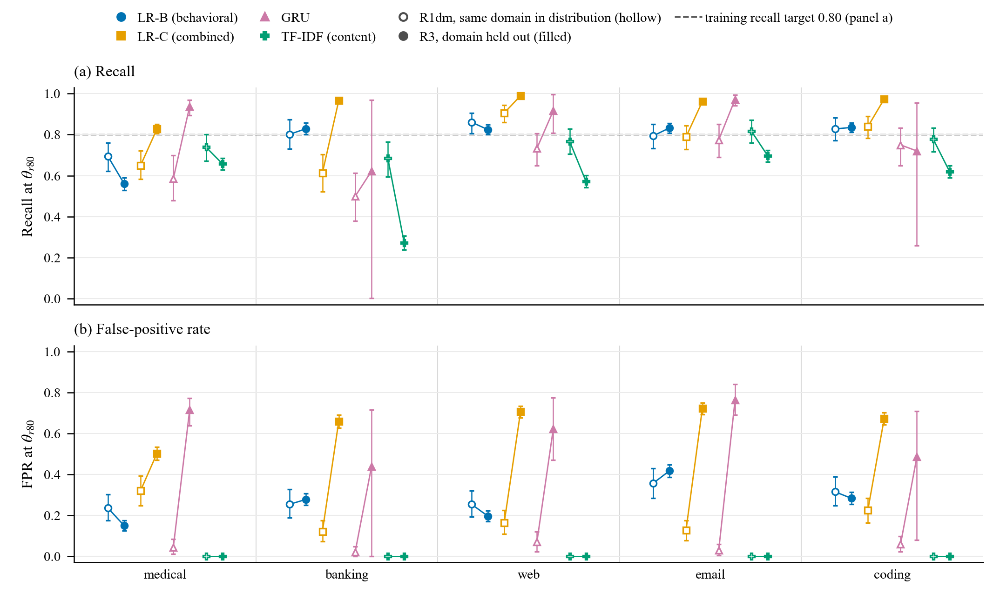

# Supplementary Material for Evaluating Baseline Detectors of Hijacked LLM Agents Under Rare Attacks and Distribution Shift

**Mahmoud Abbasi and Juan M. Núñez V.**

*M. Abbasi (corresponding author, e-mail: mahmoudabbasi@usal.es) and J. M. Núñez V. are with the BISITE Research Group, University of Salamanca, 37007 Salamanca, Spain.*

This document supplements the main paper. It gives the detail behind every supplementary table and figure that the main text cites, the complete list of deviations from the pre-specified analysis plans, and the instructions needed to reproduce every number. Section, table, figure and equation numbers without the prefix S refer to the main paper. Every number in the tables below is read by script from the result files of the revision. The prose repeats values from those tables or from the stream summaries named in Section S11.

## S1. CONVENTIONS

The supplement uses the notation of the main paper. The within-AgentDojo control has three designs. UT groups the cross-validation folds by suite and user task, IT groups the compromised traces by suite and injection goal, and UT-F is UT with the unsuccessful attacks added as training negatives. P0F is the evaluation population that adds the 4,987 retained unsuccessful attacks to P0 as negatives. The result files store the three designs under the keys WUT, WIT and WUT_F, and the tables print the names used in the paper. The three outcomes of the cross-benchmark rule are called transfer failure, weak representation and population-dependent, which correspond to Cases A, B and C of the R4 plan (Section IV-F).

Values are point estimates followed by 95% percentile intervals from 2,000 bootstrap replicates [@efron1993bootstrap]. Unless a note says otherwise, AgentDrift intervals resample trajectories stratified by class. AgentDojo intervals resample the 117 suite and user-task clusters [@field2007bootstrap], or the attack-goal clusters for the positives of IT, and R2 intervals resample its 35 test tasks. A difference is distinguishable from zero when its interval excludes zero, and an AUROC is distinguishable from chance when its interval excludes 0.5 (Section IV-D). The marks are the same in every table. An asterisk (\*) marks a difference distinguishable from zero after Holm correction [@holm1979] within the family named in the note, and † marks a reversal by the rule of Section IV-E. The arrow ↓ marks an R3 decrease against R1dm that is distinguishable after Holm correction, and § marks a within-AgentDojo value that meets the reasonable bar of Section IV-F. Threshold failure is defined in Section IV-E and the cross-benchmark rule in Section IV-F.

Each table is drawn from one analysis run, so intervals for the same quantity can differ in the third decimal between tables. The resampling units are fixed test predictions, and no interval includes the variability of retraining on new data [@bengio2004cv].

## S2. AGENTDOJO EXTRACTION AND MEASURED SHIFT

The extractor of the earlier version paired each tool call with the tool message that carried the same tool-call identifier. Gemini runs store an empty identifier, so every step of a Gemini trace received the last tool message of the run. Some GPT runs reuse identifiers, so an earlier step received the observation of a later one. The two observation-length features of representation B were therefore wrong for a model-specific subset of traces. The corrected extractor pairs calls and observations by position, as the extractor's own documentation intended. The unit test `tests/test_agentdojo_alignment.py` checks the alignment. It confirms a known Gemini run, finds that positional and identifier-based pairing agree on 8,151 runs with usable identifiers, and confirms that the extracted file uses positional pairing. The test passed on 26 and 27 September 2026.

Compared by observation content, 413 of the 2,686 P0 traces change (188 from `gemini-2.0-flash-001`, 185 from `gemini-1.5-pro-002`, 37 from `gpt-4o-2024-05-13` and 3 from `gpt-4-turbo-2024-04-09`). Compared by per-step observation length, 408 change (186, 183, 36 and 3). A further 249 traces change only because the earlier extractor cut observations at 2,000 characters without saying so. The cut affected 448 of 14,079 P0 steps in 262 traces. In the corrected extraction, 500 P0 steps in 300 traces are longer than 2,000 characters. Observations are now stored uncut in both benchmarks. With the cut applied again, within-AgentDojo LR-C reaches 0.846 against 0.797 without it. No paired interval was computed for this point difference.

Table S1 compares the earlier and corrected values. LR-A does not read observations and is unchanged. The corrected extraction moves transfer toward 0.5 for LR-B, LR-C and the GRU and lowers their within-AgentDojo AUROC. Most of the within-AgentDojo drop comes from the removal of the cut. The version 0.3 scripts never produced the earlier per-model values of LR-A and the GRU or the earlier IT value of LR-A, so these were recomputed on the archived version 0.3 extraction with the version 0.3 code. The lower block lists the runs removed by the filter on fewer than two tool calls. It removes 236 of 628 benign runs but only 70 of 2,364 compromised runs, all of the latter from `gpt-4o-2024-05-13`. For `gemini-2.0-flash-001` it removes 77 of 132 benign runs.

**TABLE S1**
**AGENTDOJO EXTRACTION FIX WITH EARLIER AND CORRECTED VALUES, AND THE RUNS EXCLUDED BY THE SHORT-RUN FILTER**

<!-- BEGIN s_m7 -->
| v0.3 → corrected | LR-A (tool identity) | LR-B (behavioral) | LR-C (combined) | GRU |
| --- | --- | --- | --- | --- |
| Transfer AUROC | 0.566 → 0.566 [0.543, 0.586] | 0.447 → 0.482 [0.448, 0.516] | 0.440 → 0.473 [0.441, 0.508] | 0.488 → 0.513 [0.482, 0.544] |
| Within UT AUROC | 0.788 → 0.788 [0.759, 0.816] | 0.798 → 0.741 [0.708, 0.771] | 0.855 → 0.797 [0.766, 0.829] | 0.860 → 0.840 [0.794, 0.871] |
| Within IT AUROC | 0.690 → 0.690 [0.616, 0.769] | 0.771 → 0.719 [0.676, 0.758] | 0.766 → 0.688 [0.634, 0.736] | not run → 0.645 [0.581, 0.691] |
| Within UT − transfer | +0.222 → +0.223 [+0.189, +0.258] | +0.351 → +0.259 [+0.214, +0.304] | +0.415 → +0.323 [+0.277, +0.370] | +0.371 → +0.326 [+0.276, +0.368] |
| Within IT − transfer | +0.124 → +0.124 [+0.048, +0.210] | +0.325 → +0.237 [+0.184, +0.288] | +0.326 → +0.214 [+0.151, +0.273] | not run → +0.132 [+0.062, +0.187] |
| Transfer FPR at θr80 | 0.043 → 0.043 [0.025, 0.064] | 0.332 → 0.225 [0.184, 0.265] | 0.347 → 0.225 [0.184, 0.265] | 0.230 → 0.168 [0.115, 0.232] |
| Transfer, `gemini-1.5-pro-002` | 0.572 → 0.572 [0.513, 0.637] | 0.582 → 0.483 [0.395, 0.573] | 0.593 → 0.477 [0.389, 0.566] | 0.646 → 0.535 [0.449, 0.616] |
| Transfer, `gemini-2.0-flash-001` | 0.525 → 0.525 [0.455, 0.596] | 0.612 → 0.565 [0.461, 0.662] | 0.640 → 0.562 [0.458, 0.662] | 0.751 → 0.627 [0.530, 0.718] |
| Transfer, `gpt-4-turbo-2024-04-09` | 0.540 → 0.540 [0.484, 0.591] | 0.487 → 0.487 [0.406, 0.567] | 0.485 → 0.485 [0.405, 0.564] | 0.533 → 0.531 [0.456, 0.605] |
| Transfer, `gpt-4o-2024-05-13` | 0.573 → 0.573 [0.530, 0.610] | 0.456 → 0.454 [0.389, 0.515] | 0.447 → 0.444 [0.380, 0.505] | 0.488 → 0.482 [0.425, 0.541] |
| **Short-run filter, excluded / all** | **Benign** | **Compromised** | **Unsuccessful** | **Kept (benign / compromised / unsuccessful)** |
| `gpt-4o-2024-05-13` | 32/124 (0.258) | 70/1936 (0.036) | 1216/4839 (0.251) | 92 / 1866 / 3623 |
| `claude-3-5-sonnet-20241022` | 40/124 (0.323) | 0/7 (0.000) | 184/622 (0.296) | 84 / 7 / 438 |
| `gemini-1.5-pro-002` | 45/124 (0.363) | 0/107 (0.000) | 185/522 (0.354) | 79 / 107 / 337 |
| `gpt-4-turbo-2024-04-09` | 42/124 (0.339) | 0/180 (0.000) | 141/449 (0.314) | 82 / 180 / 308 |
| `gemini-2.0-flash-001` | 77/132 (0.583) | 0/134 (0.000) | 534/815 (0.655) | 55 / 134 / 281 |
| All models | 236/628 (0.376) | 70/2364 (0.030) | 2260/7247 (0.312) | 392 / 2294 / 4987 |
<!-- END s_m7 -->
*Each cell of the upper block gives the version 0.3 value, then the corrected value with its interval under the trajectory-level bootstrap of the earlier version. These intervals therefore differ slightly from the cluster intervals of Table VI. The GRU was not run under IT in version 0.3. The lower block counts runs with fewer than two tool calls against all runs of each class, and the last column gives the retained benign, compromised and unsuccessful-attack runs.*

Table S2 measures how far each setting moves the behavioral features. The statistic is a classifier two-sample test [@lopezpaz2017], the cross-validated AUROC of a class-weighted logistic regression on representation B that separates training rows from test rows. R1 is indistinguishable from its training data (0.501), and world-disjoint and task-disjoint splits move it slightly (0.551 to 0.564). The held-out domains move it by 0.622 (email) to 0.866 (web), and AgentDojo is almost perfectly separable from AgentDrift (0.992). The statistic does not track the degradation of the detectors. Email has the smallest behavioral shift of the five folds but the largest LR-C loss against R1dm (−0.155).

**TABLE S2**
**MEASURED SHIFT PER SETTING WITH A CLASSIFIER TWO-SAMPLE TEST ON REPRESENTATION B, AND TOOL-OCCURRENCE COVERAGE**

<!-- BEGIN s_shift -->
| Setting | n train / test | Tool coverage κ | C2ST AUROC, all rows | C2ST AUROC, pool-E rows | LR-B AUROC | LR-C AUROC | LR-C R3 − R1dm AUROC |
| --- | --- | --- | --- | --- | --- | --- | --- |
| R1 | 8775 / 1881 | 1.000 | 0.501 [0.485, 0.515] | 0.512 [0.497, 0.527] | 0.830 [0.811, 0.850] | 0.879 [0.863, 0.895] | n/a |
| R1-wd s0 | 8762 / 1894 | 1.000 | 0.553 [0.538, 0.566] | 0.555 [0.540, 0.570] | 0.821 [0.800, 0.839] | 0.891 [0.875, 0.905] | n/a |
| R1-wd s1 | 8739 / 1917 | 1.000 | 0.564 [0.550, 0.578] | 0.571 [0.557, 0.586] | 0.803 [0.784, 0.824] | 0.889 [0.874, 0.904] | n/a |
| R1-wd s2 | 8711 / 1945 | 1.000 | 0.555 [0.541, 0.570] | 0.559 [0.544, 0.575] | 0.822 [0.802, 0.840] | 0.901 [0.886, 0.915] | n/a |
| R1-wd s3 | 8752 / 1904 | 1.000 | 0.555 [0.540, 0.569] | 0.551 [0.536, 0.566] | 0.818 [0.797, 0.837] | 0.888 [0.872, 0.902] | n/a |
| R1-wd s4 | 8764 / 1892 | 1.000 | 0.558 [0.545, 0.573] | 0.573 [0.558, 0.588] | 0.819 [0.798, 0.838] | 0.892 [0.875, 0.907] | n/a |
| R2 | 9081 / 1722 | 1.000 | 0.551 [0.537, 0.565] | 0.554 [0.538, 0.569] | 0.849 [0.829, 0.868] | 0.902 [0.887, 0.917] | n/a |
| R3 medical | 8446 / 2210 | 0.000 | 0.842 [0.834, 0.850] | 0.845 [0.837, 0.853] | 0.808 [0.789, 0.826] | 0.745 [0.724, 0.766] | −0.041 [−0.091, +0.012] |
| R3 banking | 8840 / 1816 | 0.000 | 0.701 [0.689, 0.713] | 0.736 [0.723, 0.749] | 0.854 [0.835, 0.873] | 0.828 [0.807, 0.849] | −0.024 [−0.072, +0.029] |
| R3 web | 8446 / 2210 | 0.000 | 0.866 [0.858, 0.873] | 0.875 [0.868, 0.882] | 0.896 [0.883, 0.909] | 0.862 [0.847, 0.878] | −0.065 [−0.095, −0.033] |
| R3 email | 8446 / 2210 | 0.000 | 0.622 [0.609, 0.635] | 0.620 [0.606, 0.633] | 0.792 [0.773, 0.811] | 0.739 [0.718, 0.761] | −0.155 [−0.194, −0.113] |
| R3 coding | 8446 / 2210 | 0.000 | 0.751 [0.740, 0.761] | 0.754 [0.743, 0.766] | 0.852 [0.835, 0.869] | 0.814 [0.796, 0.833] | −0.080 [−0.117, −0.042] |
| R4 | 10656 / 7673 | 0.075 | 0.992 [0.991, 0.993] | 0.992 [0.990, 0.994] | 0.482 | 0.473 | n/a |
| LOSO banking | 1959 / 1450 | 0.000 | 0.887 [0.876, 0.898] | 0.887 [0.875, 0.900] | n/a | n/a | n/a |
| LOSO slack | 1677 / 1601 | 0.000 | 0.969 [0.964, 0.974] | 0.977 [0.972, 0.981] | n/a | n/a | n/a |
| LOSO travel | 2401 / 2083 | 0.084 | 0.891 [0.881, 0.900] | 0.887 [0.865, 0.908] | n/a | n/a | n/a |
| LOSO workspace | 2021 / 2539 | 0.362 | 0.971 [0.967, 0.974] | 0.951 [0.943, 0.959] | n/a | n/a | n/a |
| Within UT (25 CV pairs) | 2149 / 1535 | 0.976 | 0.721 (0.616 to 0.844) | n/a | n/a | n/a | n/a |
| Within UT-F (25 CV pairs) | 6138 / 1535 | 0.976 | 0.681 (0.589 to 0.785) | n/a | n/a | n/a | n/a |
| Within IT (25 CV pairs) | 2149 / 1535 | 0.980 | 0.722 (0.631 to 0.799) | n/a | n/a | n/a | n/a |
<!-- END s_shift -->
*The two-sample test standardizes representation B, fits a logistic regression with balanced class weights under five-fold stratified cross-validation (seed 0) and reports the AUROC of the out-of-fold scores with a stratified bootstrap interval. A value of 0.5 means that training and test rows are indistinguishable in the ten behavioral features. The pool-E variant drops the failed and unsuccessful attacks on both sides. The statistic ignores the tool-vocabulary shift, which κ records as the share of test tool occurrences whose tool appears in the benign training vocabulary. The R4 test rows include the unsuccessful attacks, and its LR-B and LR-C cells are transfer points. Within-AgentDojo rows give the mean and range over the 25 cross-validation pairs, with mean training and test sizes.*

## S3. PRE-SPECIFIED PLANS AND DEVIATIONS

The study followed four pre-specified internal analysis plans, none of which was externally registered. We call them the R4 plan (`R4_CONTROL.md`), the ablation plan (`PRE_ABLATION_DESIGN.md`), the GRU plan (`GRU_PREREGISTRATION.md`, a file name kept from the earlier version) and the revision plan (`REVISION_ANALYSIS_PLAN.md`). All four are released with the code at https://github.com/Mahmoud-Abbasi-svg/agent-trace-detector-eval. The released monitor follows a fifth plan, `MONITOR_PREREGISTRATION.md`, which was registered by hash before any monitor call and is described with its amendments in Section S14. The revision plan was recorded in `revision/PLAN_MANIFEST.txt` on 26 September 2026 at 18.30.33, when no file existed in the revision cache. The three earlier plans have no independent timestamp. Their file modification times show when each file was last written, not when each part of it was written. They therefore cannot show that a plan was not edited after results existed.

Table S3 gives the full record in four parts. Part A states which results were known when each plan was written. Part B lists every deviation from the three earlier plans, including the items raised by the review and one found during the check (gradient clipping, V22). Part C lists how each item of the revision plan was executed, and Part D lists the corrections that the consolidation of the revision streams made after independent verification. The version 0.3 results file of the GRU and the GRU plan now carry appended correction notes. Their unmodified versions, with their original modification times, are kept in `archive_v0.3`.

The B− arm of the ablation plan (V8) drops the two keyword features, and version 0.3 did not run it. This arm gives LR-B-minus an AUROC of 0.827 in R1 and 0.803, 0.839, 0.899, 0.807 and 0.849 in the medical, banking, web, email and coding folds of R3 (Table S4). These values are close to those of LR-B, so the omission does not change any conclusion.

**TABLE S3**
**DEVIATIONS FROM THE PRE-SPECIFIED PLANS, PART A, WHAT WAS KNOWN WHEN EACH PLAN WAS WRITTEN**

| Plan | Last written | Results already known | Results not yet known | Consequence |
|---|---|---|---|---|
| R4 plan (plan in Part 1, results appended as Part 2) | 25 Sep. 2026, 14.32.54 | Transfer AUROC of LR-C (0.440) and LR-B (0.447), written at 13.42.56, then all within-AgentDojo results (UT 0.855 and 0.798, IT 0.766 and 0.771), written at 14.26.35, and LR-C in R1 to R3, written at 14.29.48 | None can be established. The within-AgentDojo results were prospective only if Part 1 predates 14.26.35, which file times cannot show | The one-sided near-chance clause (AUROC < 0.60) and the Case rules were fixed with transfer known |
| Ablation plan | 25 Sep. 2026, 14.42.08 | LR-C in R1, R2 and R3 as well as LR-C and LR-B in R4 (transfer 0.440 and 0.447, within UT 0.855 and 0.798, IT), all listed in the plan as reproduction anchors | LR-A in every setting. LR-B in R1 and R3, and hence the R3 comparison of LR-C with LR-B (results written at 14.47.34) | Only LR-A and the R1 and R3 results of LR-B were prospective. Rule 4 names R4 as its primary evidence although both R4 values were known |
| GRU plan | 25 Sep. 2026, 15.02.47 | All linear results, including LR-C below LR-B in all five R3 folds (14.47.34), the world-disjoint results (14.53.36) and the R4 control (14.26.35) | Every GRU result (code at 15.05.05, results at 15.34.18) | The GRU results were prospective. The GRU diagnostic (15.44.03 to 16.02.26) came after them and is post hoc |
| Revision plan | 26 Sep. 2026, 18.30.32, entered in the plan manifest at 18.30.33 | All version 0.3 results, and the exploratory numbers of the independent review for most planned analyses (dropout arms, TF-IDF, reweighted AUPRC, domain-matched comparators, observation-length ablations and padding, unsuccessful attacks as negatives, the corrected extraction, cluster bootstraps) | No revision output existed, and the corrected extraction and the re-run of the version 0.3 scripts came after the plan | The revision analyses are confirmatory re-runs of analyses whose approximate outcome was known, not prospective tests |

*Times are file modification times (hours.minutes.seconds) in Central European Summer Time, read on 27 September 2026. For result files overwritten by the re-run of 26 September, the times of the archived version 0.3 copies are used. File times show only when a file was last written.*

**TABLE S3 (CONTINUED)**
**DEVIATIONS FROM THE PRE-SPECIFIED PLANS, PART B, THE R4 AND ABLATION PLANS**

| ID | Plan and location | Planned | Executed | Effect and where reported |
|---|---|---|---|---|
| V1 | R4 plan, line 3 | Part 1 written before any within-AgentDojo result | The file was last written at 14.32.54, after the R4 control code (14.23.43) and its results (14.26.35), and Part 2 was appended to the same file | The timing of Part 1 cannot be verified, and no independent record exists (Sec. IV-A) |
| V2 | R4 plan, line 61 | Near chance if the AUROC interval includes 0.5, or AUROC < 0.60 | The one-sided clause was written with transfer 0.440 [0.407, 0.471] known | Post hoc. On corrected data it alone makes LR-A near chance in every population and TF-IDF near chance on C1 (Sec. IV-F, Table VI) |
| V3 | R4 plan, line 65 | Mixed or other outcomes reported as observed, including UT reasonable but IT not reasonable | The version 0.3 manuscript omitted the clause and stated that the conditions for Case A were met | The earlier verdict misstated the rule. LR-C is now mixed, and the GRU shows transfer failure under UT with the mixed clause applying under IT (Sec. VI-E) |
| V4 | R4 plan, lines 62 to 64 | Case rules applied per population to both representations run | Case A was declared for LR-C only, and the manuscript extended the verdict to the features in general | Overgeneralized. Outcomes are now given per representation (Table VI) |
| V5 | R4 plan, line 10 | Unsuccessful attacks excluded at extraction | As planned, although AgentDrift counts failed attacks as training negatives | A design choice, not a deviation. P0F and UT-F are added (Sec. VI-E, Table S15) |
| V6 | R4 plan, line 13 | Within-model AUROC and AUPRC with their macro-average | The macro-average was computed for AUROC only | Minor, no effect |
| V7 | R4 plan, line 16 | Model-identity probe, five-fold logistic regression on benign traces | As planned (unregularized, C = 1, not nested) | No deviation. Its signal on B (0.615) came from the extraction error, and a nested regularized probe replaces it (Table S7) |
| V8 | Ablation plan, lines 87, 90 and 92 | Arms A, B, B− and C, with the paired contrast of C against B− | B− and its contrast were not run and were called not triggered, although only the A+UNK arm was optional | No effect on conclusions. LR-B-minus has R1 AUROC 0.827 and R3 AUROC 0.803, 0.839, 0.899, 0.807 and 0.849 (Table S4) |
| V9 | Ablation plan, line 73 (Rule 2) | B degrades if the independent-bootstrap change from R1 to the shift is negative and distinguishable | No such change was computed for B, and the values were compared descriptively | The rule was not applied in version 0.3. LR-B R3 − R1dm is now distinguishable in no fold (−0.012 to +0.022, Table IV) |
| V10 | Ablation plan, line 79 (Rule 4) | Degradation difference, with R4 as the primary evidence for Outcome 4 | Not computed and not reported | The R1-referenced degradation difference is +0.057 [+0.042, +0.073], so the R4 clause is met, but the test is weak because both transfer near chance (Sec. VI-D) |
| V11 | Ablation plan, line 91 | Transfer on P0, C1 and model-balanced, with within-AgentDojo UT and IT references | Within UT only per representation, IT only for LR-B and LR-C, and model-balanced only at 10% prevalence | LR-A under IT (0.690) and native-count model-balanced values for all detectors are now reported (Tables VI and S15) |
| V12 | Ablation plan, lines 19 to 22 | 1,029 worlds, largest worlds 194, 169 and 144, purity 0.858 | The audit script behind these numbers was truncated at line 44 and did not parse | The numbers do not reproduce. The rewritten audit gives 1,133 worlds and purity 0.883 (Sec. III-A) |
| V13 | Ablation plan, lines 29 and 36 | Domain and world probes with three-fold cross-validation | The earlier results file and the audit docstring say five-fold, and the earlier probe code is lost | Inconsistent specification. Nested regularized probes replace them (Table S7) |
| V14 | Design referred to by the ablation plan | Dataset-identity probe on benign traces | Not run in version 0.3 or in the revision | The two-sample test on B for R4 (0.992 [0.991, 0.993]) answers the same question for B (Tables II and S2) |

*Line numbers refer to the plan files provided with this supplement. The design of V14 is Part 1 of `ABLATION_RESULTS.md` (line 86), to which the ablation plan points.*

**TABLE S3 (CONTINUED)**
**DEVIATIONS FROM THE PRE-SPECIFIED PLANS, PART B, THE GRU PLAN**

| ID | Plan and location | Planned | Executed | Effect and where reported |
|---|---|---|---|---|
| V15 | GRU plan, line 28 | R1 early stopping on `data/val.jsonl` (1,880 trajectories) | A stratified 10% hold-out of the R1 training data, as for every other setting. The GRU audit file and results file recorded the planned source | No effect on any number. Both records now carry correction notes (Sec. V-E) |
| V16 | GRU plan, lines 29 and 70 | Three training seeds per fit, including within AgentDojo | One training seed per cross-validation repetition within AgentDojo, seeds 0 to 4 | Seed variance cannot be separated from fold-assignment variance within AgentDojo (Sec. IV-A) |
| V17 | GRU plan, line 36 | R1-wd with five split seeds and three training seeds | Split seed 0 only | The revision fits all five split seeds with three training seeds (GRU AUROC 0.949 to 0.962, Table S8) |
| V18 | GRU plan, line 55 | Independent-bootstrap AUROC change of each shifted setting against R1 | Replaced by the non-overlap of intervals | Valid and conservative. GRU R3 − R1dm is now distinguishable after Holm correction in five of five folds (Table IV) |
| V19 | GRU plan, line 39 | R4 on P0, C1 and model-balanced as in the R4 control code, which uses native counts | Model-balanced GRU only at 10% prevalence | Native-count model-balanced transfer is 0.536 [0.501, 0.569] under the stratified interval, so Outcome 1 is indeterminate at the boundary (Sec. VI-E) |
| V20 | GRU plan, line 61 | Outcome 1 requires near-chance transfer on P0 and model-balanced | Assessed on the 10% subsample only | At the boundary, as in V19 (Sec. VI-E) |
| V21 | GRU plan, line 64 | Outcome 4 requires reporting the inconsistency and the seed variance | The results file dismissed Outcome 4, although thresholds varied strongly by seed | Under criteria defined after the fact, Outcome 4 is triggered on the operating point (Sec. VI-E, Table S12) |
| V22 | GRU plan, lines 24 to 31 and 73 | Training procedure fixed, with no values beyond those listed | Gradient norm clipped at 1.0 (`gru_detector.py`, line 83), which the plan does not list | An addition in every version 0.3 and revision GRU fit, found during the check. Its effect was not measured (Sec. IV-A) |
| V23 | GRU plan, line 19 | Optional GRU on the tool sequence only | The diagnostic also added a linear head on B trained with the GRU procedure, after the GRU results were known | Post hoc and reported as exploratory (Table S12) |
| V24 | GRU plan, line 77 | Every deviation recorded in the results file and in the plan | The results file stated that the plan was implemented exactly | Withdrawn by the correction notes appended to both files |
| V25 | GRU plan, lines 12 and 22 | Vocabulary from the tool names of benign training trajectories | The code matches the plan | No deviation. The version 0.3 manuscript misstated the vocabulary source (Sec. V-E) |

*The GRU results file and the split audit are `GRU_RESULTS.md` and `gru_audit.json`. The audit file is left unchanged as script output, and `revision/gru_audit_CORRECTION.md` records its error.*

**TABLE S3 (CONTINUED)**
**DEVIATIONS FROM THE PRE-SPECIFIED PLANS, PART C, EXECUTION OF THE REVISION PLAN**

| Plan item | Status | Deviation or interpretation | Effect on conclusions |
|---|---|---|---|
| 1.1 Positional pairing and unit test | Done | None, and the alignment test passes | None |
| 1.2 No truncation | Done | Observations are uncut in both benchmarks, whereas the review's corrected estimates still used the 2,000-character cut | Explains why the corrected within-AgentDojo LR-C value (0.797) is below the review's (0.846) |
| 1.3 Unsuccessful attacks, exclusions and DoS flag | Done | None | None |
| 1.4 Re-run of the version 0.3 scripts, unchanged | Done | The prediction caches reproduce the re-run points to within 5e-5, which is four-decimal rounding | None |
| 2 Shared prediction cache | Done, with restrictions | Tied scores are made exact. No GRU dropout arm in R1-wd, R2 or UT, and no GRU in LOSO. GRU fits under IT and UT-F were added later with one seed per repetition | Exact ties move the R4 Markov AUROC from 0.508 to 0.590 and R3 LR-A from 0.499 to 0.500, and no conclusion depends on them |
| 2 GRU seeds and validation data | As in the version 0.3 code | The same as V15, V16 and V22 | None beyond those items |
| 2 Added detectors | Addition | TF-IDF on tool names, TF-IDF with anonymization, LR-obsonly (post hoc), LR-B with annotation-based features, GRU fits without `<UNK>`-bearing traces and without DoS positives | Sensitivity analyses only |
| 3.1 Prevalence-weighted AUPRC as primary | Done | Subsampling kept as secondary. Rounding scores to 12 decimals merges saturated AgentDojo scores, so unrounded AgentDojo values are quoted | Changes of up to 0.0056. The LR-C AUPRC criterion of the R4 rule flips (0.2985 weighted against 0.322 subsampled) |
| 3.2 Domain-matched R1 comparator | Done | The R1dm and R3 pools share 345 trajectories per domain (276 in banking) | Conservative intervals, and a joint bootstrap changes no decision |
| 3.3 Threshold failure | Done | Headline counts use Holm correction, whereas the plan's definition is unadjusted, and both are reported | The counts differ only for the pooled GRU (3 against 4) and LR-B-noobs (1 against 2) |
| 3.4 Reversal rule | Done | AUROC primary and wAUPRC@10% secondary. The rule is also applied to the dropout pairs, and the GRU has three interval estimands | The reversal folds are identical under all three estimands |
| 3.5 Cluster bootstrap | Done, extended | Also used for R4 transfer and LOSO, with the cross-validation repetition shared across detectors | Borderline results depend on the resampling unit, for example R4 TF-IDF − LR-C |
| 3.6 Holm correction | Done | Bootstrap p-values with different floors across streams, and family (d) read in three ways | A recomputation with a per-detector family changed no decision |
| 3.7 Label-free threshold | Done, with a post hoc reading | The pre-specified reading (a) and a post hoc reading (b) at 2% prevalence are both reported, and the R1 alert rate had to be interpreted | Reading (b), not (a), matches the figures of the review |
| 3.8 FPR at a fixed TPR and FPR budgets | Done, with a restriction | FPR at a test TPR of 0.8 is descriptive, and the budgets are computed in R1 only | The budget question is answered for R1 only |
| 4 Observation length | Done | Padding appends a neutral sentence, the GRU is padded in R1 only, and only lengthening is tested | The within-AgentDojo padding effect reported by the review is not reproduced |
| 4 Keyword features | Done | One non-blind annotator | Annotation-based features change LR-B by at most 0.024 |
| 4 Negative-class and pattern breakdown | Restriction | Computed for R1, R2, the five R3 folds, R4 and UT, not for R1-wd, IT, UT-F or LOSO | No headline number depends on the missing settings |
| 4 Composition and templates in R4 | Done | Interpretations of the Case rule, an exploratory attempt target and a per-template design | The LR-C outcome lies at the boundary (0.003 AUROC) |
| 4 Mechanism | Done | Graded coverage masks tool names rather than domains, the R1 GRU was refitted, and the GRU training negatives include failed attacks | None |
| 4 Leave-one-suite-out | Done | Linear detectors only | None |
| 4 Shift size | Done, extended | Added for R1-wd seeds 1 to 4, LOSO and every cross-validation pair | None |
| 4 Diagnostics | Done | The audit script was rewritten, probes are nested and regularized, and an exploratory world-key search was added | None |
| 5 Decision rules | Applied | The Rule 4 estimand was corrected to the R1-referenced difference | Wording only |
| Outside the plan (review M2) | Done in part | A frozen-encoder reimplementation (SE, Section S13), no released guard model | The request is met only in part, with TF-IDF and SE |

*Item numbers follow the sections of the revision plan. The stream logs behind each row are in `revision/DEVIATIONS.md`, Part E.*

**TABLE S3 (CONTINUED)**
**DEVIATIONS FROM THE PRE-SPECIFIED PLANS, PART D, CORRECTIONS MADE IN THE CONSOLIDATION OF THE REVISION ANALYSES**

| ID | Correction | Effect |
|---|---|---|
| X1 | The breakdown by negative class and hijack pattern covers R1, R2, the five R3 folds, R4 and UT only, although the caches for the other settings exist | No headline depends on the missing settings, and the gap is stated in Sec. VIII |
| X2 | TPR at FPR budgets of 1% and 5% is reported for R1 only, for all detectors including TF-IDF | The budget question is answered in R1 only |
| X3 | No GRU in LOSO and no GRU dropout arm in R1-wd, R2 or UT | Stated in Sec. VIII |
| X4 | The pre-specified Rule 4 estimand is the R1-referenced degradation difference, +0.057 [+0.042, +0.073]. The within-AgentDojo-referenced value (+0.064) is supplementary | The outcome is the same |
| X5 | One world key on the training and validation data (user, date and sorted contact names) reproduces 1,029 worlds, purity 0.858 and 54 worlds with at least 30 trajectories, but not the largest world sizes. The README's ext-audit share is approximately reproduced (0.281) | A lead, not proof. The paper reports 1,133 worlds and purity 0.883 |
| X6 | Test FPR exceeds a 1% budget only for the GRU (0.070) and TF-IDF (0.033), not for LR-C (0.017). The Isolation Forest is close to chance rather than at chance, and in R4 only LR-A is slightly above chance on wAUPRC@10% | Wording |
| X7 | R4 TF-IDF − LR-C, +0.047 [−0.002, +0.096] with p = 0.057, is borderline. The best single-token rule (0.780) is the maximum over ten rules selected on training data, and the rule ranked first gives 0.753 | Wording |
| X8 | Bootstrap p-value floors differ between streams | No Holm decision changes |
| X9 | Streams read Holm family (d) in three ways | No decision changes. LR-C under IT is borderline in every reading (Holm p = 0.051) |
| X10 | One stream summary rounds four-decimal values a second time, so a few printed values differ by 0.001 | Values at a decision boundary are quoted to four decimals (0.5655, 0.2985) |
| X11 | Unrounded AgentDojo rank values are quoted, for example LR-C transfer AUROC 0.473 | None |
| X12 | Paired-difference centers in the R4 analysis are bootstrap means | Third-decimal differences between tables |
| X13 | The world-cluster sensitivity of the reversal analysis was run in the domain-shift stream only | Same reversal folds |
| X14 | Gradient clipping at norm 1.0 is part of every GRU fit and is not in the GRU plan (the same as V22) | Disclosed as a deviation |
| X15 | The fall in LR-C alert rates under LOSO holds only in the two zero-coverage suites, and the graded-coverage GRU intervals are seed-averaged | Wording |
| X16 | No released guard model was run. The only frozen sentence encoder is the SE reimplementation of Section S13 | Review request M2 is met only in part |
| X17 | The within-AgentDojo effect of the 2,000-character cut (0.846 against 0.797) has no paired interval. Shortened observations also occur in hard negatives (median 73 against 98 characters). LR-C-noobs ranks below LR-B-noobs in five of five folds on wAUPRC@10% and in four of five on AUROC | Both metrics are reported |
| X18 | The stratified lower bound of the model-balanced GRU transfer (0.5007) lies within Monte Carlo error of 0.5 | GRU Outcome 1 is reported as indeterminate at the boundary |

*These corrections come from the independent verification of each analysis stream and take precedence over the stream logs.*

## S4. BEHAVIORAL FEATURES

Two of the ten behavioral features count calls whose tool name contains one of fourteen write-like keywords. Table S4 checks this flag against a state-change annotation of every AgentDrift and AgentDojo tool. The annotation was made by a single annotator with no second rater. That annotator was an AI assistant working for the authors and knew the keyword list. The flag is precise but catches only 22 of the 50 state-changing AgentDrift tools, with a call-level recall of 0.455. Replacing the keyword features with annotation-based ones changes the AUROC of LR-B by at most 0.024, and dropping them altogether (LR-B-minus, the B− arm of the ablation plan) changes it by at most 0.015 in R1 and R3. The keyword features are therefore not what drives the results.

**TABLE S4**
**KEYWORD STATE-CHANGE FLAG AGAINST A TOOL ANNOTATION, AND LR-B WITH ANNOTATION-BASED FEATURES OR WITHOUT THE KEYWORD FEATURES**

<!-- BEGIN s_keyword -->
| Keyword flag vs annotation | Tool-level precision | Tool-level recall | Call-level precision | Call-level recall |
| --- | --- | --- | --- | --- |
| AgentDrift (train and test) | 22/23 (0.957) | 22/50 (0.440) | 0.970 [0.966, 0.973] | 0.455 [0.448, 0.461] |
| AgentDojo (P0 and unsuccessful) | 15/18 (0.833) | 15/22 (0.682) | 0.867 [0.784, 0.944] | 0.831 [0.773, 0.887] |
| AgentDojo P0 | 15/17 (0.882) | 15/22 (0.682) | 0.974 [0.951, 0.991] | 0.830 [0.783, 0.881] |
| **LR-B AUROC** | **LR-B** | **LR-B-annot** | **LR-B-minus** | **LR-B-annot − LR-B** |
| R1 | 0.830 [0.811, 0.849] | 0.826 [0.806, 0.846] | 0.827 [0.808, 0.846] | −0.004 [−0.010, +0.001] |
| R3 medical | 0.808 [0.788, 0.826] | 0.807 [0.788, 0.826] | 0.803 [0.783, 0.822] | −0.001 [−0.004, +0.003] |
| R3 banking | 0.854 [0.836, 0.873] | 0.850 [0.831, 0.869] | 0.839 [0.820, 0.858] | −0.004 [−0.009, +0.001] |
| R3 web | 0.896 [0.882, 0.910] | 0.899 [0.885, 0.912] | 0.899 [0.886, 0.911] | +0.003 [−0.002, +0.008] |
| R3 email | 0.792 [0.772, 0.812] | 0.768 [0.747, 0.790] | 0.807 [0.787, 0.827] | −0.024* [−0.031, −0.016] |
| R3 coding | 0.852 [0.835, 0.868] | 0.859 [0.842, 0.874] | 0.849 [0.832, 0.865] | +0.007* [+0.002, +0.012] |
| R4 transfer | 0.482 [0.434, 0.522] | 0.479 [0.431, 0.520] | 0.478 [0.431, 0.518] | −0.002 [−0.006, +0.001] |
<!-- END s_keyword -->
*Tool-level values count tools of the vocabulary, and call-level intervals resample trajectories (clusters in AgentDojo). LR-B-annot replaces the two keyword features with the same counts based on the annotation, and LR-B-minus drops them. \* marks a difference distinguishable from zero after Holm correction over the five R3 folds.*

## S5. OPERATING POINTS AND THE NEGATIVE MIX

Table S5 complements the training threshold $\theta_{r80}$ of the main paper with other operating points in R1. FPR at a fixed test TPR of 0.8 places the threshold with test labels, so it is a descriptive comparison of ranking at matched recall. It shows that the GRU's advantage over LR-C (0.082 against 0.210) does not depend on where the threshold sits. Budget thresholds flag at most 1% or 5% of the benign and hard-negative training trajectories. Under them no logistic regression has a test FPR that distinguishably exceeds its budget, whereas the GRU and TF-IDF exceed both budgets. With the validation threshold $\theta_{\mathrm{val}80}$ the GRU reaches a recall of 0.775 [0.745, 0.804] at an FPR of 0.073 [0.055, 0.092] and a precision at 2% of 0.179 [0.147, 0.225]. The threshold $\theta=0.5$ behaves like $\theta_{r80}$ for the logistic regressions. LR-C over-alerts under R3 (FPR 0.538 to 0.733), and every detector recalls at most 0.301 of compromised traces in R4.

**TABLE S5**
**ALTERNATIVE OPERATING POINTS IN R1, AND THE THRESHOLD 0.5 UNDER DOMAIN SHIFT AND TRANSFER**

<!-- BEGIN s_oppoints -->
| Detector | FPR at test TPR 0.8 (descriptive) | 1% budget TPR | 1% budget FPR | 5% budget TPR | 5% budget FPR | θ=0.5 R1 recall | θ=0.5 R1 FPR | θ=0.5 R3 recall (range) | θ=0.5 R3 FPR (range) | θ=0.5 R4 recall | θ=0.5 R4 FPR |
| --- | --- | --- | --- | --- | --- | --- | --- | --- | --- | --- | --- |
| LR-A (tool identity) | 0.411 [0.364, 0.472] | 0.173 [0.147, 0.199] | 0.013 [0.006, 0.022] | 0.400 [0.367, 0.433] | 0.065 [0.048, 0.082] | 0.658 [0.628, 0.687] | 0.230 [0.202, 0.259] | 0.000 to 0.000 | 0.000 to 0.000 | 0.067 | 0.008 |
| LR-B (behavioral) | 0.288 [0.250, 0.335] | 0.194 [0.166, 0.221] | 0.011 [0.005, 0.019] | 0.373 [0.341, 0.407] | 0.067 [0.051, 0.085] | 0.758 [0.730, 0.787] | 0.247 [0.219, 0.274] | 0.527 to 0.807 | 0.140 to 0.384 | 0.178 | 0.224 |
| LR-C (combined) | 0.210 [0.175, 0.244] | 0.276 [0.244, 0.307] | 0.017 [0.008, 0.027] | 0.529 [0.495, 0.563] | 0.065 [0.048, 0.082] | 0.786 [0.759, 0.815] | 0.198 [0.172, 0.224] | 0.864 to 0.990 | 0.538 to 0.733 | 0.226 | 0.224 |
| GRU | 0.082 [0.061, 0.108] | 0.770 [0.717, 0.809] | 0.070 [0.050, 0.092] | 0.889 [0.866, 0.910] | 0.156 [0.128, 0.182] | 0.856 [0.819, 0.893] | 0.119 [0.084, 0.159] | 0.686 to 0.994 | 0.531 to 0.832 | 0.301 | 0.212 |
| TF-IDF (content) | 0.000 [0.000, 0.000] | 0.998 [0.994, 1.000] | 0.033 [0.021, 0.045] | 0.999 [0.996, 1.000] | 0.081 [0.063, 0.102] | 0.990 [0.983, 0.996] | 0.008 [0.002, 0.016] | 0.559 to 0.951 | 0.000 to 0.145 | 0.175 | 0.217 |
| Markov | 0.472 [0.417, 0.524] | 0.054 [0.039, 0.070] | 0.017 [0.008, 0.027] | 0.243 [0.214, 0.272] | 0.069 [0.052, 0.087] | n/a | n/a | n/a | n/a | n/a | n/a |
| IForest | 0.634 [0.594, 0.676] | 0.006 [0.001, 0.012] | 0.013 [0.006, 0.022] | 0.046 [0.032, 0.060] | 0.052 [0.038, 0.068] | n/a | n/a | n/a | n/a | n/a | n/a |
| GRU at θval80 (R1) | n/a | n/a | n/a | n/a | n/a | 0.775 [0.745, 0.804] | 0.073 [0.055, 0.092] | n/a | n/a | n/a | n/a |
<!-- END s_oppoints -->
*FPR at a test TPR of 0.8 uses test labels and is descriptive only. Budget thresholds flag at most 1% or 5% of the benign and hard-negative training trajectories, scored in sample. R3 cells give the range of points over the five folds, and R4 cells are points. Markov and Isolation Forest scores are not probabilities, so they have no threshold of 0.5. The last row gives the GRU at the validation threshold $\theta_{\mathrm{val}80}$, pooled over three seeds.*

Table S6 breaks the operating point at $\theta_{r80}$ down by negative class and hijack pattern, as the AgentDrift documentation asks [@agentdrift]. In R1, LR-A, LR-B, LR-C, the Markov model and the GRU all flag hard negatives more often than benign trajectories. Precision at 2% prevalence therefore depends on the negative mix as much as on prevalence. For LR-C it is 0.117 against benign negatives only, 0.076 with the 27% hard negatives of pool E and 0.039 against hard negatives only. Recall differs by pattern as well. TF-IDF, which flags no negative, recalls 0.974 of full hijacks but only 0.410 of delayed ones. In R3, LR-B's full-hijack recall ranges from 0.468 (medical) to 0.840 (web). In AgentDojo, transferred LR-C flags benign runs as often as compromised ones (0.224 against 0.225). Within AgentDojo, TF-IDF flags no benign run but 0.308 of the unsuccessful attacks.

**TABLE S6**
**OPERATING POINT AT THE TRAINING THRESHOLD BY NEGATIVE CLASS AND HIJACK PATTERN IN R1, R3 AND AGENTDOJO**

<!-- BEGIN s_breakdown -->
| Detector | FPR benign | FPR hard negative | Failed attacks flagged | Recall pool E | Recall full | Recall partial | Recall delayed | Precision 2%, benign only | Precision 2%, pool-E mix | Precision 2%, hard only |
| --- | --- | --- | --- | --- | --- | --- | --- | --- | --- | --- |
| *R1 (pool E with 831 attacked, 600 benign and 225 hard-negative trajectories)* |  |  |  |  |  |  |  |  |  |  |
| LR-A (tool identity) | 0.295 [0.258, 0.333] | 0.440 [0.373, 0.502] | 0.351 [0.289, 0.413] | 0.744 [0.716, 0.771] | 0.893 [0.863, 0.921] | 0.502 [0.437, 0.567] | 0.642 [0.560, 0.716] | 0.049 | 0.043 | 0.033 |
| LR-B (behavioral) | 0.193 [0.163, 0.225] | 0.524 [0.458, 0.591] | 0.524 [0.462, 0.587] | 0.795 [0.768, 0.822] | 0.758 [0.717, 0.796] | 0.848 [0.801, 0.892] | 0.836 [0.776, 0.896] | 0.077 | 0.054 | 0.030 |
| LR-C (combined) | 0.118 [0.092, 0.147] | 0.387 [0.320, 0.449] | 0.218 [0.164, 0.271] | 0.771 [0.744, 0.800] | 0.830 [0.796, 0.863] | 0.727 [0.671, 0.784] | 0.642 [0.567, 0.724] | 0.117 | 0.076 | 0.039 |
| GRU | 0.024 [0.010, 0.040] | 0.101 [0.062, 0.142] | 0.043 [0.013, 0.084] | 0.682 [0.645, 0.716] | 0.722 [0.670, 0.768] | 0.606 [0.532, 0.675] | 0.674 [0.575, 0.761] | 0.373 | 0.238 | 0.122 |
| TF-IDF (content) | 0.000 [0.000, 0.000] | 0.000 [0.000, 0.000] | 0.000 [0.000, 0.000] | 0.763 [0.739, 0.787] | 0.974 [0.959, 0.987] | 0.541 [0.476, 0.606] | 0.410 [0.328, 0.493] | 1.000 (≥ 0.711) | 1.000 (≥ 0.772) | 1.000 (≥ 0.481) |
| Markov | 0.412 [0.372, 0.452] | 0.671 [0.604, 0.729] | 0.618 [0.556, 0.680] | 0.810 [0.786, 0.836] | 0.775 [0.738, 0.811] | 0.827 [0.775, 0.874] | 0.903 [0.851, 0.948] | 0.039 | 0.033 | 0.024 |
| IForest | 0.628 [0.590, 0.667] | 0.609 [0.542, 0.676] | 0.791 [0.738, 0.844] | 0.785 [0.756, 0.811] | 0.811 [0.775, 0.843] | 0.697 [0.636, 0.758] | 0.843 [0.784, 0.903] | 0.025 | 0.025 | 0.026 |
| *R3 held-out domains* |  |  |  |  |  |  |  |  |  |  |
| LR-B, medical | 0.090 [0.069, 0.112] | 0.310 [0.255, 0.365] | 0.396 [0.337, 0.455] | 0.560 [0.529, 0.589] | 0.468 [0.427, 0.506] | 0.830 [0.781, 0.879] | 0.497 [0.419, 0.574] | 0.113 | 0.071 | 0.036 |
| LR-B, banking | 0.150 [0.124, 0.176] | 0.620 [0.561, 0.678] | 0.737 [0.682, 0.788] | 0.829 [0.800, 0.856] | 0.659 [0.594, 0.719] | 0.958 [0.931, 0.981] | 0.852 [0.792, 0.906] | 0.101 | 0.057 | 0.027 |
| LR-B, web | 0.088 [0.069, 0.110] | 0.486 [0.424, 0.549] | 0.424 [0.361, 0.482] | 0.825 [0.801, 0.847] | 0.840 [0.811, 0.870] | 0.833 [0.787, 0.878] | 0.747 [0.673, 0.814] | 0.160 | 0.079 | 0.033 |
| LR-B, email | 0.357 [0.322, 0.394] | 0.580 [0.522, 0.639] | 0.424 [0.361, 0.486] | 0.833 [0.811, 0.856] | 0.820 [0.790, 0.851] | 0.864 [0.822, 0.902] | 0.834 [0.775, 0.887] | 0.045 | 0.039 | 0.028 |
| LR-B, coding | 0.213 [0.182, 0.244] | 0.471 [0.412, 0.533] | 0.565 [0.502, 0.627] | 0.835 [0.813, 0.859] | 0.834 [0.804, 0.863] | 0.853 [0.807, 0.896] | 0.811 [0.750, 0.866] | 0.074 | 0.057 | 0.035 |
| LR-C, medical | 0.451 [0.413, 0.488] | 0.639 [0.580, 0.694] | 0.576 [0.514, 0.635] | 0.827 [0.805, 0.849] | 0.759 [0.725, 0.791] | 0.951 [0.923, 0.976] | 0.903 [0.852, 0.948] | 0.036 | 0.033 | 0.026 |
| LR-C, banking | 0.599 [0.562, 0.634] | 0.824 [0.776, 0.867] | 0.831 [0.784, 0.875] | 0.966 [0.952, 0.979] | 0.917 [0.876, 0.949] | 0.996 [0.988, 1.000] | 0.987 [0.966, 1.000] | 0.032 | 0.029 | 0.023 |
| LR-C, web | 0.632 [0.599, 0.669] | 0.906 [0.871, 0.941] | 0.745 [0.690, 0.800] | 0.990 [0.984, 0.996] | 0.990 [0.982, 0.997] | 0.992 [0.981, 1.000] | 0.987 [0.967, 1.000] | 0.031 | 0.028 | 0.022 |
| LR-C, email | 0.685 [0.650, 0.718] | 0.820 [0.773, 0.867] | 0.616 [0.557, 0.675] | 0.962 [0.950, 0.973] | 0.950 [0.932, 0.967] | 0.977 [0.958, 0.992] | 0.980 [0.954, 1.000] | 0.028 | 0.026 | 0.023 |
| LR-C, coding | 0.610 [0.575, 0.647] | 0.835 [0.792, 0.879] | 0.753 [0.698, 0.804] | 0.974 [0.964, 0.983] | 0.977 [0.963, 0.988] | 0.961 [0.938, 0.985] | 0.982 [0.957, 1.000] | 0.032 | 0.029 | 0.023 |
| *AgentDojo P0 (392 benign negatives, with unsuccessful attacks in the failed column)* |  |  |  |  |  |  |  |  |  |  |
| LR-C (combined), transfer | 0.224 [0.186, 0.265] | n/a | 0.056 [0.050, 0.062] | 0.225 [0.208, 0.242] | n/a | n/a | n/a | 0.020 | 0.020 | n/a |
| GRU, transfer | 0.168 [0.115, 0.230] | n/a | 0.073 [0.049, 0.094] | 0.256 [0.213, 0.296] | n/a | n/a | n/a | 0.030 | 0.030 | n/a |
| TF-IDF (content), transfer | 0.000 [0.000, 0.000] | n/a | 0.000 [0.000, 0.000] | 0.000 [0.000, 0.000] | n/a | n/a | n/a | no alert | no alert | n/a |
| LR-C (combined), within UT | 0.216 [0.138, 0.281] | n/a | 0.279 [0.253, 0.305] | 0.720 [0.686, 0.744] | n/a | n/a | n/a | 0.065 | 0.065 | n/a |
| GRU, within UT | 0.178 [0.115, 0.240] | n/a | 0.227 [0.173, 0.276] | 0.761 [0.719, 0.794] | n/a | n/a | n/a | 0.082 | 0.082 | n/a |
| TF-IDF (content), within UT | 0.000 [0.000, 0.000] | n/a | 0.308 [0.286, 0.331] | 0.780 [0.758, 0.801] | n/a | n/a | n/a | 1.000 (≥ 0.623) | 1.000 (≥ 0.623) | n/a |
<!-- END s_breakdown -->
*The bootstrap resamples each combination of category and hijack pattern separately, so the class composition is that of the test set. Precision at 2% combines the pooled recall with the FPR of each negative mix through (4), and its values are points. For AgentDojo the negatives are benign runs only, and the failed column counts unsuccessful attacks. Where TF-IDF flags no negative, precision is 1.000 with the lower bound implied by the exact 95% upper bound on the FPR. "No alert" means that the detector flags nothing, so precision is undefined. The breakdown was not computed for R1-wd, IT, UT-F or LOSO.*

## S6. WORLD AND TASK REUSE

Table S7 reports regularized, nested probes that ask whether the representations identify the domain, the generation world or the generating model. Representation A identifies the domain perfectly, because tool sets are disjoint across domains. For worlds, representation A reaches 0.096 against a domain-only floor of 0.097, and representation B stays below that floor. A linear probe therefore finds no world information beyond the domain. The world probe population is 81% email, and a supplementary probe on the other four domains gives the same picture. The model-identity probe on benign AgentDojo traces is not distinguishable from chance for B (0.488) or C (0.427). The signal on B reported in the earlier version (0.615) came from the extraction error of Section S2.

**TABLE S7**
**DOMAIN, WORLD AND MODEL-IDENTITY PROBES WITH THEIR FLOORS**

<!-- BEGIN s_probes -->
| Probe | A (tools) | B (behavioral) | B-minus | C (combined) | Majority floor | Domain-only floor / suite floor |
| --- | --- | --- | --- | --- | --- | --- |
| *AgentDrift domain and world probes (accuracy)* |  |  |  |  |  |  |
| Domain, all pooled (n=10,656) | 1.000 [1.000, 1.000] | 0.458 [0.449, 0.467] | 0.381 [0.372, 0.390] | 1.000 [1.000, 1.000] | 0.207 [0.200, 0.215] | n/a |
| Domain, benign only (n=3,400) | 1.000 [1.000, 1.000] | 0.505 [0.489, 0.522] | 0.458 [0.441, 0.474] | n/a | 0.200 [0.186, 0.213] | n/a |
| World, 54 worlds of 30 or more (n=2,724) | 0.096 [0.086, 0.107] | 0.059 [0.050, 0.067] | 0.049 [0.041, 0.056] | 0.096 [0.085, 0.107] | 0.044 [0.036, 0.052] | 0.097 [0.086, 0.108] |
| World, non-email (supplementary) (n=4,646) | 0.039 [0.034, 0.045] | 0.029 [0.025, 0.034] | 0.025 [0.021, 0.030] | 0.039 [0.034, 0.045] | 0.026 [0.021, 0.031] | 0.043 [0.038, 0.049] |
| *AgentDojo model-identity probe on benign P0 (AUROC, with the suite floor in the last column)* |  |  |  |  |  |  |
| gpt-4o vs other models (92 vs 300) | n/a | 0.488 [0.402, 0.578] | n/a | 0.427 [0.342, 0.504] | 0.500 [0.500, 0.500] | 0.459 [0.383, 0.538] |
<!-- END s_probes -->
*AgentDrift probes standardize the features and fit an L2-regularized multinomial logistic regression. Its strength is chosen by an inner three-fold grid search inside outer five-fold cross-validation repeated with seeds 0, 1 and 2. Values are accuracies with paired trajectory-level intervals. The floors are the majority class and a probe on the domain alone. The AgentDojo probe separates the 92 benign `gpt-4o-2024-05-13` traces from the 300 benign traces of the other models with nested cross-validation (outer five folds repeated five times, inner grid over the regularization strength). It reports the pooled out-of-fold AUROC against the majority floor and a suite-only floor.*

Table S8 reports the world-disjoint control on pool E for five split seeds and the task-disjoint split R2 with task-cluster intervals. No decrease in AUROC is distinguishable from zero in any of the 25 detector and seed pairs, and LR-A gains in every seed. LR-B is lower than in R1 in all five seeds. Its largest loss (seed 1) is distinguishable only when the resampling accounts for the trajectories that the two test pools share. It is not distinguishable after Holm correction over seeds, so it is borderline. The world-disjoint splits also change the domain mix, since email makes up 0.553 to 0.621 of their pool E against 0.208 in R1. On R2, no change against R1 is distinguishable for LR-B, LR-C or the GRU, and the wAUPRC@10% gain of LR-C is borderline.

**TABLE S8**
**WORLD-DISJOINT AND TASK-DISJOINT CONTROLS ON POOL E**

<!-- BEGIN s_splits -->
| Quantity | LR-A (tool identity) | LR-B (behavioral) | LR-C (combined) | GRU | TF-IDF (content) |
| --- | --- | --- | --- | --- | --- |
| *World-disjoint control (R1-wd), pool E, five split seeds* |  |  |  |  |  |
| R1 AUROC | 0.777 [0.756, 0.800] | 0.830 [0.811, 0.850] | 0.879 [0.863, 0.895] | 0.936 [0.923, 0.947] | 0.999 [0.999, 1.000] |
| R1-wd s0 − R1 | +0.043* [+0.013, +0.072] | −0.010 [−0.038, +0.017] | +0.012 [−0.011, +0.034] | +0.020* [+0.003, +0.037] | +0.000 [−0.000, +0.001] |
| R1-wd s1 − R1 | +0.044* [+0.014, +0.073] | −0.027 [−0.054, +0.001] | +0.011 [−0.011, +0.033] | +0.014 [−0.002, +0.029] | +0.000 [−0.000, +0.001] |
| R1-wd s2 − R1 | +0.045* [+0.015, +0.074] | −0.008 [−0.036, +0.019] | +0.022* [+0.001, +0.044] | +0.026* [+0.011, +0.041] | +0.001 [+0.000, +0.001] |
| R1-wd s3 − R1 | +0.044* [+0.014, +0.073] | −0.012 [−0.040, +0.014] | +0.010 [−0.013, +0.032] | +0.023* [+0.003, +0.041] | +0.000 [−0.000, +0.001] |
| R1-wd s4 − R1 | +0.039* [+0.008, +0.068] | −0.012 [−0.039, +0.016] | +0.013 [−0.010, +0.034] | +0.021* [+0.002, +0.037] | +0.000 [−0.000, +0.001] |
| R1-wd AUROC, mean (range) | 0.821 (0.817 to 0.823) | 0.817 (0.803 to 0.822) | 0.892 (0.888 to 0.901) | 0.956 (0.949 to 0.962) | 1.000 (1.000 to 1.000) |
| R1-wd s1 − R1, overlap-aware | +0.044* [+0.018, +0.071] | −0.027* [−0.052, −0.002] | +0.011 [−0.009, +0.031] | +0.014 [−0.001, +0.028] | +0.000 [−0.000, +0.001] |
| *Task-disjoint split (R2), 35 test tasks, task-cluster bootstrap* |  |  |  |  |  |
| R2 AUROC | n/a | 0.849 [0.817, 0.880] | 0.902 [0.879, 0.923] | 0.915 [0.884, 0.941] | n/a |
| R2 − R1 AUROC | n/a | +0.018 [−0.017, +0.054] | +0.023 [−0.005, +0.049] | −0.020 [−0.054, +0.008] | n/a |
| R2 wAUPRC 10% | n/a | 0.451 [0.377, 0.552] | 0.615 [0.554, 0.678] | 0.647 [0.538, 0.759] | n/a |
| R2 − R1 wAUPRC 10% | n/a | +0.049 [−0.044, +0.157] | +0.092* [+0.002, +0.174] | −0.051 [−0.188, +0.077] | n/a |
<!-- END s_splits -->
*R1-wd rows give R1-wd − R1 AUROC with independent bootstraps, and \* marks a difference distinguishable from zero without correction. The overlap-aware row resamples the union of the two test pools, so that trajectories shared by R1 and R1-wd enter both estimates together. The GRU rows average three training seeds. R2 intervals resample the 35 test tasks. LR-A and TF-IDF have no task-cluster values in R2.*

## S7. THRESHOLD FAILURE UNDER DOMAIN SHIFT

Part A of Table S9 gives the threshold-failure status of every detector and every GRU seed in each held-out domain, relative to the R1 model scored on the same domain. It also gives the changes in recall and FPR with their intervals. Part B gives the recall and FPR themselves for LR-B, LR-C, the GRU and TF-IDF. Threshold failure is common but its direction depends on the detector. LR-C, LR-C-noobs and the Markov model over-alert, with recall and FPR rising together, whereas LR-A, the Isolation Forest, GRU-drop0.2 and TF-IDF under-alert. LR-B fails only in medical, in the recall direction. The pooled GRU fails in three folds after Holm correction, but each seed fails in every fold, because the seeds fail in different directions in banking and coding. Fig. S1 shows the same comparison for LR-B, LR-C, the GRU and TF-IDF.

**TABLE S9**
**THRESHOLD FAILURE, PART A, STATUS OF EVERY DETECTOR AND SEED AND THE R3 − R1dm CHANGES OF RECALL AND FPR AT THE TRAINING THRESHOLD**

<!-- BEGIN s_thresholds_all -->
| Detector | medical | banking | web | email | coding | Folds failing (Holm / unadjusted) |
| --- | --- | --- | --- | --- | --- | --- |
| *Status relative to domain-matched R1 after Holm over five folds* |  |  |  |  |  |  |
| LR-A (tool identity) | FPR↓ rec↓ | FPR↓ rec↓ | FPR↓ rec↓ | FPR↓ rec↓ | FPR↓ rec↓ | 5 / 5 |
| LR-B (behavioral) | rec↓ | holds | holds | holds | holds | 1 / 1 |
| LR-B-minus | FPR↓ | holds | holds | holds | holds | 1 / 1 |
| LR-B-noobs | holds | holds | FPR↓ rec↓ | holds | holds | 1 / 2 |
| LR-C (combined) | FPR↑ rec↑ | FPR↑ rec↑ | FPR↑ rec↑ | FPR↑ rec↑ | FPR↑ rec↑ | 5 / 5 |
| LR-C-drop | FPR↓ rec↓ | FPR↑ rec↑ | rec↓ | FPR↑ | holds | 4 / 4 |
| LR-C-noobs | FPR↑ rec↑ | FPR↑ rec↑ | FPR↑ rec↑ | FPR↑ rec↑ | FPR↑ rec↑ | 5 / 5 |
| GRU | FPR↑ rec↑ | holds | FPR↑ rec↑ | FPR↑ rec↑ | holds | 3 / 4 |
| GRU, seed 0 | FPR↑ rec↑ | FPR↑ rec↑ | FPR↑ rec↑ | FPR↑ rec↑ | FPR↑ rec↑ | 5 / 5 |
| GRU, seed 1 | FPR↑ rec↑ | rec↓ | FPR↑ rec↑ | FPR↑ rec↑ | FPR↑ rec↑ | 5 / 5 |
| GRU, seed 2 | FPR↑ rec↑ | FPR↑ rec↑ | FPR↑ rec↑ | FPR↑ rec↑ | rec↓ | 5 / 5 |
| GRU at θval80 | FPR↑ rec↑ | holds | FPR↑ rec↑ | FPR↑ rec↑ | FPR↑ | 4 / 4 |
| GRU-drop0.2 | rec↓ | rec↓ | rec↓ | rec↓ | rec↓ | 5 / 5 |
| GRU-drop0.1 | rec↓ | holds | rec↓ | rec↓ | rec↓ | 4 / 4 |
| TF-IDF (content) | rec↓ | rec↓ | rec↓ | rec↓ | rec↓ | 5 / 5 |
| TF-IDF no digits | holds | rec↓ | rec↓ | rec↓ | rec↓ | 4 / 4 |
| Markov | FPR↑ rec↑ | FPR↑ rec↑ | FPR↑ rec↑ | FPR↑ rec↑ | FPR↑ rec↑ | 5 / 5 |
| IForest | FPR↓ rec↓ | FPR↓ rec↓ | FPR↓ rec↓ | FPR↓ rec↓ | FPR↓ rec↓ | 5 / 5 |
| *R3 minus domain-matched R1 at θr80* |  |  |  |  |  |  |
| LR-B (behavioral), Δ recall | −0.135* [−0.208, −0.059] | +0.027 [−0.048, +0.110] | −0.037 [−0.092, +0.023] | +0.039 [−0.025, +0.106] | +0.007 [−0.054, +0.069] |  |
| LR-B (behavioral), Δ FPR | −0.087 [−0.159, −0.018] | +0.024 [−0.052, +0.094] | −0.058 [−0.129, +0.013] | +0.061 [−0.018, +0.138] | −0.032 [−0.109, +0.046] |  |
| LR-C (combined), Δ recall | +0.177* [+0.102, +0.248] | +0.354* [+0.265, +0.447] | +0.085* [+0.045, +0.131] | +0.173* [+0.114, +0.235] | +0.135* [+0.083, +0.191] |  |
| LR-C (combined), Δ FPR | +0.181* [+0.105, +0.262] | +0.539* [+0.478, +0.594] | +0.543* [+0.479, +0.603] | +0.595* [+0.539, +0.652] | +0.447* [+0.379, +0.513] |  |
| GRU, Δ recall | +0.353* [+0.225, +0.466] | +0.123 [−0.575, +0.551] | +0.183* [+0.036, +0.326] | +0.199* [+0.117, +0.288] | −0.030 [−0.538, +0.283] |  |
| GRU, Δ FPR | +0.672* [+0.582, +0.740] | +0.418 [−0.042, +0.702] | +0.552* [+0.381, +0.724] | +0.734* [+0.649, +0.818] | +0.427 [+0.002, +0.668] |  |
| TF-IDF (content), Δ recall | −0.081* [−0.147, −0.009] | −0.413* [−0.503, −0.320] | −0.195* [−0.261, −0.127] | −0.121* [−0.184, −0.059] | −0.158* [−0.224, −0.089] |  |
| TF-IDF (content), Δ FPR | +0.000 [+0.000, +0.000] | +0.000 [+0.000, +0.000] | +0.000 [+0.000, +0.000] | +0.000 [+0.000, +0.000] | +0.000 [+0.000, +0.000] |  |
<!-- END s_thresholds_all -->
*The upper block gives the status of each detector relative to R1dm after Holm correction over the five folds. Arrows give the direction of a distinguishable change in FPR or recall, and "holds" means that neither changes. The last column counts failing folds with and without the correction. The lower block gives R3 − R1dm with independent-bootstrap intervals, and \* marks a change distinguishable from zero after Holm correction. The pooled GRU rows draw one seed per replicate, which widens their intervals where the seeds disagree.*

**TABLE S9 (CONTINUED)**
**THRESHOLD FAILURE, PART B, RECALL AND FPR AT THE TRAINING THRESHOLD $\theta_{r80}$ IN R1dm AND R3 FOR LR-B, LR-C, THE GRU AND TF-IDF**

<!-- BEGIN v04_thresholds -->
| Detector | Rate | medical | banking | web | email | coding | Failing folds (Holm) and direction |
| --- | --- | --- | --- | --- | --- | --- | --- |
| LR-B (behavioral) | Recall | 0.694 → 0.560* | 0.802 → 0.829 | 0.861 → 0.825 | 0.794 → 0.833 | 0.828 → 0.835 | 1 of 5 |
| LR-B (behavioral) | FPR | 0.236 → 0.150 | 0.255 → 0.278 | 0.255 → 0.197 | 0.358 → 0.418 | 0.315 → 0.283 | recall down (medical only) |
| LR-C (combined) | Recall | 0.650 → 0.828* | 0.613 → 0.967* | 0.906 → 0.990* | 0.789 → 0.962* | 0.839 → 0.974* | 5 of 5 |
| LR-C (combined) | FPR | 0.321 → 0.503* | 0.121 → 0.660* | 0.164 → 0.707* | 0.127 → 0.722* | 0.224 → 0.672* | over-alerting (FPR and recall up) |
| GRU | Recall | 0.585 → 0.938* | 0.498 → 0.622 | 0.733 → 0.917* | 0.774 → 0.973* | 0.750 → 0.720 | 3 of 5 |
| GRU | FPR | 0.044 → 0.717* | 0.020 → 0.438 | 0.071 → 0.623* | 0.030 → 0.764* | 0.059 → 0.486 | over-alerting (FPR and recall up) |
| GRU | Per seed | 3 of 3 seeds fail | 3 of 3 seeds fail | 3 of 3 seeds fail | 3 of 3 seeds fail | 3 of 3 seeds fail | 5 of 5 for every seed |
| TF-IDF (content) | Recall | 0.739 → 0.658* | 0.685 → 0.272* | 0.767 → 0.572* | 0.817 → 0.696* | 0.778 → 0.620* | 5 of 5 |
| TF-IDF (content) | FPR | 0.000 → 0.000 | 0.000 → 0.000 | 0.000 → 0.000 | 0.000 → 0.000 | 0.000 → 0.000 | under-alerting (recall down) |
<!-- END v04_thresholds -->
*Each cell gives R1dm → R3. \* marks a change distinguishable from zero after Holm correction over five folds (independent bootstraps). Threshold failure is any such change in recall or FPR (Section IV-E). The GRU rows pool three seeds. The per-seed row counts seeds whose own threshold fails. It differs from the pooled row because the seeds disagree, as in banking, where recall by seed is 0.903, 0.006 and 0.957. Intervals are in Part A.*

*Fig. S1. Recall (a) and FPR (b) at the training threshold $\theta_{r80}$ on each held-out domain for LR-B, LR-C, the GRU and TF-IDF. Hollow markers give the R1 model on the same domain (R1dm) and filled markers the model trained without it (R3). Bars are 95% intervals, and the dashed line in (a) is the training recall target of 0.8.*

Table S10 evaluates a label-free remedy. For each held-out domain, the threshold is set on 200 unlabeled held-out trajectories so that it reproduces the alert rate the detector had in R1. Reading (a), which was pre-specified, draws the sample at the native prevalence of the held-out pool and targets the native R1 alert rate. Reading (b), added after reading (a) was seen, draws traffic at 2% prevalence and targets the R1 alert rate at 2%. Both readings lower LR-C's FPR well below its value at $\theta_{r80}$. Under reading (b), however, the recall of the GRU collapses, and LR-B's FPR is higher than at $\theta_{r80}$ in four of five folds. The remedy restores an alert budget, not ranking quality, and it assumes that the prevalence of the calibration sample is known.

**TABLE S10**
**LABEL-FREE THRESHOLD SET ON 200 UNLABELED HELD-OUT TRAJECTORIES, WITH A PRE-SPECIFIED AND A POST HOC READING**

<!-- BEGIN s_labelfree -->
| Fold and detector | (a) FPR | (a) recall | (b) FPR | (b) recall | (b) precision at 2% | θr80 FPR | θr80 recall |
| --- | --- | --- | --- | --- | --- | --- | --- |
| medical, LR-C (combined) | 0.312 [0.257, 0.342] | 0.631 [0.559, 0.689] | 0.180 [0.130, 0.200] | 0.489 [0.439, 0.512] | 0.053 [0.050, 0.065] | 0.503 | 0.827 |
| medical, LR-B (behavioral) | 0.303 [0.243, 0.348] | 0.742 [0.677, 0.776] | 0.271 [0.234, 0.299] | 0.731 [0.697, 0.755] | 0.052 [0.049, 0.057] | 0.150 | 0.560 |
| medical, GRU | 0.314 [0.269, 0.372] | 0.432 [0.367, 0.496] | 0.057 [0.026, 0.076] | 0.123 [0.092, 0.160] | 0.044 [0.035, 0.068] | 0.717 | 0.938 |
| banking, LR-C (combined) | 0.284 [0.248, 0.347] | 0.770 [0.737, 0.827] | 0.179 [0.153, 0.217] | 0.665 [0.640, 0.698] | 0.071 [0.062, 0.079] | 0.660 | 0.966 |
| banking, LR-B (behavioral) | 0.303 [0.271, 0.334] | 0.846 [0.817, 0.871] | 0.287 [0.235, 0.340] | 0.834 [0.801, 0.863] | 0.057 [0.049, 0.065] | 0.278 | 0.829 |
| banking, GRU | 0.243 [0.148, 0.300] | 0.553 [0.445, 0.618] | 0.050 [0.020, 0.092] | 0.273 [0.204, 0.352] | 0.107 [0.072, 0.170] | 0.438 | 0.622 |
| web, LR-C (combined) | 0.220 [0.182, 0.245] | 0.770 [0.744, 0.796] | 0.203 [0.173, 0.246] | 0.745 [0.714, 0.783] | 0.070 [0.061, 0.078] | 0.707 | 0.990 |
| web, LR-B (behavioral) | 0.221 [0.143, 0.264] | 0.846 [0.772, 0.877] | 0.276 [0.235, 0.323] | 0.889 [0.870, 0.912] | 0.062 [0.054, 0.070] | 0.197 | 0.825 |
| web, GRU | 0.250 [0.159, 0.314] | 0.495 [0.390, 0.613] | 0.077 [0.053, 0.143] | 0.250 [0.191, 0.340] | 0.065 [0.042, 0.094] | 0.623 | 0.917 |
| email, LR-C (combined) | 0.290 [0.226, 0.343] | 0.609 [0.514, 0.670] | 0.221 [0.172, 0.267] | 0.505 [0.441, 0.557] | 0.045 [0.041, 0.050] | 0.722 | 0.962 |
| email, LR-B (behavioral) | 0.295 [0.223, 0.356] | 0.721 [0.630, 0.781] | 0.309 [0.279, 0.376] | 0.738 [0.714, 0.769] | 0.047 [0.040, 0.050] | 0.418 | 0.833 |
| email, GRU | 0.257 [0.194, 0.331] | 0.440 [0.391, 0.527] | 0.065 [0.047, 0.096] | 0.194 [0.152, 0.267] | 0.058 [0.044, 0.069] | 0.764 | 0.973 |
| coding, LR-C (combined) | 0.217 [0.164, 0.277] | 0.666 [0.602, 0.728] | 0.192 [0.160, 0.241] | 0.634 [0.591, 0.677] | 0.064 [0.054, 0.070] | 0.672 | 0.974 |
| coding, LR-B (behavioral) | 0.244 [0.186, 0.323] | 0.785 [0.725, 0.849] | 0.293 [0.237, 0.357] | 0.836 [0.792, 0.869] | 0.056 [0.047, 0.064] | 0.283 | 0.835 |
| coding, GRU | 0.245 [0.190, 0.345] | 0.444 [0.380, 0.516] | 0.059 [0.035, 0.087] | 0.180 [0.135, 0.244] | 0.060 [0.051, 0.076] | 0.486 | 0.720 |
<!-- END s_labelfree -->
*Values are the mean with the minimum and maximum over five draws (for the GRU over three seeds and five draws), not confidence intervals. Reading (a) is pre-specified and reading (b) post hoc. The last two columns repeat the operating point at $\theta_{r80}$ in the same fold for reference.*

## S8. MECHANISM OF THE DOMAIN-SHIFT FAILURES

Table S11 gives the numbers behind Fig. 4. Inside R1, with no change of domain, a fixed fraction of the 103 tool names of the benign training vocabulary is masked at test time. The masked tools then reach the same untrained inputs as an unseen domain. Level L masks round((1 − L) × 103) randomly drawn tool names, with five draws at each intermediate level. The achieved share of tool occurrences is given in parentheses. As coverage falls, LR-C loses its advantage over LR-B at a coverage of about one half and ends below it. The GRU ends 0.156 below LR-B. The dropout variants keep their FPR nearly flat.

**TABLE S11**
**GRADED TOOL COVERAGE INSIDE R1, WITH AUROC, FPR AT THE TRAINING THRESHOLD AND PAIRED DIFFERENCES**

<!-- BEGIN s_coverage -->
| AUROC by target coverage (achieved coverage) | LR-C | LR-C-drop | LR-B | GRU | GRU-drop0.2 |
| --- | --- | --- | --- | --- | --- |
| 1.0 (1.000) | 0.879 [0.863, 0.895] | 0.882 [0.866, 0.898] | 0.830 [0.810, 0.848] | 0.936 [0.925, 0.946] | 0.943 [0.933, 0.953] |
| 0.75 (0.775) | 0.853 [0.836, 0.869] | 0.862 [0.845, 0.877] | 0.830 [0.810, 0.848] | 0.874 [0.862, 0.887] | 0.923 [0.912, 0.933] |
| 0.5 (0.483) | 0.825 [0.807, 0.841] | 0.846 [0.829, 0.861] | 0.830 [0.810, 0.848] | 0.792 [0.778, 0.807] | 0.888 [0.875, 0.899] |
| 0.25 (0.225) | 0.800 [0.780, 0.818] | 0.827 [0.808, 0.843] | 0.830 [0.810, 0.848] | 0.720 [0.700, 0.739] | 0.842 [0.826, 0.857] |
| 0.0 (0.000) | 0.787 [0.765, 0.808] | 0.822 [0.801, 0.840] | 0.830 [0.810, 0.848] | 0.674 [0.650, 0.699] | 0.794 [0.772, 0.813] |
| **FPR at θr80** | **LR-C** | **LR-C-drop** | **LR-B** | **GRU** | **GRU-drop0.2** |
| 1.0 (1.000) | 0.192 [0.166, 0.219] | 0.187 [0.160, 0.213] | 0.284 [0.253, 0.315] | 0.045 [0.034, 0.057] | 0.054 [0.041, 0.068] |
| 0.75 (0.775) | 0.263 [0.237, 0.289] | 0.182 [0.160, 0.206] | 0.284 [0.253, 0.315] | 0.169 [0.152, 0.186] | 0.057 [0.046, 0.069] |
| 0.5 (0.483) | 0.442 [0.416, 0.470] | 0.246 [0.223, 0.271] | 0.284 [0.253, 0.315] | 0.383 [0.362, 0.405] | 0.070 [0.060, 0.082] |
| 0.25 (0.225) | 0.546 [0.519, 0.575] | 0.221 [0.198, 0.245] | 0.284 [0.253, 0.315] | 0.586 [0.560, 0.612] | 0.055 [0.045, 0.066] |
| 0.0 (0.000) | 0.657 [0.627, 0.687] | 0.235 [0.207, 0.264] | 0.284 [0.253, 0.315] | 0.737 [0.710, 0.766] | 0.053 [0.040, 0.066] |
| **Paired AUROC** | **LR-C − LR-B** | **LR-C-drop − LR-B** | **GRU − LR-B** | **GRU-drop0.2 − LR-B** | **GRU − LR-C** |
| 1.0 (1.000) | +0.049* [+0.034, +0.064] | +0.051* [+0.036, +0.067] | +0.105* [+0.087, +0.125] | +0.113* [+0.096, +0.131] | +0.057* [+0.043, +0.071] |
| 0.75 (0.775) | +0.023* [+0.009, +0.037] | +0.031* [+0.018, +0.045] | +0.044* [+0.026, +0.064] | +0.093* [+0.077, +0.110] | +0.021* [+0.008, +0.035] |
| 0.5 (0.483) | −0.005 [−0.016, +0.006] | +0.016* [+0.006, +0.025] | −0.038* [−0.056, −0.020] | +0.058* [+0.044, +0.072] | −0.033* [−0.045, −0.021] |
| 0.25 (0.225) | −0.030* [−0.041, −0.020] | −0.004 [−0.009, +0.001] | −0.110* [−0.131, −0.089] | +0.012 [+0.000, +0.023] | −0.080* [−0.095, −0.066] |
| 0.0 (0.000) | −0.043* [−0.055, −0.031] | −0.009* [−0.011, −0.007] | −0.156* [−0.179, −0.131] | −0.037* [−0.046, −0.027] | −0.113* [−0.129, −0.096] |
<!-- END s_coverage -->
*Intervals are conditional on the drawn masks and, for the GRUs, on the three training seeds (seed-averaged). \* marks a paired difference distinguishable from zero without correction. LR-B does not read tool identity, so its values are the same at every level.*

Table S12 reports the GRU per training seed. In every held-out domain the GRU ranks below LR-C for each seed, and the difference is distinguishable from zero under three interval estimands. The mixture interval, which the GRU plan specified, draws one seed per replicate and describes a randomly drawn single-seed deployment. The two-level interval resamples seeds and then trajectories, and the seed-averaged interval is conditional on the three seeds. In email the per-seed differences range from −0.096 to −0.025. The operating point varies far more across seeds than the ranking does. In banking, seed 1 flags almost nothing (FPR 0.000, recall 0.006), whereas seeds 0 and 2 over-alert. This is why Outcome 4 of the GRU plan is triggered on the operating point.

The last two columns reproduce the post hoc diagnostic of the earlier version, which was not re-run. A GRU that reads only the tool sequence scores 0.567 to 0.606 in R3, close to what trajectory length alone achieves. A linear head on representation B trained with the GRU procedure scores 0.786 to 0.898. The earlier version called the second variant GRU-B although it has no recurrence.

**TABLE S12**
**GRU PER TRAINING SEED, THREE INTERVAL ESTIMANDS FOR GRU − LR-C, AND THE POST HOC DIAGNOSTIC OF THE EARLIER VERSION**

<!-- BEGIN s_gru -->
| Setting | GRU AUROC per seed | GRU − LR-C per seed | GRU − LR-C, two-level | GRU − LR-C, mixture (pre-specified) | GRU − LR-C, seed-averaged | FPR at θr80 per seed | Recall at θr80 per seed | v0.3 post hoc LR head on B, GRU training (AUROC) | v0.3 post hoc GRU on tool sequence only (AUROC) |
| --- | --- | --- | --- | --- | --- | --- | --- | --- | --- |
| R1 | 0.936 / 0.935 / 0.935 | +0.058 / +0.057 / +0.056 | +0.057 [+0.043, +0.072] | +0.057 [+0.042, +0.072] | +0.057 [+0.043, +0.071] | 0.046 / 0.050 / 0.039 | 0.674 / 0.693 / 0.680 | n/a | n/a |
| R3 medical | 0.640 / 0.649 / 0.626 | −0.105 / −0.096 / −0.119 | −0.107 [−0.124, −0.090] | −0.107 [−0.130, −0.087] | −0.107 [−0.119, −0.094] | 0.752 / 0.736 / 0.662 | 0.962 / 0.945 / 0.908 | 0.797 | 0.572 |
| R3 banking | 0.733 / 0.718 / 0.758 | −0.096 / −0.111 / −0.070 | −0.092 [−0.120, −0.069] | −0.092 [−0.135, −0.061] | −0.092 [−0.104, −0.079] | 0.619 / 0.000 / 0.694 | 0.903 / 0.006 / 0.957 | 0.847 | 0.568 |
| R3 web | 0.752 / 0.718 / 0.707 | −0.110 / −0.144 / −0.155 | −0.137 [−0.162, −0.110] | −0.137 [−0.167, −0.100] | −0.137 [−0.151, −0.122] | 0.754 / 0.495 / 0.620 | 0.994 / 0.827 / 0.929 | 0.898 | 0.606 |
| R3 email | 0.644 / 0.715 / 0.654 | −0.096 / −0.025 / −0.085 | −0.069 [−0.101, −0.027] | −0.069 [−0.106, −0.009] | −0.069 [−0.082, −0.055] | 0.823 / 0.760 / 0.710 | 0.990 / 0.977 / 0.951 | 0.786 | 0.567 |
| R3 coding | 0.684 / 0.672 / 0.729 | −0.130 / −0.142 / −0.086 | −0.119 [−0.148, −0.087] | −0.119 [−0.154, −0.078] | −0.119 [−0.133, −0.105] | 0.686 / 0.680 / 0.092 | 0.944 / 0.938 / 0.278 | 0.843 | 0.582 |
<!-- END s_gru -->
*Per-seed values are given for seeds 0, 1 and 2. The GRU − LR-C columns give AUROC differences under the two-level, mixture and seed-averaged estimands. The diagnostic columns are points from `archive_v0.3/gru_r3_diagnostic_results.json`, which was computed after the GRU results were known.*

Table S13 isolates the observation-length cue. Without the maximum and mean observation length, LR-B loses 0.112 to 0.221 AUROC in every held-out domain, while the two features alone (LR-obsonly) come within 0.053 of the full LR-B. In R4, dropping them raises transfer to 0.630 for LR-B-noobs and 0.657 for LR-C-noobs. The noobs variants and LR-obsonly were defined after related results were known, however, so these results are post hoc. The padding test appends a neutral English sentence, repeated and cut to the target length, to the observation of the injection step of every positive, with models and thresholds unchanged. In R1 it lowers recall at $\theta_{r80}$ for every detector, down to 0.033 for LR-C and 0.000 for the GRU at 1,200 characters. Within AgentDojo it slightly raises the recall of LR-B and LR-C, because there the cue points the other way. We did not test whether padded injections still succeed, and we tested only lengthening.

**TABLE S13**
**OBSERVATION-LENGTH ABLATION AND PADDING TEST**

<!-- BEGIN s_obslen -->
| AUROC, pool E | LR-B | LR-B-noobs | LR-C | LR-C-noobs | LR-obsonly |
| --- | --- | --- | --- | --- | --- |
| R1 | 0.830 [0.811, 0.849] | 0.699 [0.674, 0.724] | 0.879 [0.862, 0.894] | 0.805 [0.784, 0.824] | 0.790 [0.769, 0.812] |
| R3 medical | 0.808 [0.788, 0.826] | 0.629 [0.605, 0.654] | 0.745 [0.724, 0.767] | 0.588 [0.563, 0.614] | 0.802 [0.781, 0.821] |
| R3 banking | 0.854 [0.836, 0.873] | 0.666 [0.639, 0.693] | 0.828 [0.809, 0.847] | 0.645 [0.619, 0.670] | 0.847 [0.828, 0.865] |
| R3 web | 0.896 [0.882, 0.910] | 0.675 [0.651, 0.698] | 0.862 [0.847, 0.878] | 0.672 [0.648, 0.697] | 0.858 [0.842, 0.873] |
| R3 email | 0.792 [0.772, 0.812] | 0.680 [0.657, 0.705] | 0.739 [0.717, 0.761] | 0.621 [0.596, 0.647] | 0.739 [0.718, 0.761] |
| R3 coding | 0.852 [0.835, 0.868] | 0.740 [0.718, 0.761] | 0.814 [0.796, 0.832] | 0.682 [0.659, 0.704] | 0.808 [0.789, 0.827] |
| R4 transfer | 0.482 [0.434, 0.522] | 0.630 [0.582, 0.680] | 0.473 [0.425, 0.513] | 0.657 [0.611, 0.706] | 0.469 [0.422, 0.509] |
| Within UT | 0.741 [0.689, 0.793] | 0.740 [0.688, 0.790] | 0.797 [0.747, 0.842] | 0.795 [0.744, 0.838] | 0.708 [0.657, 0.762] |
| **Padding (recall at θr80, AUROC)** | **+0** | **+100** | **+300** | **+600** | **+1,200** |
| R1 LR-B, recall | 0.795 [0.768, 0.823] | 0.664 [0.632, 0.698] | 0.448 [0.414, 0.480] | 0.274 [0.244, 0.306] | 0.161 [0.137, 0.188] |
| R1 LR-B, AUROC | 0.830 [0.811, 0.849] | 0.761 [0.739, 0.783] | 0.616 [0.589, 0.643] | 0.435 [0.407, 0.464] | 0.259 [0.235, 0.284] |
| R1 LR-C, recall | 0.771 [0.744, 0.799] | 0.634 [0.602, 0.664] | 0.360 [0.327, 0.392] | 0.170 [0.144, 0.195] | 0.033 [0.021, 0.046] |
| R1 LR-C, AUROC | 0.879 [0.862, 0.894] | 0.809 [0.789, 0.829] | 0.632 [0.605, 0.658] | 0.382 [0.354, 0.408] | 0.132 [0.115, 0.149] |
| R1 GRU, recall | 0.682 [0.646, 0.717] | 0.578 [0.543, 0.611] | 0.341 [0.300, 0.380] | 0.100 [0.069, 0.132] | 0.000 [0.000, 0.000] |
| R1 GRU, AUROC | 0.936 [0.924, 0.947] | 0.907 [0.892, 0.921] | 0.814 [0.791, 0.837] | 0.593 [0.556, 0.633] | 0.159 [0.119, 0.199] |
| Within UT LR-B, recall | 0.776 [0.705, 0.840] | 0.778 [0.708, 0.842] | 0.785 [0.713, 0.852] | 0.792 [0.719, 0.860] | 0.808 [0.732, 0.876] |
| Within UT LR-B, AUROC | 0.741 [0.689, 0.793] | 0.743 [0.690, 0.795] | 0.746 [0.695, 0.798] | 0.752 [0.701, 0.804] | 0.764 [0.713, 0.814] |
| Within UT LR-C, recall | 0.720 [0.642, 0.788] | 0.723 [0.645, 0.790] | 0.731 [0.656, 0.796] | 0.745 [0.675, 0.807] | 0.759 [0.693, 0.820] |
| Within UT LR-C, AUROC | 0.797 [0.747, 0.842] | 0.799 [0.749, 0.844] | 0.803 [0.752, 0.848] | 0.808 [0.757, 0.853] | 0.818 [0.767, 0.863] |
<!-- END s_obslen -->
*The noobs variants drop the maximum and mean observation length, and LR-obsonly keeps only these two features. All three were defined after related results were seen. AgentDojo rows use cluster intervals. Padding lengthens the injected observation of every positive by the stated number of characters, and the GRU is padded in R1 only. In AgentDojo the injected steps were located from each run's record of injections (2,285 of 2,294 located).*

Table S14 repeats the coverage analysis on recorded traces through AgentDojo leave-one-suite-out. Two suites share no tool with the others (banking and Slack), and two share a few (travel 0.084 and workspace 0.362). No suite meets the reversal rule. The in-distribution advantage of LR-C over LR-B is not distinguishable from zero under cluster resampling (+0.056 [−0.003, +0.111]), and the sign of the held-out difference differs between the two zero-coverage suites. The LR-C offset of (7) is negative in three suites. In the two zero-coverage suites it applies to every trajectory, so there LR-C raises fewer alerts than LR-B rather than more. With 22 to 47 clusters per suite, small reversals in single suites cannot be excluded.

**TABLE S14**
**AGENTDOJO LEAVE-ONE-SUITE-OUT REPLICATION OF THE COVERAGE EFFECT**

<!-- BEGIN s_loso -->
| Held-out suite | pos / neg (clusters) | Tool-occurrence coverage | LR-B AUROC | LR-C AUROC | LR-C-drop AUROC | LR-C − LR-B, LOSO cluster | LR-C − LR-B, LOSO trajectory | LR-C − LR-B, within UT suite-matched | LR-C tool-block offset |
| --- | --- | --- | --- | --- | --- | --- | --- | --- | --- |
| banking | 671 / 56 (22) | 0.000 | 0.898 [0.814, 0.964] | 0.840 [0.731, 0.929] | 0.913 [0.827, 0.975] | −0.059 [−0.172, +0.034] | −0.059* [−0.104, −0.016] | +0.021 [−0.070, +0.141] | −0.358 |
| slack | 904 / 105 (24) | 0.000 | 0.701 [0.619, 0.799] | 0.744 [0.665, 0.834] | 0.720 [0.639, 0.817] | +0.044* [+0.016, +0.076] | +0.044* [+0.030, +0.056] | +0.029 [−0.075, +0.113] | −2.217 |
| travel | 182 / 103 (24) | 0.084 | 0.613 [0.550, 0.706] | 0.661 [0.588, 0.761] | 0.626 [0.557, 0.720] | +0.048* [+0.011, +0.084] | +0.048* [+0.022, +0.075] | +0.034 [−0.138, +0.174] | −0.433 |
| workspace | 537 / 128 (47) | 0.362 | 0.644 [0.574, 0.725] | 0.643 [0.570, 0.726] | 0.640 [0.570, 0.719] | −0.001 [−0.019, +0.019] | −0.001 [−0.012, +0.011] | +0.054 [−0.038, +0.153] | +1.558 |
| Within UT, pooled | 2294 / 392 | n/a | n/a | n/a | n/a | +0.056 [−0.003, +0.111] | +0.056* [+0.014, +0.092] | n/a | n/a |
<!-- END s_loso -->
*Held-out AUROC and the LOSO contrast use a cluster bootstrap over suite and user task, and \* marks a difference distinguishable from zero after Holm correction over the four suites. The trajectory column is a sensitivity analysis. The suite-matched column gives the same contrast within UT restricted to the held-out suite. The offset is the logit that the LR-C tool block adds to a trajectory with no known tool. The GRU was not run in this design.*

## S9. CROSS-BENCHMARK TRANSFER CONTROLS

Table S15 applies the composition controls of the R4 plan per representation. Removing the 65 benign traces in which an injection task was run as the user task (C1) lifts LR-C and LR-A above the reasonable bar within AgentDojo. Model balancing, in contrast, lowers the within values of the content-blind detectors slightly and moves transfer by only a few hundredths. Without the 101 DoS positives, within LR-C reaches 0.813, and transfer is unchanged. With the unsuccessful attacks as training negatives (UT-F), LR-A, LR-C and the GRU are reasonable when evaluated on P0F. Transfer on P0F (0.626 for LR-C and 0.645 for the GRU) is no longer near chance, however, so this is not transfer failure in the rule's sense. With positives from the important_instructions template only, the one template run for every model, transfer stays near 0.5, and across the 15 templates of `gpt-4o-2024-05-13` LR-C transfer ranges from 0.309 to 0.666. Per model, within-UT LR-C lies between 0.745 and 0.794 and transfer between 0.444 and 0.562.

The two attempt-target rows count every injection attempt as positive, which relabels the 4,987 unsuccessful attacks as positives at evaluation with the models unchanged. This target is exploratory and outside the plan. Within AgentDojo the content-blind representations then score only 0.584 to 0.613 under UT. Their transfer lies between 0.387 and 0.506, below 0.5 for all but LR-A, because the AgentDrift-trained models score unsuccessful attacks below benign runs. Only TF-IDF, which reads the injected text, remains reasonable within AgentDojo under this target.

**TABLE S15**
**R4 UNDER COMPOSITION CONTROLS AND ALTERNATIVE POPULATIONS, WITH WITHIN-AGENTDOJO AND TRANSFER AUROC PER REPRESENTATION**

<!-- BEGIN s_r4_controls -->
| Population | LR-A (tool identity) within | LR-A (tool identity) transfer | LR-B (behavioral) within | LR-B (behavioral) transfer | LR-C (combined) within | LR-C (combined) transfer | GRU within | GRU transfer | TF-IDF (content) within | TF-IDF (content) transfer |
| --- | --- | --- | --- | --- | --- | --- | --- | --- | --- | --- |
| P0 | 0.788 [0.740, 0.828] | 0.566 | 0.741 [0.688, 0.792] | 0.482 | 0.797 [0.747, 0.842] | 0.473 | 0.840§ [0.784, 0.884] | 0.513 | 0.996§ [0.992, 0.999] | 0.520 |
| C1 | 0.802§ [0.757, 0.846] | 0.594 | 0.741 [0.689, 0.791] | 0.480 | 0.832§ [0.789, 0.872] | 0.472 | 0.848§ [0.797, 0.892] | 0.508 | 0.998§ [0.994, 1.000] | 0.555 |
| Model-balanced | 0.771 [0.722, 0.815] | 0.555 | 0.728 [0.673, 0.782] | 0.491 | 0.778 [0.725, 0.829] | 0.486 | 0.829§ [0.772, 0.878] | 0.536 | 0.997§ [0.994, 0.999] | 0.488 |
| UT-F | 0.790 [0.750, 0.828] | 0.566 | 0.720 [0.669, 0.770] | 0.482 | 0.794 [0.747, 0.838] | 0.473 | 0.849§ [0.805, 0.888] | 0.513 | 0.941§ [0.911, 0.966] | 0.520 |
| P0F | 0.781 [0.733, 0.828] | 0.585 | 0.718 [0.651, 0.780] | 0.626 | 0.776 [0.723, 0.827] | 0.626 | 0.828§ [0.774, 0.877] | 0.645 | 0.821§ [0.795, 0.847] | 0.626 |
| UT-F on P0F | 0.815§ [0.778, 0.853] | 0.585 | 0.734 [0.676, 0.789] | 0.626 | 0.819§ [0.773, 0.861] | 0.626 | 0.869§ [0.831, 0.901] | 0.645 | 0.942§ [0.927, 0.955] | 0.626 |
| P0 without DoS | 0.802 [0.754, 0.842] | 0.570 | 0.753 [0.697, 0.807] | 0.483 | 0.813 [0.763, 0.859] | 0.475 | 0.855 [0.800, 0.900] | 0.517 | 0.998 [0.995, 1.000] | 0.523 |
| important_instructions only (trajectory bootstrap) | 0.782 [0.750, 0.813] | 0.561 | 0.739 [0.703, 0.771] | 0.481 | 0.794 [0.756, 0.832] | 0.476 | 0.842 [0.796, 0.874] | 0.522 | 0.998 [0.996, 0.999] | 0.485 |
| Per template, gpt-4o (range over 15 templates) | n/a | 0.460 to 0.744 | n/a | 0.322 to 0.664 | n/a | 0.309 to 0.666 | n/a | 0.295 to 0.716 | n/a | 0.318 to 0.819 |
| Attempt target, UT (exploratory) | 0.591 [0.555, 0.628] | 0.506 | 0.584 [0.554, 0.618] | 0.396 | 0.605 [0.564, 0.645] | 0.387 | 0.613 [0.573, 0.653] | 0.403 | 0.959§ [0.936, 0.976] | 0.440 |
| Attempt target, IT (exploratory) | 0.584 [0.514, 0.660] | 0.506 | 0.578 [0.515, 0.642] | 0.396 | 0.595 [0.521, 0.668] | 0.387 | 0.580 [0.514, 0.652] | 0.403 | 0.956§ [0.940, 0.968] | 0.440 |
| *Per model (UT, cluster intervals)* |  |  |  |  |  |  |  |  |  |  |
| `gemini-1.5-pro-002` (79/107) | 0.753 [0.683, 0.817] | 0.572 | 0.703 [0.625, 0.777] | 0.483 | 0.745 [0.666, 0.816] | 0.477 | 0.804§ [0.720, 0.871] | 0.535 | 1.000§ [0.997, 1.000] | 0.430 |
| `gemini-2.0-flash-001` (55/134) | 0.788 [0.719, 0.862] | 0.525 | 0.780 [0.706, 0.854] | 0.565 | 0.789 [0.708, 0.860] | 0.562 | 0.841§ [0.771, 0.909] | 0.627 | 0.997§ [0.991, 1.000] | 0.485 |
| `gpt-4-turbo-2024-04-09` (82/180) | 0.782 [0.724, 0.836] | 0.540 | 0.695 [0.614, 0.774] | 0.487 | 0.791 [0.722, 0.857] | 0.485 | 0.844§ [0.773, 0.902] | 0.531 | 0.997§ [0.991, 1.000] | 0.531 |
| `gpt-4o-2024-05-13` (92/1866) | 0.769 [0.723, 0.815] | 0.573 | 0.748 [0.694, 0.801] | 0.454 | 0.794 [0.744, 0.843] | 0.444 | 0.831§ [0.774, 0.878] | 0.482 | 0.995§ [0.989, 0.999] | 0.512 |
<!-- END s_r4_controls -->
*Within cells carry cluster intervals (trajectory intervals for the important_instructions row), and transfer cells are points whose intervals are in Tables VI and S16. § marks a within value that meets the reasonable bar of Section IV-F. P0F adds the 4,987 unsuccessful attacks as evaluation negatives, and UT-F also uses them as training negatives. The per-template row gives the range of transfer AUROC over the 15 templates of `gpt-4o-2024-05-13`, which share its 92 benign traces as negatives. The attempt-target rows are exploratory. Per-model counts are negatives and positives. The model `claude-3-5-sonnet-20241022`, with 7 compromised traces, is omitted.*

Table S16 shows how the AgentDojo intervals depend on the resampling unit. Clustering by suite and user task widens the transfer intervals modestly, and clustering by attack goal, with only 30 goal clusters among the positives, widens them substantially. LR-C transfer goes from [0.441, 0.508] under trajectory resampling to [0.426, 0.512] with user-task clusters and [0.329, 0.599] with attack-goal clusters. The within-minus-transfer gap under UT stays distinguishable after Holm correction for every supervised detector, whereas under IT it remains distinguishable only for LR-B and TF-IDF.

The lower block reports the prevalence-weighted AUPRC of (5) at 10% and 5% prevalence, which the main paper gives only at 10% (Table VI). Chance is 0.10 and 0.05. Transfer wAUPRC@5% lies between 0.044 and 0.086 for all detectors, near the chance value. Within UT it is 0.271 for the GRU and 0.173 for LR-C. The last three columns give the subsampling estimator of the earlier version at 5% (21 positives against 392 negatives), which Section IV-B keeps only to show how variable a small test set is. The main paper makes no claim at 5% prevalence.

**TABLE S16**
**AGENTDOJO INTERVALS UNDER TRAJECTORY, USER-TASK CLUSTER AND ATTACK-GOAL CLUSTER RESAMPLING, AND PREVALENCE-WEIGHTED AUPRC AT 10% AND 5%**

<!-- BEGIN s_intervals -->
| Detector | Transfer, trajectory | Transfer, UT clusters | Transfer, IT clusters | Within UT, trajectory | Within UT, UT clusters | Within IT, trajectory | Within IT, IT clusters | Within UT − transfer, UT clusters | Within IT − transfer, IT clusters |
| --- | --- | --- | --- | --- | --- | --- | --- | --- | --- |
| LR-A (tool identity) | 0.566 [0.542, 0.587] | 0.566 [0.515, 0.618] | 0.566 [0.484, 0.670] | 0.788 [0.761, 0.817] | 0.788 [0.743, 0.829] | 0.690 [0.613, 0.768] | 0.690 [0.551, 0.827] | +0.223* [+0.158, +0.285] | +0.124 [−0.050, +0.287] |
| LR-B (behavioral) | 0.482 [0.450, 0.516] | 0.482 [0.434, 0.522] | 0.482 [0.342, 0.606] | 0.741 [0.709, 0.772] | 0.741 [0.690, 0.791] | 0.719 [0.677, 0.759] | 0.719 [0.639, 0.797] | +0.262* [+0.197, +0.323] | +0.241* [+0.095, +0.392] |
| LR-C (combined) | 0.473 [0.441, 0.508] | 0.473 [0.426, 0.512] | 0.473 [0.329, 0.599] | 0.797 [0.765, 0.831] | 0.797 [0.747, 0.844] | 0.688 [0.636, 0.737] | 0.688 [0.546, 0.832] | +0.326* [+0.266, +0.383] | +0.222 [+0.045, +0.404] |
| GRU | 0.513 [0.484, 0.545] | 0.513 [0.465, 0.553] | 0.513 [0.358, 0.643] | 0.840 [0.796, 0.872] | 0.840 [0.782, 0.889] | 0.645 [0.581, 0.691] | 0.645 [0.505, 0.793] | +0.329* [+0.265, +0.390] | +0.143 [−0.063, +0.344] |
| TF-IDF (content) | 0.520 [0.488, 0.554] | 0.520 [0.473, 0.566] | 0.520 [0.386, 0.637] | 0.996 [0.993, 0.998] | 0.996 [0.991, 0.999] | 0.987 [0.982, 0.991] | 0.987 [0.973, 0.996] | +0.477* [+0.430, +0.522] | +0.471* [+0.352, +0.600] |
| Markov | 0.590 [0.572, 0.607] | 0.590 [0.548, 0.632] | 0.590 [0.536, 0.656] | 0.575 [0.528, 0.617] | 0.575 [0.514, 0.635] | 0.564 [0.527, 0.601] | 0.564 [0.464, 0.662] | −0.014 [−0.081, +0.054] | −0.026 [−0.120, +0.068] |
| IForest | 0.647 [0.615, 0.681] | 0.647 [0.593, 0.700] | 0.647 [0.562, 0.738] | 0.692 [0.662, 0.723] | 0.692 [0.641, 0.744] | 0.690 [0.649, 0.723] | 0.690 [0.607, 0.772] | +0.045 [−0.032, +0.121] | +0.042 [−0.081, +0.169] |
| **wAUPRC** | **Transfer 10%** | **Transfer 5%** | **Within UT 10%** | **Within UT 5%** | **Within IT 10%** | **Within IT 5%** | **v0.3 subsample 5%, transfer** | **v0.3 subsample 5%, within UT** | **v0.3 subsample 5%, within IT** |
| LR-A (tool identity) | 0.138 [0.113, 0.190] | 0.074 [0.058, 0.128] | 0.303 [0.230, 0.490] | 0.177 [0.127, 0.378] | 0.216 [0.131, 0.408] | 0.119 [0.068, 0.274] | 0.093 [0.049, 0.196] | 0.211 [0.113, 0.369] | 0.142 [0.071, 0.262] |
| LR-B (behavioral) | 0.090 [0.082, 0.101] | 0.045 [0.041, 0.051] | 0.228 [0.183, 0.311] | 0.129 [0.100, 0.196] | 0.198 [0.151, 0.291] | 0.108 [0.080, 0.173] | 0.051 [0.039, 0.069] | 0.151 [0.084, 0.272] | 0.128 [0.073, 0.224] |
| LR-C (combined) | 0.089 [0.081, 0.098] | 0.044 [0.040, 0.049] | 0.298 [0.227, 0.457] | 0.173 [0.125, 0.320] | 0.242 [0.145, 0.450] | 0.137 [0.076, 0.322] | 0.050 [0.038, 0.067] | 0.203 [0.114, 0.347] | 0.164 [0.080, 0.313] |
| GRU | 0.104 [0.093, 0.118] | 0.052 [0.047, 0.060] | 0.411 [0.319, 0.614] | 0.271 [0.191, 0.496] | 0.236 [0.139, 0.437] | 0.140 [0.074, 0.336] | 0.061 [0.042, 0.094] | 0.301 [0.161, 0.471] | 0.162 [0.072, 0.316] |
| TF-IDF (content) | 0.100 [0.090, 0.119] | 0.052 [0.046, 0.064] | 0.980 [0.958, 0.996] | 0.968 [0.931, 0.994] | 0.955 [0.914, 0.982] | 0.936 [0.882, 0.974] | 0.060 [0.042, 0.110] | 0.968 [0.911, 1.000] | 0.937 [0.846, 1.000] |
| Markov | 0.128 [0.113, 0.161] | 0.066 [0.057, 0.091] | 0.110 [0.096, 0.136] | 0.056 [0.048, 0.073] | 0.109 [0.089, 0.154] | 0.055 [0.044, 0.085] | 0.079 [0.052, 0.140] | 0.063 [0.047, 0.095] | 0.064 [0.046, 0.099] |
| IForest | 0.160 [0.134, 0.215] | 0.086 [0.070, 0.147] | 0.190 [0.154, 0.298] | 0.101 [0.080, 0.199] | 0.178 [0.135, 0.302] | 0.094 [0.069, 0.201] | 0.107 [0.057, 0.211] | 0.126 [0.070, 0.229] | 0.116 [0.067, 0.204] |
<!-- END s_intervals -->
*Points are identical across resampling schemes. In the upper block \* marks a within − transfer gap distinguishable from zero after Holm correction over the 12 within-capable detectors, of which seven are shown. In the lower block, transfer and within-UT intervals resample user-task clusters and within-IT intervals resample attack-goal clusters. The subsample columns give the mean and the 2.5th to 97.5th percentiles over 2,000 stratified replicates. They are not confidence intervals for the weighted estimand. The LR-C within-UT value at 10% (0.2985 to four decimals) comes from a separate analysis run from Table VI, so its interval differs slightly.*

## S10. CONTENT-AWARE REFERENCE

Table S17 runs the TF-IDF reference [@salton1988tfidf] through every setting with its variants. It is near perfect in every in-distribution setting and under R3, where its FPR at $\theta_{r80}$ stays at zero while its recall falls. The R1 AUROC changes by at most 0.0008, whether digits are removed or world strings are masked or anonymized. AgentDrift's separability therefore rests not on the year or on world identities but on the category templates of the generator. The words of tool names alone score 0.520 to 0.663 in R3. Transfer to AgentDojo is near chance (0.520) and flags no trace at $\theta_{r80}$. Within AgentDojo, TF-IDF reaches 0.996 under UT and 0.989 to 0.998 in LOSO, largely by detecting the presence of injected text. With the unsuccessful attacks as training negatives (UT-F), it falls to 0.941, flagging 0.055 of the unsuccessful attacks.

**TABLE S17**
**CONTENT-AWARE TF-IDF REFERENCE THROUGH THE SETTINGS, WITH NO-DIGIT, TOOL-NAME AND MASKING VARIANTS AND LEAVE-ONE-SUITE-OUT**

<!-- BEGIN s_content -->
| Setting | TF-IDF AUROC | TF-IDF wAUPRC 2% | TF-IDF recall at θr80 | TF-IDF FPR at θr80 | TF-IDF − LR-C AUROC | TF-IDF no digits AUROC | TF-IDF tool names AUROC | Unsuccessful attacks flagged (TF-IDF) |
| --- | --- | --- | --- | --- | --- | --- | --- | --- |
| *AgentDrift ladder* |  |  |  |  |  |  |  |  |
| R1 | 0.999 [0.999, 1.000] | 0.984 [0.973, 0.994] | 0.763 [0.735, 0.791] | 0.000 [0.000, 0.000] | +0.121* [+0.105, +0.136] | 0.999 | 0.839 | 0.000 |
| R1-wd (5 seeds) | 0.9997 (0.9996 to 0.9998) | 0.990 (0.987 to 0.994) | 0.776 (0.761 to 0.792) | 0.000 (0.000 to 0.000) | +0.099 to +0.111 | 0.9994 (0.9991 to 0.9996) | n/a | n/a |
| R2 (task clusters) | 0.998 [0.996, 1.000] | 0.957 [0.927, 0.985] | 0.734 [0.683, 0.781] | 0.000 [0.000, 0.000] | +0.096* [+0.074, +0.119] | 0.995 | n/a | 0.000 |
| R3 medical | 0.996 [0.994, 0.997] | 0.926 [0.905, 0.949] | 0.658 [0.630, 0.687] | 0.000 [0.000, 0.000] | +0.250* [+0.230, +0.271] | 0.980 | 0.520 | 0.000 |
| R3 banking | 0.989 [0.985, 0.992] | 0.825 [0.783, 0.873] | 0.272 [0.236, 0.307] | 0.000 [0.000, 0.000] | +0.161* [+0.139, +0.181] | 0.943 | 0.540 | 0.000 |
| R3 web | 0.980 [0.976, 0.984] | 0.849 [0.824, 0.877] | 0.572 [0.543, 0.603] | 0.000 [0.000, 0.000] | +0.118* [+0.102, +0.136] | 0.969 | 0.587 | 0.000 |
| R3 email | 0.990 [0.987, 0.993] | 0.912 [0.888, 0.937] | 0.696 [0.668, 0.724] | 0.000 [0.000, 0.000] | +0.251* [+0.230, +0.273] | 0.974 | 0.554 | 0.000 |
| R3 coding | 0.987 [0.983, 0.990] | 0.871 [0.851, 0.894] | 0.620 [0.589, 0.649] | 0.000 [0.000, 0.000] | +0.172* [+0.153, +0.190] | 0.958 | 0.663 | 0.000 |
| *AgentDojo* |  |  |  |  |  |  |  |  |
| R4 transfer | 0.520 [0.471, 0.564] | 0.023 [0.019, 0.032] | 0.000 [0.000, 0.000] | 0.000 [0.000, 0.000] | +0.047 [−0.002, +0.096] | 0.470 | 0.700 | 0.000 |
| Within UT | 0.996 [0.991, 0.999] | 0.943 [0.890, 0.992] | 0.780 [0.708, 0.837] | 0.000 [0.000, 0.000] | +0.199* [+0.154, +0.249] | 0.996 | n/a | 0.308 |
| Within UT-F | 0.941 [0.911, 0.966] | 0.349 [0.196, 0.785] | 0.755 [0.675, 0.822] | 0.049 [0.010, 0.097] | +0.148* [+0.095, +0.195] | 0.942 | n/a | 0.055 |
| Within IT | 0.987 [0.972, 0.996] | 0.912 [0.844, 0.966] | 0.640 [0.450, 0.786] | 0.000 [0.000, 0.000] | +0.300* [+0.168, +0.440] | 0.988 | n/a | 0.360 |
| LOSO banking | 0.998 [0.993, 1.000] | 0.989 [0.975, 0.999] | 0.921 [0.874, 0.977] | 0.000 [0.000, 0.000] | +0.158* [+0.064, +0.264] | 0.996 | 0.605 | 0.571 |
| LOSO slack | 0.998 [0.995, 1.000] | 0.990 [0.980, 0.999] | 0.950 [0.922, 0.975] | 0.000 [0.000, 0.000] | +0.254* [+0.163, +0.332] | 0.998 | 0.449 | 0.544 |
| LOSO travel | 0.989 [0.960, 1.000] | 0.989 [0.961, 1.000] | 0.489 [0.299, 0.659] | 0.000 [0.000, 0.000] | +0.328* [+0.223, +0.406] | 0.989 | 0.606 | 0.433 |
| LOSO workspace | 0.991 [0.969, 1.000] | 0.991 [0.968, 1.000] | 0.263 [0.128, 0.397] | 0.000 [0.000, 0.000] | +0.347* [+0.267, +0.422] | 0.991 | 0.703 | 0.253 |
| *R1 masking variants (fifth column gives the paired difference to TF-IDF)* |  |  |  |  |  |  |  |  |
| World mask (plan) | 0.9992 [0.9985, 0.9997] | 0.978 [0.962, 0.992] | 0.757 [0.728, 0.787] | 0.000 [0.000, 0.000] | −0.0002 [−0.0005, +0.0001] | n/a | n/a | n/a |
| README anonymization | 0.9992 [0.9985, 0.9997] | 0.981 [0.968, 0.993] | 0.765 [0.736, 0.794] | 0.000 [0.000, 0.000] | −0.0002 [−0.0004, +0.0000] | n/a | n/a | n/a |
| Anonymization and no digits | 0.9986 [0.9975, 0.9994] | 0.980 [0.971, 0.989] | 0.758 [0.729, 0.787] | 0.000 [0.000, 0.000] | −0.0007* [−0.0014, −0.0002] | n/a | n/a | n/a |
| No digits | 0.9985 [0.9973, 0.9994] | 0.976 [0.963, 0.988] | 0.752 [0.723, 0.783] | 0.000 [0.000, 0.000] | −0.0008* [−0.0016, −0.0002] | n/a | n/a | n/a |
<!-- END s_content -->
*Intervals resample tasks in R2 and clusters in AgentDojo. \* marks a TF-IDF − LR-C difference distinguishable from zero after Holm correction within the R3 folds and within the LOSO suites (R1 and R1-wd without correction). The last three columns are points, and the last column gives the share of failed or unsuccessful attacks flagged at $\theta_{r80}$. In the masking rows, which all refer to R1, the fifth column is the paired difference to unmasked TF-IDF. The R1-wd row gives the mean with the range over five split seeds.*

## S11. REPRODUCIBILITY

This section gives everything needed to regenerate the numbers of the paper and of this supplement. The file `revision/REPRODUCIBILITY.md` repeats it with the file and line of every setting. The file `revision/repro_checks.json` records the SHA-256 of every script, the environment variables it reads and every line that sets a seed, a bootstrap size or an estimator.

*Environment.* All results were computed with CPython 3.10.4 on a Windows 11 machine without a GPU, using numpy 2.2.6, scipy 1.15.3, scikit-learn 1.7.2, torch 2.11.0+cpu and matplotlib 3.10.8 (figures only). The lock file `revision/requirements-lock.txt` pins these packages and their 20 installed runtime dependencies. Install it with `pip install -r revision/requirements-lock.txt --extra-index-url https://download.pytorch.org/whl/cpu`. The code imports nothing else beyond the Python standard library.

*Data and environment variables.* The variable `AGENTDRIFT` must point to a clone of AgentDrift [@agentdrift] at commit `014a514fa998b4ac4519579fceb8a5884b379bda` (dataset release 1.0, record schema 2.0). The variable `AGENTDOJO` must point to a clone of AgentDojo [@agentdojo] at commit `089ed468cf3ed0322acc66b0211f26d9d90dbf60` with its `runs` folder. Several modules read `AGENTDRIFT` when they are imported, so both variables should be set before any script runs. The optional variable `AUDIT_NJOBS` sets the number of grid-search workers of the audit script and does not affect results.

*Commands in order.* All commands run from the project root with the Python interpreter above unless stated.

- Data preparation. Run `agentdojo_extract.py`, which writes the P0 traces, the unsuccessful attacks and the extraction manifest. Run `tests/test_agentdojo_alignment.py`, which must pass. Run `pre_ablation_audit.py` repeatedly until it prints ASSEMBLED, then `revision/repro_checks.py` and `revision/write_diagnostics_summary.py`.
- Version 0.3 scripts on the corrected extraction, unchanged. Run `rerun_r1r3.py`, `ablation.py`, `world_disjoint_r1.py`, `r4_control.py` and `gru_ladder.py full`. The GRU diagnostic of Table S12 is the archived version 0.3 output of `gru_r3_diagnostic.py` and was not re-run.
- Prediction caches. Run `revision/build_linear_cache.py --all`, then `revision/validate_linear_cache.py`, `revision/linear_r4_truncation_check.py` and `revision/linear_tie_check.py`. Run `revision/build_gru_cache.py run` with each setting and each of GRU, GRU-drop0.2 and GRU-drop0.1, in the order of `revision/offline_driver.sh`, then `revision/summarize_gru_cache.py all`. The cache builders are resumable and can be repeated until their status command reports completion.
- Analysis streams, which read the caches. Run `revision/prevalence_ops.py all`, `revision/domain_shift.py all`, `revision/oov_mechanism.py all`, `revision/features_obslen.py all`. Then run `revision/content_detector.py` with `fit --all`, `analyze --all`, `assemble` and `summarize`, and `revision/r4_deep.py` with `fit all`, `analyze all` and `assemble`. Finally, run `revision/consolidate_results.py`, which fits nothing and collects the values quoted most often.
- Paper. From the folder `paper`, run `gen_tables_v04.py`, `make_figures_v04.py`, `sync_tables.py`, `build_manuscript.py`, `md2tex_v04.py main` and `md2tex_v04.py supp`, and compile `main_v04.tex` and `supplement_v04.tex` twice with pdflatex.

*Model settings.* Logistic regressions use L2 regularization with inverse strength 1, the lbfgs solver, balanced class weights, standardized features and at most 1,000 iterations (2,000 for TF-IDF). TF-IDF uses lowercase word unigrams and bigrams, a minimum document frequency of 2, at most 50,000 features and sublinear term frequency. The Isolation Forest [@liu2008iforest] uses 200 trees with random state 0 on the standardized features of benign training trajectories, and the Markov model uses add-0.5 smoothing. The GRU [@cho2014gru] follows Section V-E, with Adam [@kingma2015adam], gradient clipping at norm 1.0 and deterministic PyTorch algorithms.

*Seeds.* The GRU uses training seeds 0, 1 and 2 in AgentDrift, each with a stratified 10% validation hold-out drawn with seed 1000 plus the training seed. Within AgentDojo the training seed equals the fold-assignment seed, 0 to 4, and token dropout draws from a separate generator seeded with the training seed plus 10007. Cross-validation shuffles the groups with seeds 0 to 4 and assigns folds by position modulo 5, and groups that no P0 trace defines are assigned with seed 10000 plus the repetition. World-disjoint splits use split seeds 0 to 4, and the graded-coverage masks use seed 7100 plus 100 times the level plus the draw. Every bootstrap of the revision uses 2,000 replicates with seeds fixed in the stream scripts. The operating-point and diagnostic streams use 20260926 plus a fixed offset per block, and the domain-shift and content streams use the CRC32 of the population or analysis name. The fixed blocks 8001 to 8024, 8101 to 8102 and 9200 to 9903 serve the observation-length stream, and the fixed blocks 20201 to 20224 and 50500 to 50912 serve the mechanism stream. The R4 stream uses 12345 (stratified), 20260927 (cluster) and 4242 (unsuccessful-attack flag rates). The two-sample test uses five stratified folds with seed 0. The re-run version 0.3 scripts keep their own seeds, which `revision/REPRODUCIBILITY.md` lists.

## S12. EVALUATION PROTOCOLS OF THE AUDITED STUDIES

Table S18 gives the evaluation protocol of each of the eleven works audited in Section II-A. We checked every cell against the arXiv full text of the version named in the table note. The attack shares are our own arithmetic from the class counts each paper reports. The table describes what each protocol measures and is not a judgment of the detectors.

**TABLE S18**
**EVALUATION PROTOCOLS OF AGENT-TRACE DETECTOR STUDIES**

| Work | Dataset | Detector | Metrics | Imbalance? (test attack share) | Drift? | Cross-benchmark or within-target? | Hard neg., adaptive, or shortcut check? |
|---|---|---|---|---|---|---|---|
| TraceAegis [@traceaegis] | Own TraceAegis-Bench (2 agents, each with 1,300 benign, 150 unseen-malicious and 150 seen-but-abnormal traces) and red-team logs from one company | Hierarchical rules + LLM-summarized behavioral constraints | P, R, F1, acc. | No (≈50% abnormal, inferred from reported P, R, acc.) | No | No | Partial (seen-but-abnormal traces made by slight perturbations, no adaptive attacker) |
| Praetor [@praetor] | ASB [@zhang2025asb] attack suite (5 scenarios), ToolBench [@qin2024toolllm] benign traces (400 train, 100 test) and own context-sequential payloads | Parameterized DFA + sentence-embedding parameter guards (all-MiniLM-L6-v2) | ASR with Clopper-Pearson CIs, BTFR, latency, throughput | No (attack and benign runs scored separately) | Partial (20% of tools replaced, benign traffic only) | Partial (benign profile from ToolBench and attacks from ASB, but no train-on-A, test-on-B detector) | **Yes** (gray-box attacker knowing 10% to 90% of traces, oracle attacker with 100 queries, and TextFooler [@jin2020textfooler] variants, of which 18% evade) |
| Agent-Sentry [@agentsentry] | Own Agent-Sentry Bench on AgentDojo [@agentdojo] and AgentDyn [@li2026agentdyn] agents (3,299 benign/2,081 attack) and Native-Trace Bench (126/544) | XGBoost or rules, then allowlist, then LLM judge | Utility, ABR, FPR, FNR and F1 | No (38.7% attack, Native-Trace 81.2%) | Partial (5-fold CV grouped by user task, prompt-style shift to Native-Trace) | Partial (transfer to Native-Trace with both classes and the same agents and tools, plus **within-target** grouped K-fold on Native-Trace with K = 2 to 5) | No (mimicry stated as a limitation) |
| AgentDrift [@agentdrift] | Own synthetic AgentDrift (12,536 trajectories, 5 domains) | Surface-feature LR (benchmark validation, not a detector) | P, R, F1, AUROC, AUPRC | Partial (AUPRC at 44.2% attack, ratio not varied) | No (stratified split, world-held-out protocol recommended but not run) | No | Partial (hard negatives and failed attacks, and a world-identity lookup reaches 86.1% accuracy) |
| DriftNet [@driftnet] | AgentDrift, task-disjoint split (9,081/1,733/1,722) | Frozen all-mpnet-base-v2 step embeddings [@mpnetmodelcard] + 4 world features, dual-head transformer | P, R, F1, step F1, EM, IoU | No (45.0% attack) | Partial (task-disjoint) | No | Partial (hard negatives and failed attacks, no adaptive attacker) |
| Trajectory Guard [@trajguard] | Galileo [@galileo2025] and AgentAlign [@zhang2025agentalign] trajectories with GPT-5-perturbed anomalies, plus RAS-Eval [@fu2025raseval] and Who&When [@zhang2025whowhen] anomalies | Siamese recurrent autoencoder | P, R and F1 (recall only on external sets) | No (synthetic test 45.5% anomalous, external sets anomaly-only) | Partial (external anomaly sources, recall only) | Partial (external sets lack benign traces, so FPR is not measurable) | Partial (contextual and structural plan perturbations, but the anomalies are plan errors, not injections) |
| MCPShield [@mcpshield] | RAS-Eval (605/3,797), ATBench [@li2026atbench] (502/497), Combined (1,939/4,294) | GNNs, MLP, XGB, RF, LR, SVM on SBERT [@reimers2019sbert] content or tool-name metadata | AUROC, AUPRC, F1, P, R and FPR over 3 seeds | Partial (AUPRC at 86.3%, 49.7% and 68.9% attack, ratio not varied) | Partial (task-disjoint on RAS-Eval, and a random split inflates metadata AUROC by 25.8 points, 0.898 vs. 0.640, because one-hot tool names learn task-specific signatures) | No (sources pooled in Combined) | Partial (no adaptive attacker, benign-only model-fingerprint probe with AUROC 0.41) |
| Skynet [@skynet] | ETO [@song2024eto] benign (4,494/562/562) and anomalies from Agent-SafetyBench [@zhang2024agentsafetybench] (111), ATBench (497) and AgentErrorBench [@zhu2025agenterrorbench] (200) | Graph contrastive encoder, benign-only, k-means mode bank | Acc., P, R, F1, FPR and ROC curves without area | Partial (threshold for a sub-1% FPR budget, 0.89% on test, with 16.5% to 59.0% anomalous and no AUPRC) | Partial (anomaly types unseen in training) | Partial (benign and anomalous classes from different sources, so class and source are confounded) | Partial (counterfactual negative views in training, no adaptive attacker) |
| TrajAD [@trajad] | Own TrajBench (60,000+ trajectories from AgentBank seeds, balanced classes, 5 domains) | Fine-tuned Qwen3-4B [@qwen3] generative verifier | P, R, macro-F1, joint exact match | No (balanced) | Partial (leave-one-domain-out with Embodied AI, a novel action space, held out, giving F1 83.09% vs. 83.84% for the fully supervised upper bound) | No | No (procedural errors, not attacks) |
| SentinelAgent [@sentinelagent] | Two own case studies (email assistant, Magentic-One) | Execution graph + LLM overseer | Qualitative | No | No | No | No |
| LlamaFirewall [@llamafirewall] | AgentDojo leaderboard traces (10 models, one attack template), an in-house goal-hijacking set and private jailbreak sets | PromptGuard 2 (fine-tuned input classifier) + AlignmentCheck (few-shot LLM auditor over the whole trace, no fine-tuning) | ASR and utility, AUC and recall at 1% FPR (PromptGuard 2), and recall and FPR (AlignmentCheck) | Partial (recall at 1% FPR, prompt level) | Partial (out-of-distribution jailbreak sets, prompt level) | Partial (PromptGuard 2 trained on Meta's data and applied to AgentDojo, AlignmentCheck not trained) | No (one attack template) |

*The versions audited are Agent-Sentry v2, Skynet v2 and MCPShield v3, and v1 for all other works. MCPShield is the name under which v1 of that study circulated. "Partial" means that an aspect is tested only in the limited form described in the cell. Attack shares are our arithmetic from the class counts in each paper. For TraceAegis the number of test negatives was inferred from its reported precision, recall and accuracy. ABR is the attack block rate, ASR the attack success rate, BTFR the benign task failure rate, EM exact match and IoU intersection over union.*

## S13. A FROZEN-ENCODER REIMPLEMENTATION

Table S19 reports SE, our reimplementation of the DriftNet architecture [@driftnet]. Its code and weights have not been released, so no number in the table is DriftNet's own. Each step is written as the tool name, the sorted arguments and the observation, without the THOUGHT field. A frozen all-mpnet-base-v2 encoder embeds it [@mpnetmodelcard], and four world features computed from the arguments are appended. A three-layer transformer with 1,845,637 trainable parameters, the published count, scores the trajectory. We adopted the source's sweep-selected configuration and tuned nothing. Ten seeds were trained on CPU. The analysis plan was registered before any embedding or fit existed (SHA-256 `cef3e767…a8493`). The code is `revision/sencoder_*.py` with `revision/build_sencoder_cache.py`, and the run record, plan amendments and manifests are in `revision/sencoder_run`.

SE's point estimate lies above LR-B at every rung, and it meets the reversal rule in no R3 fold. Its training thresholds still fail in medical, coding and web, where held-out negatives sit 5.2 to 7.4 logits above training negatives. Removing tool names inside R1 barely moves it, although masking shifts the embeddings far less than a held-out domain does. Padding the injected observation costs SE less than it costs the detectors that read length as a scalar. Transfer to AgentDojo is near chance, as for every other detector. At R2 our F1 is 0.973 against a published 0.983, in a setting that is not like for like (panel g).

**TABLE S19**
**SE, A REIMPLEMENTATION OF THE DRIFTNET ARCHITECTURE, ON THE EVALUATION LADDER, WITH THE REVERSAL RULE, OFFSETS, GRADED COVERAGE, PADDING AND CROSS-BENCHMARK TRANSFER**

<!-- BEGIN s_sencoder -->
| (a) Rung | κ | AUROC | SE − LR-B, paired | AUPRC at 10% | recall at θr80 | FPR at θr80 | Drift |
| --- | --- | --- | --- | --- | --- | --- | --- |
| R1 | 1.000 | 0.998 [0.995, 0.999] | +0.167* [+0.148, +0.185] | 0.988 [0.968, 0.999] | 0.796 [0.764, 0.826] | 0.001 [0.000, 0.004] | 0.041 |
| R1-wd split 0 | 1.000 | 0.994 [0.989, 0.998] | +0.174* [+0.153, +0.196] | 0.976 [0.938, 0.997] | 0.790 [0.750, 0.830] | 0.002 [0.000, 0.008] | 0.040 |
| R1-wd split 1 | 1.000 | 0.997 [0.994, 0.999] | +0.194* [+0.175, +0.216] | 0.989 [0.969, 1.000] | 0.823 [0.780, 0.857] | 0.000 [0.000, 0.004] | 0.039 |
| R1-wd split 2 | 1.000 | 0.998 [0.992, 1.000] | +0.176* [+0.156, +0.198] | 0.991 [0.970, 0.999] | 0.808 [0.774, 0.843] | 0.000 [0.000, 0.000] | 0.039 |
| R1-wd split 3 | 1.000 | 0.994 [0.989, 0.998] | +0.176* [+0.156, +0.197] | 0.983 [0.961, 0.998] | 0.797 [0.747, 0.836] | 0.000 [0.000, 0.003] | 0.038 |
| R1-wd split 4 | 1.000 | 0.997 [0.992, 0.999] | +0.178* [+0.158, +0.198] | 0.987 [0.959, 1.000] | 0.808 [0.773, 0.842] | 0.001 [0.000, 0.005] | 0.038 |
| R2 | 1.000 | 0.996 [0.993, 0.998] | +0.147* [+0.127, +0.167] | 0.977 [0.952, 0.994] | 0.786 [0.746, 0.821] | 0.001 [0.000, 0.008] | 0.080 |
| R3 medical | 0.000 | 0.959 [0.940, 0.972] | +0.152* [+0.123, +0.177] | 0.829 [0.706, 0.906] | 0.770 [0.688, 0.884] | 0.046 [0.018, 0.091] | 0.296 |
| R3 banking | 0.000 | 0.917 [0.874, 0.940] | +0.062* [+0.016, +0.093] | 0.745 [0.644, 0.834] | 0.345 [0.281, 0.447] | 0.002 [0.000, 0.005] | 0.283 |
| R3 web | 0.000 | 0.904 [0.842, 0.935] | +0.007 [−0.058, +0.042] | 0.678 [0.353, 0.818] | 0.732 [0.632, 0.809] | 0.106 [0.031, 0.255] | 0.410 |
| R3 email | 0.000 | 0.950 [0.931, 0.967] | +0.158* [+0.133, +0.184] | 0.864 [0.801, 0.925] | 0.620 [0.575, 0.672] | 0.001 [0.000, 0.006] | 0.260 |
| R3 coding | 0.000 | 0.938 [0.922, 0.951] | +0.086* [+0.062, +0.108] | 0.792 [0.655, 0.866] | 0.737 [0.611, 0.802] | 0.049 [0.016, 0.104] | 0.383 |
| **(b) Held-out domain** | **R1dm SE − LR-B** | **R3 SE − LR-B** | **R3 SE − LR-B, AUPRC at 10%** | **SE R3 − R1dm** | **SE offset** | **SE offset, range over seeds** | **GRU offset†** |
| medical | +0.206* [+0.161, +0.256] | +0.151* [+0.125, +0.177] | +0.481* [+0.355, +0.558] | −0.040* [−0.058, −0.027] | +5.161 | +3.899 to +6.689 | +5.920 |
| banking | +0.163* [+0.117, +0.213] | +0.063* [+0.023, +0.093] | +0.301* [+0.192, +0.394] | −0.077* [−0.116, −0.054] | +0.524 | −0.040 to +1.522 | +5.592 |
| web | +0.111* [+0.078, +0.148] | +0.008 [−0.056, +0.043] | +0.114 [−0.225, +0.254] | −0.093* [−0.154, −0.061] | +7.420 | +3.994 to +8.821 | +7.280 |
| email | +0.195* [+0.151, +0.242] | +0.158* [+0.133, +0.181] | +0.508* [+0.450, +0.558] | −0.049* [−0.067, −0.033] | +0.692 | +0.373 to +1.291 | +7.133 |
| coding | +0.151* [+0.113, +0.193] | +0.086* [+0.063, +0.107] | +0.335* [+0.197, +0.409] | −0.059* [−0.075, −0.045] | +5.795 | +4.012 to +7.084 | +7.382 |
| R1 (reference) | n/a | n/a | n/a | n/a | +0.643 | +0.281 to +0.984 | +0.661 |
| **(c) Target coverage (achieved)** | **AUROC** | **FPR at θr80** | **recall at θr80** | **SE − LR-B, paired** | **LR-C‡** | **GRU‡** | **Drift** |
| 1.0 (1.000) | 0.998 [0.996, 0.999] | 0.001 [0.000, 0.001] | 0.796 [0.772, 0.819] | +0.167* [+0.148, +0.187] | 0.879 | 0.936 | 0.041 |
| 0.75 (0.775) | 0.997 [0.995, 0.998] | 0.000 [0.000, 0.001] | 0.774 [0.750, 0.797] | +0.167* [+0.147, +0.186] | 0.853 | 0.874 | 0.059 |
| 0.5 (0.483) | 0.996 [0.994, 0.997] | 0.000 [0.000, 0.001] | 0.750 [0.725, 0.774] | +0.166* [+0.147, +0.186] | 0.825 | 0.792 | 0.084 |
| 0.25 (0.225) | 0.995 [0.993, 0.997] | 0.000 [0.000, 0.001] | 0.726 [0.699, 0.751] | +0.165* [+0.146, +0.185] | 0.800 | 0.720 | 0.107 |
| 0.0 (0.000) | 0.994 [0.991, 0.997] | 0.000 [0.000, 0.000] | 0.711 [0.683, 0.737] | +0.164* [+0.145, +0.184] | 0.787 | 0.674 | 0.126 |
| **(d) Filler characters** | **SE recall at θr80** | **SE AUROC** | **SE recall change** | **LR-C recall‡** | **LR-B recall‡** | **GRU recall‡** |  |
| 0 | 0.796 [0.772, 0.819] | 0.998 [0.996, 0.999] | n/a | 0.771 | 0.795 | 0.682 |  |
| 100 | 0.685 [0.655, 0.713] | 0.990 [0.987, 0.993] | −0.112* [−0.125, −0.098] | 0.634 | 0.664 | 0.578 |  |
| 1,200 | 0.531 [0.498, 0.564] | 0.883 [0.868, 0.897] | −0.265* [−0.290, −0.241] | 0.033 | 0.161 | 0.000 |  |
| **(e) Population** | **n pos / n neg** | **SE transfer** | **SE transfer, cluster§** | **SE within (UT)** | **within − transfer** | **SE-W0 transfer** | **SE-W0 within** |
| P0 | 2,294 / 392 | 0.481 [0.418, 0.555] | 0.481 [0.399, 0.560] | 0.956 [0.924, 0.977] | +0.475* [+0.395, +0.544] | 0.503 [0.413, 0.579] | 0.963 [0.916, 0.985] |
| C1 | 2,294 / 327 | 0.467 [0.403, 0.533] | 0.467 [0.390, 0.535] | 0.949 [0.875, 0.977] | +0.482* [+0.381, +0.561] | 0.491 [0.409, 0.559] | 0.952 [0.910, 0.979] |
| P0F | 2,294 / 5,379 | 0.572 [0.525, 0.647] | 0.572 [0.490, 0.657] | 0.669 [0.630, 0.704] | +0.098* [+0.004, +0.165] | 0.587 [0.525, 0.640] | 0.645 [0.597, 0.684] |
| model-balanced | 2,287 / 308 | 0.477 [0.400, 0.551] | 0.474 [0.385, 0.555] | 0.961 [0.924, 0.984] | +0.484* [+0.403, +0.566] | 0.500 [0.405, 0.578] | 0.968 [0.919, 0.990] |
| **(f) AgentDojo suite** | **Traces** | **Any address in arguments** | **Any URL in arguments** | **Any non-zero world feature** |  |  |  |
| banking | 1,450 | 0.000 | 0.000 | 0.000 |  |  |  |
| slack | 1,601 | 0.347 | 0.816 | 0.871 |  |  |  |
| travel | 2,083 | 0.067 | 0.000 | 0.067 |  |  |  |
| workspace | 2,539 | 0.545 | 0.005 | 0.545 |  |  |  |
| **(g) R2, threshold 0.5** | **Ours, mean of 10 seeds** | **Ours, min** | **Ours, max** | **Published, single run¶** |  |  |  |
| precision | 0.975 | 0.965 | 0.982 | 0.982 |  |  |  |
| recall | 0.970 | 0.955 | 0.986 | 0.985 |  |  |  |
| F1 | 0.973 | 0.967 | 0.979 | 0.983 |  |  |  |
| flag rate, benign | 0.021 | 0.015 | 0.027 | 0.015 |  |  |  |
| flag rate, failed attack | 0.005 | 0.005 | 0.009 | 0.000 |  |  |  |
| flag rate, hard negative | 0.036 | 0.020 | 0.059 | 0.029 |  |  |  |
<!-- END s_sencoder -->
*Panels a to d. The notes for the whole table follow its continuation.*

**TABLE S19 (CONTINUED)**
**SE, A REIMPLEMENTATION OF THE DRIFTNET ARCHITECTURE, ON THE EVALUATION LADDER, WITH THE REVERSAL RULE, OFFSETS, GRADED COVERAGE, PADDING AND CROSS-BENCHMARK TRANSFER (CONTINUED)**

<!-- BEGIN s_sencoder_b -->
(table)
<!-- END s_sencoder_b -->
*SE is our reimplementation and none of its values is DriftNet's own. Values are means over ten seeds. Intervals come from the stratified bootstrap of Section IV-D (B = 1,000 in panels a, c and d and B = 2,000 in panel e) and, in panel b, from the domain-shift estimator of Section IV-E (B = 2,000). Drift is the mean cosine distance from each pool-E test step to its nearest training step in embedding space. In panel c it is averaged over the five mask draws. The offset is the mean detection logit on held-out pool-E negatives minus the mean on training negatives. \* marks a paired difference distinguishable from zero, after Holm correction over five folds in panel b and without correction elsewhere. † The 10-seed GRU under the same full-logit estimator, computed after the SE values were seen. It differs from the tool-pathway offset of Table V. ‡ Published values under the same masks or padding protocol (Tables S11 and S13), with the GRU at three seeds. § The suite and user-task cluster bootstrap of Table VI, computed after the run. Under it the P0F interval includes 0.5. ¶ DriftNet as published, a single GPU run with seed 42. Our run drops THOUGHT, uses a literal reading of the fourth world feature, carves validation from training and trains ten CPU seeds, so the comparison is not like for like. Panel f gives the share of AgentDojo traces, successful and unsuccessful attacks together, with each kind of value in the tool arguments. In banking all four world features are constant. SE-W0 is SE refitted with the world features set to zero in training and test.*

## S14. A RELEASED ACTION MONITOR

This section gives the protocol and full results of the AlignmentCheck monitor of Section V-F. The plan is `MONITOR_PREREGISTRATION.md`, registered by its SHA-256 in `revision/PLAN_MANIFEST.txt` before the weights were downloaded and before any monitor call. Every later change is a hashed amendment, and each was made before any monitor result was analysed. Amendment 1 set the budget, order and deadline of the API arm. Amendment 2 corrected the call count of the masking arm to all 16 mask draws of Fig. 3. Amendment 3 moved the open backbone from vLLM 0.30.0 to 0.29.0, because 0.30.0 cannot load the registered checkpoint, which uses group activation ordering. Amendment 4 fixed the draw and the passes of the repeatability check. Amendment 5 added the comparison M5b, because the registered comparator of M5 flags no AgentDojo trace. The code is `revision/monitor_render.py`, `monitor_score_vllm.py`, `monitor_score_api.py`, `monitor_detector.py` and `monitor_tables.py`, and the run record is in `revision/monitor_run`.

*Prompt and calls.* The prompt, the user-message format and the output schema are the strings of `alignmentcheck_scanner.py` in LlamaFirewall (git blob `67d819d3`, commit `cd9fe657`), vendored byte for byte and checked before any call. Call $k$ of a trace shows the user request, the first $k-1$ actions and action $k$, with the user request twice as in the released code. The open backbone made 321,604 calls, 106,622 of them for the primary arm, and every call returned a parsed output. The main run took 9.0 h on one H100 80GB. The API arm cost 85.79 US dollars in batch requests with a cached system prompt. The API backbone made 46,150 calls, of which 253 were refusals (174 on P0), and refusals also take the default flag. The arms marked "error steps excluded" recompute every trace from its remaining steps.

*Scores and thresholds.* The open backbone's step score is P(true) / (P(true) + P(false)) at the conclusion token, read from the 20 most likely tokens after the schema constraint, and its native decision equals this score above 0.5 for 99.97% of parsed calls. $\theta_{r80}$ is read from the monitor scores of each setting's training positives, per fold and repetition within AgentDojo. The API backbone has no probabilities, so it has no $\theta_{r80}$, and its AUROC rests on the number of flagged steps.

*Outcomes.* M1 requires a P0 AUROC and a model-balanced AUROC with lower bounds above 0.60 and a detected advantage over every AgentDrift-trained detector on the same rows. M2 is a P0 interval that includes 0.5. M3 compares implied precision at 2% prevalence at the native decision with 0.5 on P0 and on R1. M4 tests whether the native FPR or $\theta_{r80}$ ports between the benchmarks. M5 and M5b compare the flag rate of unsuccessful attacks with that of TF-IDF at its transfer and within-AgentDojo thresholds. M6 compares the backbones across benchmarks as an indication of generator familiarity. M7 lists the outcomes on which the backbones disagree. M8 compares masked and unmasked tool names. The readings are those of Section VI-G. For MON-L, M1 is met, M2 not met, M3 met, M4 met, M5 not met, M5b met and M8 beyond 0.05.

*Diagnostics.* Re-running 500 calls drawn with seed 20261016 in a fresh process reproduced the open backbone conclusion for 0.970 of 500 calls, with a mean absolute change in the step score of 0.029, and the API backbone conclusion for 0.970 of 492. The two backbones agree on step decisions with Cohen's κ of 0.65. On attacked AgentDrift traces, the first flagged step comes before the first non-benign step in 0.020 of flagged traces, at it in 0.139 and after it in 0.842, which we report descriptively.

**TABLE S20**
**THE ALIGNMENTCHECK PROMPT WITH A LLAMA 3.3 70B (W4A16) BACKBONE (MON-L) ON THE EVALUATION LADDER**

<!-- BEGIN s_monitor_ladder -->
(table)
<!-- END s_monitor_ladder -->
*Native is the released decision rule, which flags a trace if any step is flagged. $\theta_{r80}$ is read from the monitor scores of the setting's training positives, and the monitor itself is never trained. Intervals are 95% bootstrap percentiles with B = 2,000 under the scheme of each setting (Section IV-D). Panel b gives paired differences on the same rows, with \* marking an interval that excludes zero, without correction. The comparators are read from the existing caches without refit, the GRU at ten seeds where they exist and at three elsewhere, and SE only where it was run.*

**TABLE S21**
**MONITOR ARMS ON R1 AND AGENTDOJO, AGENTDOJO POPULATIONS, UNSUCCESSFUL ATTACKS AND TOOL-NAME MASKING**

<!-- BEGIN s_monitor_arms -->
(table)
<!-- END s_monitor_arms -->
*MON-A is the same prompt with a Claude Sonnet 5.5 backbone (`claude-sonnet-5-5`). Its AUROC and wAUPRC use the number of flagged steps and are coarse, and it has no $\theta_{r80}$. MON-L-th adds the agent's own text as the thought and has no $\theta_{r80}$, because no training rows were scored for it. Panel c uses the stratified bootstrap of Table S15 (seed 12345), so its P0 intervals differ slightly from the cluster intervals of panel b. Panel d gives the flag rate of the 4,987 unsuccessful attacks at the native decision, the recall on P0 attacks and their ratio, with the paired difference from TF-IDF under the suite and user-task cluster bootstrap. M5 uses TF-IDF at its transfer threshold, which flags no AgentDojo trace, and M5b, added by amendment 5, TF-IDF within AgentDojo. Panel e masks the tool names of R1 test traces with the masks of Fig. 3 and averages over the five draws of each level.*

## REFERENCES

<!-- REFERENCES -->
